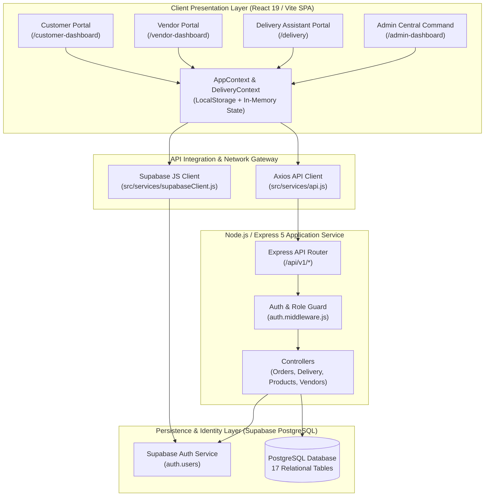
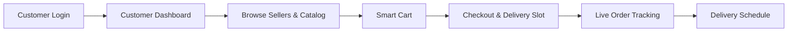
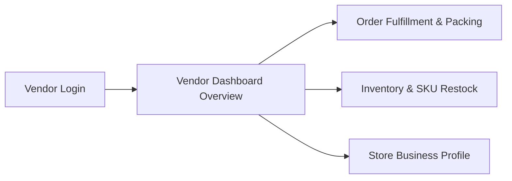
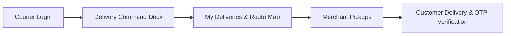
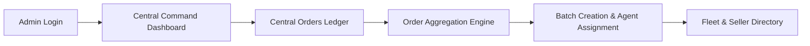
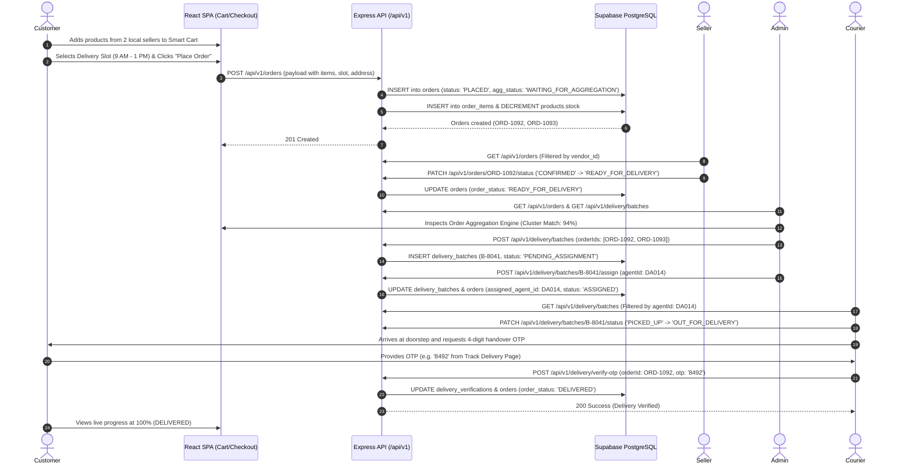
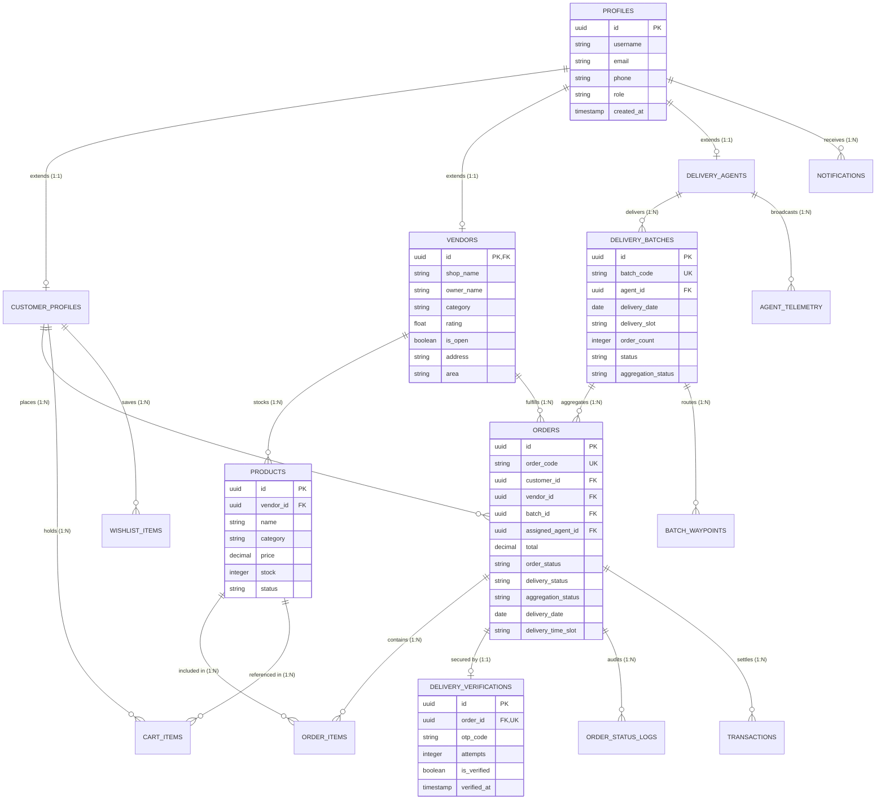
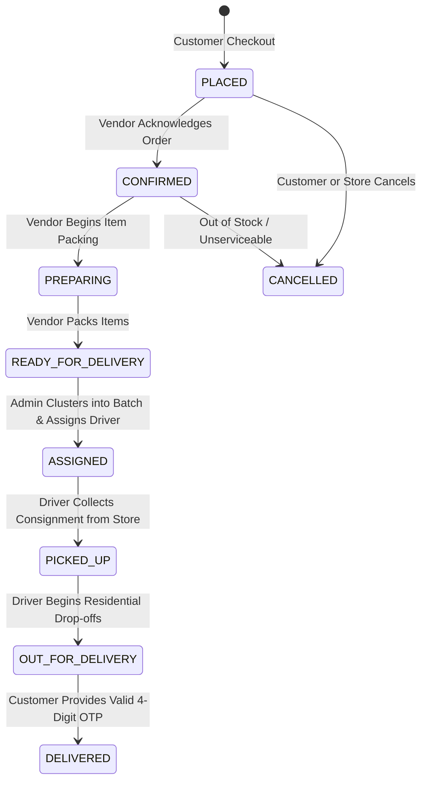
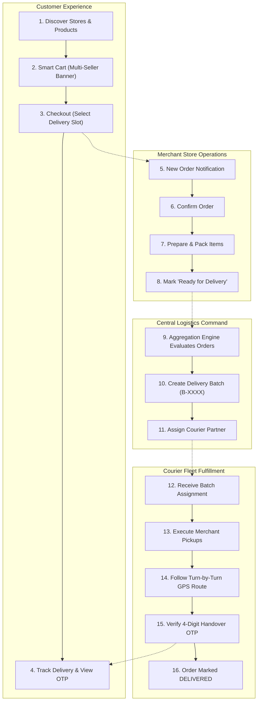

# COMPLETE MICRO-LOGISTICS PROJECT AUDIT & SYSTEM ARCHITECTURE MASTER REPORT
**Project Name:** Micro-Logistics Management and Local E-Commerce Order Aggregation Network  
**Document File:** `MICRO_LOGISTICS_COMPLETE_PROJECT_REPORT.md`  
**Audit Date:** October 27, 2026  
**Auditor:** Antigravity Autonomous Lead Architect & Systems Inspector  
**Classification:** Technical Documentation & Production Systems Audit  

---

## 1. Executive Summary

The **Micro-Logistics Management and Local E-Commerce Order Aggregation Network** is a full-stack hyper-local commerce and delivery coordination platform. The platform is designed to connect neighborhood retail merchants (grocers, dairy stores, bakeries, pharmacies, fruit & vegetable shops) with local neighborhood consumers while coordinating fulfillment via a shared, algorithmically batched delivery fleet.

Rather than running isolated point-to-point dispatches for each individual merchant purchase, the system aggregates orders across multiple local vendors based on customer proximity, delivery time windows, and courier capacity. This enables multi-stop "milk-run" routes where a single delivery assistant picks up orders from multiple neighboring shops and delivers them to clustered residential doorsteps in a single trip.

### High-Level Metrics Discovered During Audit
- **Application Frontends:** 4 dedicated role-based portals (**Customer**, **Seller/Vendor**, **Delivery Assistant/Partner**, and **Administrator**).
- **Frontend Pages/Views:** 42 distinct page views and dashboard views across 4 portals.
- **Backend Architecture:** REST API built on Express 5.x with Supabase PostgreSQL client and Supabase Auth.
- **Backend API Route Handlers:** 25 active backend endpoint paths across 9 route groups (`auth`, `products`, `orders`, `delivery`, `vendors`, `customers`, `notifications`, `settings`, `health`).
- **Database Architecture:** PostgreSQL on Supabase with 17 active tables across 2 sequential migrations (`0001_initial_schema.sql` and `0002_extended_schema.sql`).
- **Deployment Infrastructure:** Dual deployment configuration supporting local hybrid development (Vite on port `5173`, Express on port `5000`), Vercel for frontend SPA + serverless rewrites, and Render for backend containerized hosting.

---

## 2. Project Overview

### 2.1 Problem Statement
Traditional on-demand quick-commerce platforms deploy individual delivery drivers for each single-vendor order. This leads to congested neighborhood roads, duplicate delivery runs to the same apartment buildings or streets, and high per-order delivery charges for consumers. Small neighborhood merchants (kirana stores, local dairies, bakeries) cannot afford independent delivery fleets.

### 2.2 System Objective
The Micro-Logistics platform solves this through **Spatial and Temporal Order Aggregation**:
1. Customers order from multiple nearby sellers through a unified local marketplace.
2. Orders within overlapping delivery slots (e.g. 9:00 AM – 1:00 PM) and adjacent geographic sectors (e.g. T. Nagar, Velachery, Anna Nagar) are clustered.
3. The platform’s aggregation engine computes compatibility scores and generates optimized multi-order delivery batches.
4. A single delivery partner receives the batched itinerary, executes sequential pickups from neighboring vendors, and completes residential deliveries with secure OTP handoffs.

---

## 3. Actual Technology Stack

| Layer | Declared / Assumed Stack | Actual Inspected Implementation | Verification Status |
| :--- | :--- | :--- | :--- |
| **Frontend Framework** | React 18 / 19 | React `19.2.8` with React DOM `19.2.8` | **Verified** ([package.json](file:///c:/Users/Admin/Desktop/Micro-Logistics/package.json#L25-L26)) |
| **Build Tool & Dev Server**| Vite 5+ | Vite `8.2.2` with `@vitejs/plugin-react` `6.1.0` | **Verified** ([package.json](file:///c:/Users/Admin/Desktop/Micro-Logistics/package.json#L34-L37)) |
| **Client Routing** | React Router v6 | `react-router-dom` `7.18.3` | **Verified** ([package.json](file:///c:/Users/Admin/Desktop/Micro-Logistics/package.json#L27)) |
| **Icons & UI Primitives** | Lucide React | `lucide-react` `1.41.0`, Custom CSS design system | **Verified** ([package.json](file:///c:/Users/Admin/Desktop/Micro-Logistics/package.json#L22)) |
| **Animation Library** | Framer Motion | `framer-motion` `13.4.6` | **Verified** ([package.json](file:///c:/Users/Admin/Desktop/Micro-Logistics/package.json#L19)) |
| **HTTP Client** | Axios | `axios` `1.20.0` with custom request/response interceptors | **Verified** ([src/services/api.js](file:///c:/Users/Admin/Desktop/Micro-Logistics/src/services/api.js)) |
| **Backend Runtime** | Node.js (CommonJS) | Node.js with Express `5.2.1` | **Verified** ([backend/package.json](file:///c:/Users/Admin/Desktop/Micro-Logistics/backend/package.json#L23)) |
| **Backend Security** | Helmet, CORS, Zod | `helmet` `8.3.0`, `cors` `2.8.6`, `zod` `4.6.4` | **Verified** ([backend/src/app.js](file:///c:/Users/Admin/Desktop/Micro-Logistics/backend/src/app.js#L14-L18)) |
| **Database & Auth** | Supabase (PostgreSQL) | `@supabase/supabase-js` `2.116.0`, Supabase Auth + Postgres RLS | **Verified** ([backend/src/config/supabase.js](file:///c:/Users/Admin/Desktop/Micro-Logistics/backend/src/config/supabase.js)) |
| **Database Driver** | PG Client | `pg` `8.23.0` | **Verified** ([backend/package.json](file:///c:/Users/Admin/Desktop/Micro-Logistics/backend/package.json#L25)) |
| **Testing Suite** | Vitest, Supertest | `vitest` `5.0.0`, `supertest` `7.2.2` | **Verified** ([backend/package.json](file:///c:/Users/Admin/Desktop/Micro-Logistics/backend/package.json#L33-L36)) |
| **Linter** | Oxlint | `oxlint` `1.79.0` | **Verified** ([package.json](file:///c:/Users/Admin/Desktop/Micro-Logistics/package.json#L36)) |

---

## 4. Complete Project Directory Structure

```
Micro-Logistics/
├── .env                              # Root frontend environment configuration
├── .env.production                   # Frontend production environment configuration
├── .gitignore                        # Git exclusion rules
├── .oxlintrc.json                    # Oxlint code linter configuration
├── .vercel/                          # Vercel deployment cache and project links
├── api/                              # Vercel serverless functions / proxy entry point
│   ├── health.js                     # Serverless health probe
│   ├── index.js                      # Root serverless handler importing backend/src/app.js
│   └── v1/                           # Sub-route serverless forwarders
│       ├── auth/
│       └── health.js
├── backend/                          # Dedicated Node.js Express backend service
│   ├── .env                          # Backend private environment configuration
│   ├── .env.example                  # Backend environment variable template
│   ├── .gitignore                    # Backend gitignore
│   ├── audit_output_utf8.json        # Historical account provisioning audit log
│   ├── package.json                  # Backend dependencies and scripts
│   ├── secure_credentials.txt        # Plaintext credential stash (CRITICAL SECURITY RISK)
│   ├── src/
│   │   ├── app.js                    # Express application setup, security middleware & routes
│   │   ├── server.js                 # HTTP listener on PORT (default 5000)
│   │   ├── config/
│   │   │   ├── env.js                # Zod environment validation & defaults
│   │   │   └── supabase.js           # Supabase client instantiation
│   │   ├── controllers/              # Business logic controllers
│   │   │   ├── auth.controller.js    # Identifier resolution & account provisioning
│   │   │   ├── customer.controller.js# Customer profile queries and updates
│   │   │   ├── delivery.controller.js# Batches, agents, OTP handoffs & tracking
│   │   │   ├── health.controller.js  # Server and database health checks
│   │   │   ├── notification.controller.js # Role notification feeds and read markers
│   │   │   ├── order.controller.js   # Order creation, queries & status transitions
│   │   │   ├── product.controller.js # Catalog browsing, SKU insertion, edits & deletion
│   │   │   ├── setting.controller.js # Global aggregation thresholds & configuration
│   │   │   └── vendor.controller.js  # Store profiles and operating hour updates
│   │   ├── middleware/
│   │   │   ├── auth.middleware.js    # Bearer token verification & role authorization
│   │   │   └── error.middleware.js   # Global unhandled exception handler
│   │   ├── routes/
│   │   │   ├── auth.routes.js        # POST /resolve, POST /signup
│   │   │   ├── customer.routes.js    # GET, PUT /customers
│   │   │   ├── delivery.routes.js    # Batches, agents, OTP verification
│   │   │   ├── health.routes.js      # /health, /health/db
│   │   │   ├── index.js              # Router aggregator mounted at /api/v1, /api, /v1
│   │   │   ├── notification.routes.js# GET, POST, PATCH /notifications
│   │   │   ├── order.routes.js       # GET, POST, PATCH /orders
│   │   │   ├── product.routes.js     # GET, POST, PUT, DELETE /products
│   │   │   ├── setting.routes.js     # GET, PUT /settings
│   │   │   └── vendor.routes.js      # GET, PUT /vendors
│   │   └── utils/
│   │       └── mappings.js           # DB snake_case to frontend camelCase transformers
│   ├── supabase/
│   │   ├── migrations/
│   │   │   ├── 0001_initial_schema.sql  # 12 core tables, enums, indexes
│   │   │   └── 0002_extended_schema.sql # OTPs, telemetry, cart, wishlist, waypoints
│   │   └── seed.sql                  # Initial mock seed dataset for Chennai hub
│   └── tests/                        # Vitest backend integration tests
│       ├── api.test.js               # Route authentication and response tests
│       ├── health.test.js            # Mocked health endpoint tests
│       └── seed.test.js              # Environment variable sanity checks
├── dist/                             # Compiled production frontend build output
├── frontend/                         # Legacy artifact folder containing residual .env
├── index.html                        # SPA HTML root document with Google Fonts
├── package.json                      # Root workspace scripts and dependencies
├── public/                           # Static assets, icons and public images
├── src/                              # Main React frontend source code
│   ├── App.jsx                       # Master client router, role dispatchers, route definitions
│   ├── main.jsx                      # React 19 client mounting point
│   ├── auth/                         # Authentication and public onboarding pages
│   │   ├── CustomerRegisterPage.jsx  # Customer self-registration form
│   │   ├── LandingPage.jsx           # Public marketing landing page
│   │   ├── LoginPage.jsx             # Role-aware login with direct ID & demo bypass
│   │   └── SellerRegisterPage.jsx    # Merchant store registration form
│   ├── components/                   # Modular UI components
│   │   ├── common/                   # Shared cross-portal components
│   │   │   ├── ConfirmationModal.jsx # Generic destructive action confirmation dialog
│   │   │   ├── ErrorBoundary.jsx     # Global React error trap
│   │   │   ├── GoogleRouteMap.jsx    # Interactive route map with Google Maps API
│   │   │   ├── Header.jsx            # Dynamic top navigation bar with role notification bell
│   │   │   ├── LoadingFallback.jsx   # Suspense loading spinner
│   │   │   ├── MapPlaceholder.jsx    # Visual SVG tactical route preview
│   │   │   ├── NotFoundPage.jsx      # 404 error catch-all component
│   │   │   ├── OfflineBanner.jsx     # Network disconnection & offline indicator
│   │   │   ├── OrderDetailsModal.jsx # Comprehensive order item & pricing inspector
│   │   │   ├── ProtectedRoute.jsx    # Client-side role authorization guard
│   │   │   ├── Sidebar.jsx           # Dynamic navigation drawer for all 4 roles
│   │   │   └── StatusBadge.jsx       # Universal color-coded order & delivery status badge
│   │   ├── delivery/                 # Delivery Partner cockpit components (34 files)
│   │   │   ├── CommandPalette.jsx    # Keyboard-driven quick navigation (Ctrl+K)
│   │   │   ├── DataTable.jsx         # Responsive order stop table
│   │   │   ├── DeliveryAppShell.jsx  # Dedicated layout wrapper for delivery partner
│   │   │   ├── DeliverySidebar.jsx   # Mobile-first delivery drawer
│   │   │   ├── DeliveryTimeline.jsx  # Real-time shift execution feed
│   │   │   ├── DeliveryTopbar.jsx    # Online/offline status, battery & shift indicator
│   │   │   ├── OrderDrawer.jsx       # Sliding drawer with customer contact & OTP input
│   │   │   └── ToastContainer.jsx    # Notification toasts with Undo capability
│   │   └── ui/                       # Design tokens and atomics (Buttons, Cards, Tabs, Badges)
│   ├── context/                      # React Context providers
│   │   ├── AppContext.jsx            # Master state: orders, products, vendors, batches, cart
│   │   └── DeliveryContext.jsx       # Courier state: active batch, shift stats, timeline, toasts
│   ├── data/                         # Local mock datasets & initial catalog
│   │   ├── demoData.js               # Isolated demo dataset for offline preview
│   │   └── initialProducts.js        # Default retail product catalog
│   ├── layouts/                      # Page layout templates
│   │   └── DashboardLayout.jsx       # Universal app layout with Header + Sidebar
│   ├── lib/                          # Specialized data libraries
│   │   └── deliveryData.js           # Delivery batches, mock historical orders & timeline
│   ├── portals/                      # 4 Distinct Role Portals
│   │   ├── admin/                    # Administrator Portal (12 pages)
│   │   │   ├── AdminAnalyticsPage.jsx# Aggregation efficiency, revenue & delivery metrics
│   │   │   ├── AdminCentralOrdersPage.jsx # Global order ledger across all merchants
│   │   │   ├── AdminCustomersPage.jsx# Registered customer directory & status controls
│   │   │   ├── AdminDashboard.jsx    # Central command cockpit & platform health KPIs
│   │   │   ├── AdminNotificationsPage.jsx # Platform telemetry & aggregation engine alerts
│   │   │   ├── AdminReportsPage.jsx  # Cryptographic audit summaries & report generation
│   │   │   ├── AdminRoutesPage.jsx   # Spatial waypoint coordination & stop sequencer
│   │   │   ├── AdminSellersPage.jsx  # Merchant store verification & catalog inspector
│   │   │   ├── AdminSettingsPage.jsx # System aggregation parameters, security & API keys
│   │   │   ├── DeliveryAgentsPage.jsx# Fleet courier roster, capacity & vehicle assignment
│   │   │   ├── DeliveryManagementPage.jsx # Batch assignment & courier dispatch lifecycle
│   │   │   └── OrderAggregationPage.jsx   # Intelligent clustering & batch creation engine
│   │   ├── customer/                 # Customer Portal (11 pages)
│   │   │   ├── BrowseSellersPage.jsx # Merchant directory with category and location filters
│   │   │   ├── CartPage.jsx          # Shopping cart with multi-seller aggregation banner
│   │   │   ├── CheckoutPage.jsx      # Order confirmation with delivery slot selection
│   │   │   ├── CustomerDashboard.jsx # Personalized store discovery & quick re-orders
│   │   │   ├── DeliverySchedulePage.jsx # Upcoming delivery windows & slot change requests
│   │   │   ├── HelpPage.jsx          # Support FAQs and order inquiry assistant
│   │   │   ├── NotificationsPage.jsx # Customer-filtered delivery alerts & savings notifications
│   │   │   ├── OrdersPage.jsx        # Customer order history & real-time tracking launcher
│   │   │   ├── ProfilePage.jsx       # Customer address, phone & delivery preference editor
│   │   │   ├── SettingsPage.jsx      # Communication preferences & account security
│   │   │   └── TrackDeliveryPage.jsx # Live GPS courier tracker & handover OTP display
│   │   ├── delivery/                 # Delivery Partner Portal (9 pages)
│   │   │   ├── DeliveryDashboard.jsx # Courier shift command deck, progress ring & stops
│   │   │   ├── DeliveryHistoryPage.jsx# Historical completed shifts, ratings & earnings
│   │   │   ├── DeliveryProfilePage.jsx# Courier vehicle details, emergency contacts & license
│   │   │   ├── DeliveryStatusPage.jsx# Stop-by-stop delivery verification & OTP entry
│   │   │   ├── HelpSupportPage.jsx   # Dispatch hotline & delivery issue resolver
│   │   │   ├── MyDeliveriesPage.jsx  # Active assigned batch list with customer details
│   │   │   ├── NotificationsPage.jsx # Courier dispatch alerts, slot changes & payouts
│   │   │   ├── PickupPage.jsx        # Vendor pickup checklists & merchant handoffs
│   │   │   └── RoutePage.jsx         # Live turn-by-turn map navigation & stop sequencer
│   │   └── seller/                   # Seller / Vendor Portal (9 pages)
│   │       ├── BusinessProfilePage.jsx# Store operating hours, category & delivery radius
│   │       ├── CustomersPage.jsx     # Store regular customers & repeat purchase insights
│   │       ├── DashboardOverview.jsx # Merchant revenue, active order counts & store toggle
│   │       ├── DeliveriesPage.jsx    # Pickup schedule & assigned driver logistics tracker
│   │       ├── InventoryPage.jsx     # SKU stock levels, low-stock warnings & restock modal
│   │       ├── OrdersPage.jsx        # Incoming orders, SLA timers & packing status updates
│   │       ├── ProductsPage.jsx      # Product catalog CRUD with image fallbacks & pricing
│   │       ├── SellerAnalyticsPage.jsx# Sales charts, category breakdown & top-selling SKUs
│   │       └── SellerNotificationsPage.jsx # Low stock alerts, new orders & payout notices
│   ├── services/
│   │   ├── api.js                    # Axios instance with auth & user header interceptors
│   │   └── supabaseClient.js         # Browser Supabase client instantiation
│   ├── styles/
│   │   └── global.css                # Global CSS variables, theme tokens and typography
│   └── utils/
│       ├── aggregationUtils.js       # Core order clustering algorithm & time slot logic
│       ├── deliveryConstants.js      # Standard delivery time slot definitions
│       └── imageUtils.js             # Category imagery, Unsplash fallbacks & error handlers
├── vercel.json                       # Vercel SPA rewrites & API proxy rules
└── vite.config.js                    # Vite bundler configuration
```

---

## 5. Overall System Architecture

The application adopts a decoupled client-server architecture with an intelligent local-first state cache that gracefully handles network degradation.



---

## 6. User Roles and Permissions

The system defines 4 distinct roles enforced both in client route guards and backend middleware:

| Role Name | Internal Code | Default Entry Route | Key Permissions | Forbidden Operations |
| :--- | :--- | :--- | :--- | :--- |
| **Customer** | `customer` | `/customer-dashboard` | Browse products, manage cart, place orders, track live deliveries, view own orders, request delivery slot changes. | Cannot access vendor inventory, cannot assign batches, cannot inspect global telemetry or driver rosters. |
| **Vendor / Seller** | `vendor` | `/vendor-dashboard` | Manage product catalog, edit SKU prices, adjust stock, view incoming store orders, mark orders as confirmed/preparing, configure store hours. | Cannot view other vendors' orders, cannot create delivery batches, cannot reassign courier agents, cannot modify platform settings. |
| **Delivery Partner** | `delivery_partner`| `/delivery` | View assigned delivery batches, inspect pickup and drop-off stops, trigger navigation, enter delivery OTP, log proof-of-delivery notes. | Cannot modify product catalog, cannot change store details, cannot access administrative order grouping or platform settings. |
| **Administrator** | `admin` | `/admin-dashboard` | Full system oversight: central order ledger, order aggregation engine, batch creation, courier assignment, seller onboarding, system settings. | Public self-registration is strictly blocked. |

---

## 7. Frontend Architecture

### 7.1 Master Routing & Lazy Loading
Frontend routes are managed in [App.jsx](file:///c:/Users/Admin/Desktop/Micro-Logistics/src/App.jsx). To maintain performance, portal components are split into lazy-loaded chunks using `React.lazy()` and wrapped in `<Suspense fallback={<LoadingFallback />}>`.

### 7.2 Role-Based URL Dispatchers
To resolve URL conflicts where different roles navigate to generic paths such as `/orders` or `/notifications`, [App.jsx](file:///c:/Users/Admin/Desktop/Micro-Logistics/src/App.jsx#L33-L47) implements smart route dispatchers:
- **`RoleOrdersDispatcher`**:
  - `vendor` $\rightarrow$ Redirects to `/seller/orders`
  - `admin` $\rightarrow$ Redirects to `/admin/orders`
  - `delivery_partner` $\rightarrow$ Redirects to `/delivery/deliveries`
  - `customer` $\rightarrow$ Renders Customer `<OrdersPage />`
- **`RoleNotificationsDispatcher`**:
  - `vendor` $\rightarrow$ Redirects to `/seller/notifications`
  - `admin` $\rightarrow$ Redirects to `/admin/notifications`
  - `delivery_partner` $\rightarrow$ Redirects to `/delivery/notifications`
  - `customer` $\rightarrow$ Renders Customer `<NotificationsPage />`

### 7.3 State Architecture & Offline Fallback
The frontend uses a hybrid data fetching strategy in [AppContext.jsx](file:///c:/Users/Admin/Desktop/Micro-Logistics/src/context/AppContext.jsx):
1. **Network First:** When logged in, the app queries backend REST endpoints (`/api/v1/products`, `/api/v1/orders`, etc.).
2. **Local Storage Synchronization:** Critical state (`cart`, `currentUser`, `orders`, `products`) is automatically mirrored to `localStorage` under `micrologi_*` keys.
3. **Demo Isolation:** When logging in via demo mode (`currentUser.isDemo === true`), API network calls are suppressed, and the application operates entirely within an isolated in-memory dataset ([demoData.js](file:///c:/Users/Admin/Desktop/Micro-Logistics/src/data/demoData.js)).

---

## 8. Portal-by-Portal Documentation

---

### 8.1 Customer Portal



#### Pages & Features
1. **Customer Dashboard (`/customer-dashboard`)**:
   - Component: `CustomerDashboard.jsx`
   - Purpose: Central landing for local shoppers. Features search by product or store, category chips (Grocery, Fruits & Veg, Dairy, Bakery), delivery destination banner, and neighborhood seller cards.
2. **Browse Sellers (`/browse-sellers`, `/customer/browse-sellers`)**:
   - Component: `BrowseSellersPage.jsx`
   - Purpose: Directory of local neighborhood vendors with filters for category, locality (Velachery, Adyar, T. Nagar, Anna Nagar), and open status.
3. **Product Catalog (`/products`)**:
   - Component: `ProductsPage.jsx`
   - Purpose: Shoppers filter products by category, search by name, view item details, check current stock status, and add items to the cart.
4. **Smart Cart (`/cart`, `/customer/cart`)**:
   - Component: `CartPage.jsx`
   - Purpose: Displays selected items grouped by seller. When items from multiple sellers are in the cart, the **Smart Aggregation Banner** activates, explaining that orders will be consolidated into a single delivery run.
5. **Checkout (`/checkout`, `/customer/checkout`)**:
   - Component: `CheckoutPage.jsx`
   - Purpose: Finalizes delivery destination, contact phone, delivery date, and selects one of 5 standardized delivery time slots.
6. **Live Tracking (`/track-delivery`, `/customer/track-delivery`)**:
   - Component: `TrackDeliveryPage.jsx`
   - Purpose: Displays real-time progress bar (Placed $\rightarrow$ Confirmed $\rightarrow$ Preparing $\rightarrow$ Ready $\rightarrow$ Assigned $\rightarrow$ Out for Delivery $\rightarrow$ Delivered), courier details, and the dynamic delivery handover OTP.
7. **Delivery Schedule (`/delivery-schedule`, `/customer/delivery-schedule`)**:
   - Component: `DeliverySchedulePage.jsx`
   - Purpose: Displays upcoming delivery windows and allows customers to request time slot adjustments.
8. **Customer Orders (`/orders`, `/customer/orders`)**:
   - Component: `OrdersPage.jsx`
   - Purpose: Order history ledger with live status badges and "Track Delivery" actions.
9. **Customer Notifications (`/notifications`, `/customer/notifications`)**:
   - Component: `NotificationsPage.jsx`
   - Purpose: Customer-relevant alerts: Order Confirmed, Out for Delivery, Neighborhood Aggregation Discounts, Item Restocked, and Delivery Completed.

---

### 8.2 Seller / Vendor Portal



#### Pages & Features
1. **Dashboard Overview (`/vendor-dashboard`)**:
   - Component: `DashboardOverview.jsx`
   - Purpose: High-level store metrics: Today’s revenue, new incoming orders, orders in packing, and completed deliveries. Includes an emergency store open/close toggle.
2. **Incoming Orders (`/seller/orders`)**:
   - Component: `OrdersPage.jsx` (Seller)
   - Purpose: Orders list filtered for the logged-in merchant. Displays customer names, delivery addresses, ordered items, preparation timers, and status transition buttons (`CONFIRM`, `START PREPARING`, `READY FOR PICKUP`).
3. **Inventory Management (`/seller/inventory`, `/inventory`)**:
   - Component: `InventoryPage.jsx`
   - Purpose: SKU stock level manager. Displays low stock warnings ($\le 10$ units), inline $+1 / -1$ adjustment buttons, direct restock modals, and add/edit SKU forms.
4. **Product Catalog Manager (`/seller/products`)**:
   - Component: `ProductsPage.jsx`
   - Purpose: Comprehensive SKU management: create new products, edit price/category/prep-time, upload images with fallback rendering, and delete discontinued items.
5. **Store Customers (`/seller/customers`, `/customers`)**:
   - Component: `CustomersPage.jsx`
   - Purpose: Repeat customer directory, lifetime order counts, and customer neighborhood distribution.
6. **Delivery Logistics Tracker (`/seller/deliveries`, `/deliveries`)**:
   - Component: `DeliveriesPage.jsx`
   - Purpose: Tracking upcoming driver pickups from the store, assigned courier agent IDs, and dispatch schedules.
7. **Store Analytics (`/seller/analytics`)**:
   - Component: `SellerAnalyticsPage.jsx`
   - Purpose: Revenue charts, average order value, top-selling SKUs, and category distribution.
8. **Business Profile (`/seller/business-profile`)**:
   - Component: `BusinessProfilePage.jsx`
   - Purpose: Configure store name, owner name, category, operating hours, physical address, and delivery service radius.
9. **Seller Notifications (`/seller/notifications`)**:
   - Component: `SellerNotificationsPage.jsx`
   - Purpose: Merchant-focused notifications: Low Stock alerts, new customer orders placed, driver pickup arrivals, and payout credits.

---

### 8.3 Delivery Partner Portal



#### Pages & Features
1. **Delivery Dashboard / Cockpit (`/delivery`, `/delivery-dashboard`)**:
   - Component: `DeliveryDashboard.jsx` (wrapped in `DeliveryAppShell.jsx`)
   - Purpose: Mobile-first driver interface featuring shift summary, active batch completion progress ring, next stop navigator, battery status, and online/offline toggle.
2. **Active Deliveries (`/delivery/deliveries`)**:
   - Component: `MyDeliveriesPage.jsx`
   - Purpose: Stop-by-stop list of all packages in the active batch, displaying customer phone numbers, addresses, and delivery time windows.
3. **Merchant Pickups (`/delivery/pickup`)**:
   - Component: `PickupPage.jsx`
   - Purpose: Checklist of local vendor stores where packages must be collected before starting residential deliveries. Includes "Confirm Pickup" buttons.
4. **Route Navigation (`/delivery/route`)**:
   - Component: `RoutePage.jsx`
   - Purpose: Turn-by-turn waypoint routing using `GoogleRouteMap.jsx` with real-time waypoint progression from merchant pickups to customer homes.
5. **Delivery Status & Verification (`/delivery/status`)**:
   - Component: `DeliveryStatusPage.jsx`
   - Purpose: Proof-of-delivery handoff interface. Couriers enter the customer-provided 4-digit OTP or record failure reasons if the customer is unreachable.
6. **Delivery History & Earnings (`/delivery/history`)**:
   - Component: `DeliveryHistoryPage.jsx`
   - Purpose: Completed shift history, daily earnings, tips, delivery ratings, and distance traveled.
7. **Courier Notifications (`/delivery/notifications`)**:
   - Component: `NotificationsPageDelivery.jsx`
   - Purpose: Real-time assignment dispatches, customer slot change requests, and daily bank payout confirmations.
8. **Courier Profile (`/delivery/profile`)**:
   - Component: `DeliveryProfilePage.jsx`
   - Purpose: Driver vehicle registration (EV Scooter / Van), license details, emergency contacts, and active working shift hours.
9. **Driver Support (`/delivery/help`)**:
   - Component: `HelpSupportPage.jsx`
   - Purpose: Dispatch hotline and accident/vehicle breakdown escalation assistant.

---

### 8.4 Administrator Portal



#### Pages & Features
1. **Central Command Dashboard (`/admin-dashboard`)**:
   - Component: `AdminDashboard.jsx`
   - Purpose: High-level platform health: Total system revenue, pending orders, active delivery batches, online courier units, and recent operational alerts.
2. **Central Orders Ledger (`/admin/orders`)**:
   - Component: `AdminCentralOrdersPage.jsx`
   - Purpose: Global master order ledger across all merchants and customers. Supports filtering by seller, order status, and aggregation state.
3. **Order Aggregation Engine (`/admin/order-aggregation`)**:
   - Component: `OrderAggregationPage.jsx`
   - Purpose: Evaluates unassigned orders and clusters compatible orders into recommended delivery batches based on delivery date, overlapping time slots, and geographical proximity. Features a circular compatibility score ring.
4. **Delivery Management (`/admin/delivery-management`)**:
   - Component: `DeliveryManagementPage.jsx`
   - Purpose: Manages the lifecycle of created delivery batches: assigns batches to available couriers, advances batch status, and tracks delivery progression.
5. **Fleet & Agent Management (`/admin/delivery-agents`)**:
   - Component: `DeliveryAgentsPage.jsx`
   - Purpose: Onboards new delivery agents, assigns vehicles, monitors active driver capacity, and toggles driver availability.
6. **Seller Directory & Oversight (`/admin/sellers`)**:
   - Component: `AdminSellersPage.jsx`
   - Purpose: Comprehensive merchant directory. Admins inspect store compliance, catalog size, order volumes, and can suspend or reactivate merchant accounts.
7. **Customer Directory (`/admin/customers`)**:
   - Component: `AdminCustomersPage.jsx`
   - Purpose: Registered customer roster, address information, order history, and account status controls.
8. **Spatial Route Mesh (`/admin/routes`)**:
   - Component: `AdminRoutesPage.jsx`
   - Purpose: Visualizes multi-point pickup and drop-off sequences for active batches on Google Maps.
9. **Platform Analytics (`/admin/analytics`)**:
   - Component: `AdminAnalyticsPage.jsx`
   - Purpose: Aggregation efficiency metrics, average batch size, route distance reductions, and delivery SLA compliance gauges.
10. **System Reports & Audit Ledger (`/admin/reports`)**:
    - Component: `AdminReportsPage.jsx`
    - Purpose: Generates printable and downloadable fulfillment reports with dynamic cryptographic audit checksums.
11. **System Notifications (`/admin/notifications`)**:
    - Component: `AdminNotificationsPage.jsx`
    - Purpose: Platform-wide telemetry feed: aggregation events, courier assignment warnings, and unassigned order alerts.
12. **Platform Settings (`/admin/settings`)**:
    - Component: `AdminSettingsPage.jsx`
    - Purpose: Configure core aggregation parameters: max orders per batch, max group distance (km), agent timeout, and default vehicle capacities.

---

## 9. Page and Navigation Inventory

| Page Name | Route Path | Component File | Allowed Roles | Navigation Ingress / Egress | Implementation Status |
| :--- | :--- | :--- | :--- | :--- | :--- |
| **Landing Page** | `/` | `src/auth/LandingPage.jsx` | Public | Entry URL $\rightarrow$ `/login`, `/register-customer`, `/register-seller` | **Fully Implemented** |
| **Login Page** | `/login` | `src/auth/LoginPage.jsx` | Public | Header "Sign In" $\rightarrow$ Redirects to role dashboard | **Fully Implemented** |
| **Customer Register** | `/register-customer` | `src/auth/CustomerRegisterPage.jsx` | Public | Landing Page $\rightarrow$ Submits to `/api/v1/auth/signup` $\rightarrow$ `/login` | **Fully Implemented** |
| **Seller Register** | `/register-seller` | `src/auth/SellerRegisterPage.jsx` | Public | Landing Page $\rightarrow$ Submits to `/api/v1/auth/signup` $\rightarrow$ `/login` | **Fully Implemented** |
| **Customer Dashboard** | `/customer-dashboard` | `src/portals/customer/CustomerDashboard.jsx` | `customer` | Sidebar "Home" $\rightarrow$ `/products`, `/browse-sellers` | **Fully Implemented** |
| **Browse Sellers** | `/browse-sellers` | `src/portals/customer/BrowseSellersPage.jsx` | `customer` | Sidebar "Local Sellers" $\rightarrow$ `/products?vendor=...` | **Fully Implemented** |
| **Products Catalog** | `/products` | `src/portals/seller/ProductsPage.jsx` | `customer`, `vendor`| Sidebar "Explore" $\rightarrow$ Modal $\rightarrow$ Add to Cart | **Fully Implemented** |
| **Smart Cart** | `/cart` | `src/portals/customer/CartPage.jsx` | `customer` | Header Cart Icon $\rightarrow$ `/checkout` | **Fully Implemented** |
| **Checkout** | `/checkout` | `src/portals/customer/CheckoutPage.jsx` | `customer` | Cart "Proceed" $\rightarrow$ Submits order $\rightarrow$ `/track-delivery` | **Fully Implemented** |
| **Track Delivery** | `/track-delivery` | `src/portals/customer/TrackDeliveryPage.jsx` | `customer` | Sidebar "Track Delivery" $\rightarrow$ Live map & OTP | **Fully Implemented** |
| **Delivery Schedule** | `/delivery-schedule` | `src/portals/customer/DeliverySchedulePage.jsx` | `customer` | Sidebar "Delivery Schedule" $\rightarrow$ Request slot change | **Fully Implemented** |
| **Customer Orders** | `/orders` | `src/portals/customer/OrdersPage.jsx` | `customer` | Sidebar "My Orders" $\rightarrow$ Order details modal | **Fully Implemented** |
| **Customer Notifications**| `/notifications` | `src/portals/customer/NotificationsPage.jsx` | `customer` | Header Bell $\rightarrow$ Dismiss / Mark all read | **Fully Implemented** |
| **Customer Profile** | `/profile` | `src/portals/customer/ProfilePage.jsx` | All roles | Header User Menu $\rightarrow$ Updates address & preferences | **Fully Implemented** |
| **Vendor Dashboard** | `/vendor-dashboard` | `src/portals/seller/DashboardOverview.jsx` | `vendor` | Sidebar "Overview" $\rightarrow$ Store toggle, KPI review | **Fully Implemented** |
| **Seller Orders** | `/seller/orders` | `src/portals/seller/OrdersPage.jsx` | `vendor` | Sidebar "Orders" $\rightarrow$ Advance order packing status | **Fully Implemented** |
| **Inventory Manager** | `/seller/inventory` | `src/portals/seller/InventoryPage.jsx` | `vendor` | Sidebar "Inventory" $\rightarrow$ Inline $\pm1$ & restock modal | **Fully Implemented** |
| **Seller Products** | `/seller/products` | `src/portals/seller/ProductsPage.jsx` | `vendor` | Sidebar "Products" $\rightarrow$ Add / Edit / Delete SKU modal | **Fully Implemented** |
| **Seller Customers** | `/seller/customers` | `src/portals/seller/CustomersPage.jsx` | `vendor` | Sidebar "Customers" $\rightarrow$ Repeat buyer history | **Fully Implemented** |
| **Seller Deliveries** | `/seller/deliveries` | `src/portals/seller/DeliveriesPage.jsx` | `vendor` | Sidebar "Deliveries" $\rightarrow$ Pickup schedule inspector | **Fully Implemented** |
| **Seller Analytics** | `/seller/analytics` | `src/portals/seller/SellerAnalyticsPage.jsx` | `vendor` | Sidebar "Analytics" $\rightarrow$ Revenue & SKU charts | **Fully Implemented** |
| **Business Profile** | `/seller/business-profile`| `src/portals/seller/BusinessProfilePage.jsx` | `vendor` | Sidebar "Business Profile" $\rightarrow$ Store hours & radius | **Fully Implemented** |
| **Seller Notifications** | `/seller/notifications` | `src/portals/seller/SellerNotificationsPage.jsx` | `vendor` | Header Bell $\rightarrow$ Restock & incoming order alerts | **Fully Implemented** |
| **Delivery Dashboard** | `/delivery` | `src/portals/delivery/DeliveryDashboard.jsx` | `delivery_partner` | Post-login entry $\rightarrow$ Shift deck & next stop | **Fully Implemented** |
| **My Deliveries** | `/delivery/deliveries` | `src/portals/delivery/MyDeliveriesPage.jsx` | `delivery_partner` | BottomNav / Sidebar $\rightarrow$ Package stop list | **Fully Implemented** |
| **Merchant Pickups** | `/delivery/pickup` | `src/portals/delivery/PickupPage.jsx` | `delivery_partner` | BottomNav / Sidebar $\rightarrow$ Store collection checklist | **Fully Implemented** |
| **Turn-by-Turn Route** | `/delivery/route` | `src/portals/delivery/RoutePage.jsx` | `delivery_partner` | BottomNav / Sidebar $\rightarrow$ Interactive GPS map | **Fully Implemented** |
| **Delivery Verification**| `/delivery/status` | `src/portals/delivery/DeliveryStatusPage.jsx` | `delivery_partner` | Delivery card "Handoff" $\rightarrow$ 4-digit OTP entry | **Fully Implemented** |
| **Shift History** | `/delivery/history` | `src/portals/delivery/DeliveryHistoryPage.jsx` | `delivery_partner` | Sidebar "History" $\rightarrow$ Completed shifts & payouts | **Fully Implemented** |
| **Courier Notifications**| `/delivery/notifications` | `src/portals/delivery/NotificationsPage.jsx` | `delivery_partner` | Topbar Bell $\rightarrow$ Dispatch assignments & alerts | **Fully Implemented** |
| **Courier Profile** | `/delivery/profile` | `src/portals/delivery/DeliveryProfilePage.jsx` | `delivery_partner` | Topbar Profile $\rightarrow$ Vehicle & availability editor | **Fully Implemented** |
| **Admin Dashboard** | `/admin-dashboard` | `src/portals/admin/AdminDashboard.jsx` | `admin` | Sidebar "Central Command" $\rightarrow$ Overview KPIs | **Fully Implemented** |
| **Admin Central Orders** | `/admin/orders` | `src/portals/admin/AdminCentralOrdersPage.jsx`| `admin` | Sidebar "Central Orders" $\rightarrow$ Master ledger & filters | **Fully Implemented** |
| **Order Aggregation** | `/admin/order-aggregation`| `src/portals/admin/OrderAggregationPage.jsx` | `admin` | Sidebar "Aggregation Hub" $\rightarrow$ Create batch | **Fully Implemented** |
| **Delivery Management** | `/admin/delivery-management`| `src/portals/admin/DeliveryManagementPage.jsx`| `admin` | Sidebar "Delivery Operations" $\rightarrow$ Assign agent | **Fully Implemented** |
| **Fleet Courier Roster**| `/admin/delivery-agents` | `src/portals/admin/DeliveryAgentsPage.jsx` | `admin` | Sidebar "Fleet & Agents" $\rightarrow$ Onboard courier modal | **Fully Implemented** |
| **Seller Oversight** | `/admin/sellers` | `src/portals/admin/AdminSellersPage.jsx` | `admin` | Sidebar "Sellers" $\rightarrow$ Inspect & suspend stores | **Fully Implemented** |
| **Customer Directory** | `/admin/customers` | `src/portals/admin/AdminCustomersPage.jsx` | `admin` | Sidebar "Customers" $\rightarrow$ Inspect customer details | **Fully Implemented** |
| **Spatial Route Mesh** | `/admin/routes` | `src/portals/admin/AdminRoutesPage.jsx` | `admin` | Sidebar "Routes" $\rightarrow$ Waypoint stop sequence | **Fully Implemented** |
| **Platform Analytics** | `/admin/analytics` | `src/portals/admin/AdminAnalyticsPage.jsx` | `admin` | Sidebar "Analytics" $\rightarrow$ Donut gauges & metrics | **Fully Implemented** |
| **Reports & Audit** | `/admin/reports` | `src/portals/admin/AdminReportsPage.jsx` | `admin` | Sidebar "Reports" $\rightarrow$ Download CSV / Print ledger | **Fully Implemented** |
| **Platform Settings** | `/admin/settings` | `src/portals/admin/AdminSettingsPage.jsx` | `admin` | Sidebar "Settings" $\rightarrow$ Configure batch parameters | **Fully Implemented** |

---

## 10. Button, Form and Function Inventory

| Control Label & Location | Event Handler | Input Parameters | Validation Rules | Backend Endpoint Triggered | Database Operations | Success / Failure Behavior |
| :--- | :--- | :--- | :--- | :--- | :--- | :--- |
| **"Sign In" Button**<br>([LoginPage.jsx](file:///c:/Users/Admin/Desktop/Micro-Logistics/src/auth/LoginPage.jsx#L31)) | `handleLogin(e)` | `usernameOrEmail`, `password` | Identifier and password must be non-empty. | `POST /api/v1/auth/resolve`<br>`supabase.auth.signInWithPassword` | `SELECT` profiles, vendors, delivery_agents. | Sets `currentUser` in `AppContext` and navigates to role dashboard. |
| **"Register as Customer"**<br>([CustomerRegisterPage.jsx](file:///c:/Users/Admin/Desktop/Micro-Logistics/src/auth/CustomerRegisterPage.jsx)) | `handleSubmit(e)` | `fullName`, `email`, `password`, `phone`, `address`, `cityArea` | Valid email format, password $\ge 6$ chars, 10-digit phone. | `POST /api/v1/auth/signup` | `INSERT` auth.users, profiles, customer_profiles. | Displays welcome toast, routes to `/login`. |
| **"Register Your Store"**<br>([SellerRegisterPage.jsx](file:///c:/Users/Admin/Desktop/Micro-Logistics/src/auth/SellerRegisterPage.jsx)) | `handleSubmit(e)` | `businessName`, `ownerName`, `email`, `password`, `phone`, `address` | Valid email, required store name, phone. | `POST /api/v1/auth/signup` | `INSERT` auth.users, profiles, vendors. | Displays merchant welcome toast, routes to `/login`. |
| **"Add to Cart" Button**<br>([ProductsPage.jsx](file:///c:/Users/Admin/Desktop/Micro-Logistics/src/portals/seller/ProductsPage.jsx#L880)) | `addToCart(product, qty)` | `product` object, `quantity` | Stock must be $> 0$. | *None (Client State & LocalStorage)* | Writes to `cart` in `AppContext` and `micrologi_cart` in localStorage. | Increments item quantity; triggers "Added to Cart" toast. |
| **"Place Aggregated Order"**<br>([CheckoutPage.jsx](file:///c:/Users/Admin/Desktop/Micro-Logistics/src/portals/customer/CheckoutPage.jsx#L31)) | `handlePlaceOrderSubmit(e)` | `deliveryAddress`, `contactPhone`, `deliveryDate`, `selectedTimeSlot` | Address, 10-digit phone, and valid slot required. | `POST /api/v1/orders` | `INSERT` orders, order_items; `UPDATE` products (stock reduction). | Clears cart; stores order in state; navigates to `/track-delivery`. |
| **"Request Slot Change"**<br>([DeliverySchedulePage.jsx](file:///c:/Users/Admin/Desktop/Micro-Logistics/src/portals/customer/DeliverySchedulePage.jsx#L18)) | `handleRequestChangeSubmit(e)`| `orderId`, `selectedNewSlot` | Order must be pending delivery. | `PATCH /api/v1/orders/:id/status` | `UPDATE` orders (`delivery_time_slot`). | Updates delivery slot in state; shows confirmation banner. |
| **"Confirm / Prepare Order"**<br>([OrdersPage.jsx (Seller)](file:///c:/Users/Admin/Desktop/Micro-Logistics/src/portals/seller/OrdersPage.jsx)) | `updateOrderStatus(id, status)` | `orderId`, `newStatus` | Authorized vendor ownership. | `PATCH /api/v1/orders/:id/status` | `UPDATE` orders (`order_status`, `delivery_status`). | Advances order badge from `PLACED` $\rightarrow$ `CONFIRMED` $\rightarrow$ `PREPARING` $\rightarrow$ `READY`. |
| **"Restock SKU" Button**<br>([InventoryPage.jsx](file:///c:/Users/Admin/Desktop/Micro-Logistics/src/portals/seller/InventoryPage.jsx#L47)) | `handleQuickStockChange(p, delta)` | `productId`, `delta` | New stock $\ge 0$. | `PUT /api/v1/products/:id` | `UPDATE` products (`stock`, `status`). | Updates stock count; recalculates status (In Stock / Low Stock / Out of Stock). |
| **"Save Product SKU"**<br>([ProductsPage.jsx](file:///c:/Users/Admin/Desktop/Micro-Logistics/src/portals/seller/ProductsPage.jsx#L720)) | `handleSubmitProduct(e)` | `name`, `category`, `price`, `stock`, `prepTime`, `image` | Name non-empty, price $> 0$, integer stock $\ge 0$. | `POST /api/v1/products`<br>`PUT /api/v1/products/:id` | `INSERT` or `UPDATE` products. | Refreshes products catalog; displays success notification. |
| **"Create Delivery Batch"**<br>([OrderAggregationPage.jsx](file:///c:/Users/Admin/Desktop/Micro-Logistics/src/portals/admin/OrderAggregationPage.jsx#L57))| `handleCreateBatch(group)` | `orderIds` array | Selected orders must be unbatched. | `POST /api/v1/delivery/batches` | `INSERT` delivery_batches, delivery_batch_orders; `UPDATE` orders (`batch_id`). | Creates batch code `B-XXXX`; updates orders to `BATCH_CREATED`; navigates to dispatch. |
| **"Assign Courier Agent"**<br>([DeliveryManagementPage.jsx](file:///c:/Users/Admin/Desktop/Micro-Logistics/src/portals/admin/DeliveryManagementPage.jsx#L19)) | `handleAssignAgent(agentId)` | `batchId`, `agentId` | Driver must be available. | `POST /api/v1/delivery/batches/:id/assign` | `UPDATE` delivery_batches (`agent_id`), delivery_agents (`status`), orders. | Batch status advances to `ASSIGNED`; notifications sent to driver. |
| **"Verify OTP & Complete"**<br>([DeliveryStatusPage.jsx](file:///c:/Users/Admin/Desktop/Micro-Logistics/src/portals/delivery/DeliveryStatusPage.jsx#L47)) | `handleConfirmDelivered()` | `orderId`, `otpInput`, `podNotes` | 4-digit OTP matching verification code. | `POST /api/v1/delivery/verify-otp` | `UPDATE` delivery_verifications, orders (`order_status = DELIVERED`). | Order marked `DELIVERED`; recorded in shift timeline with Undo option. |
| **"Suspend / Reactivate Store"**<br>([AdminSellersPage.jsx](file:///c:/Users/Admin/Desktop/Micro-Logistics/src/portals/admin/AdminSellersPage.jsx#L16)) | `updateSellerStatus(id, status)` | `sellerId`, `newStatus` | Admin role required. | `PUT /api/v1/vendors/:id` | `UPDATE` vendors (`status = 'Suspended' / 'Active'`). | Modal closes; store status pill updates; products deactivated if suspended. |

---

## 11. End-to-End Application Workflows

### 11.1 Master Order Fulfillment & Aggregation Workflow



---

## 12. Backend Architecture

### 12.1 Server Setup & Middleware Pipeline
The backend entry point is [backend/src/server.js](file:///c:/Users/Admin/Desktop/Micro-Logistics/backend/src/server.js), which boots [backend/src/app.js](file:///c:/Users/Admin/Desktop/Micro-Logistics/backend/src/app.js) on the port specified in `PORT` (default `5000`):
1. **Security Headers:** `helmet({ contentSecurityPolicy: false })` protects against clickjacking and cross-site scripting while allowing external map assets to load.
2. **CORS:** Configured with `cors({ origin: env.FRONTEND_URL || '*' })`.
3. **Body Parsing:** `express.json()` with automatic JSON body decoding.
4. **Multi-Prefix Router Mounting:** Mounted at `/api/v1`, `/v1`, and `/api` to support diverse serverless proxy configurations without path-rewrite breakage.
5. **Centralized Error Handling:** Global middleware catches unhandled rejections and sends sanitized error responses.

### 12.2 Authentication & Role Middleware
Implemented in [auth.middleware.js](file:///c:/Users/Admin/Desktop/Micro-Logistics/backend/src/middleware/auth.middleware.js):
- **`requireAuth`**:
  1. Inspects the `Authorization: Bearer <token>` header and verifies it via `supabase.auth.getUser(token)`.
  2. If running locally without a Supabase session, evaluates fallback headers `x-user-id` and `x-user-role`.
  3. Rejects invalid requests with `401 Unauthorized`.
- **`requireRole(roles)`**:
  1. Resolves effective role from token `user_metadata.role`, database `profiles.role`, or `x-user-role`.
  2. Normalizes legacy identifiers (maps `seller` $\rightarrow$ `vendor`).
  3. Rejects unauthorized attempts with `403 Forbidden: Insufficient permissions`.

---

## 13. Complete API Reference

| HTTP Method | Route Endpoint | Purpose & Description | Role Required | Request Body / Parameters | Key Database Operations | Response Structure |
| :--- | :--- | :--- | :--- | :--- | :--- | :--- |
| `POST` | `/api/v1/auth/resolve` | Resolves user identifier (username, email, legacy ID, or shop name) to Supabase email. | Public | `{ identifier: string }` | `SELECT` profiles, vendors, customer_profiles, delivery_agents. | `{ success: true, email: string }` |
| `POST` | `/api/v1/auth/signup` | Creates Supabase auth user, profile record, and role profile. | Public (Admin blocked) | `{ email, password, role, name, phone, address, area, shopName }` | `INSERT` auth.users, profiles, customer_profiles/vendors/delivery_agents. | `{ success: true, userId: string }` |
| `GET` | `/api/v1/health` | Health probe verifying Express server status. | Public | None | None | `{ success: true, message: string }` |
| `GET` | `/api/v1/health/db` | Verifies PostgreSQL database connectivity via Supabase client. | Public | None | `SELECT` profiles limit 1. | `{ success: true, message: string }` |
| `GET` | `/api/v1/products` | Lists products with optional `?vendorId=...` filter. | Public | Query: `vendorId` (optional) | `SELECT` products JOIN vendors. | `{ success: true, data: Product[] }` |
| `GET` | `/api/v1/products/:id`| Retrieves single product details by UUID or legacy ID. | Public | Param: `id` | `SELECT` products WHERE id = :id. | `{ success: true, data: Product }` |
| `POST` | `/api/v1/products` | Creates a new product SKU in vendor inventory. | `admin`, `vendor` | `{ name, category, price, stock, prepTime, description, image, vendorId }` | `INSERT` products. | `{ success: true, data: Product }` |
| `PUT` | `/api/v1/products/:id`| Updates product pricing, stock count, description, or status. | `admin`, `vendor` | `{ name, price, stock, prepTime, description, image }` | `UPDATE` products. | `{ success: true, data: Product }` |
| `DELETE`| `/api/v1/products/:id`| Removes a product SKU from inventory. | `admin`, `vendor` | Param: `id` | `DELETE` products WHERE id = :id. | `{ success: true }` |
| `GET` | `/api/v1/vendors` | Retrieves active vendor stores and profile metadata. | Public | None | `SELECT` vendors JOIN profiles. | `{ success: true, data: Vendor[] }` |
| `GET` | `/api/v1/vendors/:id` | Retrieves single vendor store details by ID. | Public | Param: `id` | `SELECT` vendors WHERE id = :id. | `{ success: true, data: Vendor }` |
| `PUT` | `/api/v1/vendors/:id` | Updates store operating hours, category, address, or status. | `admin`, `vendor` | `{ shopName, category, isOpen, operatingHours, address, area, status }` | `UPDATE` vendors. | `{ success: true, data: Vendor }` |
| `GET` | `/api/v1/customers` | Retrieves customer directory with order metrics. | `admin` | None | `SELECT` customer_profiles JOIN profiles. | `{ success: true, data: Customer[] }` |
| `GET` | `/api/v1/customers/:id`| Retrieves single customer profile by ID. | `admin`, `customer` | Param: `id` | `SELECT` customer_profiles WHERE id = :id. | `{ success: true, data: Customer }` |
| `PUT` | `/api/v1/customers/:id`| Updates customer delivery address, area, or contact phone. | `admin`, `customer` | `{ address, area, phone, name }` | `UPDATE` customer_profiles, profiles. | `{ success: true, data: Customer }` |
| `GET` | `/api/v1/orders` | Retrieves order list filtered automatically by user role. | All Authenticated | None | `SELECT` orders JOIN customer, vendor, items, batch, agent. | `{ success: true, data: Order[] }` |
| `GET` | `/api/v1/orders/:id` | Retrieves complete details for a single order. | All Authenticated | Param: `id` | `SELECT` orders WHERE order_code = :id. | `{ success: true, data: Order }` |
| `POST` | `/api/v1/orders` | Places a new customer order and decrements product inventory. | All Authenticated | `{ vendorId, items: [{ productId, qty, price }], deliveryLocation, deliveryDate, deliveryTimeSlot }` | `INSERT` orders, order_items; `UPDATE` products.stock. | `{ success: true, data: { orderId: string } }` |
| `PATCH`| `/api/v1/orders/:id/status`| Updates order fulfillment status or delivery time slot. | `admin`, `vendor`, `delivery_partner` | `{ status?: string, deliveryTimeSlot?: string }` | `UPDATE` orders (`order_status`, `delivery_status`). | `{ success: true, data: Order }` |
| `GET` | `/api/v1/delivery/agents`| Lists delivery fleet agents, capacities, and availability. | `admin`, `delivery_partner` | None | `SELECT` delivery_agents JOIN profiles. | `{ success: true, data: Agent[] }` |
| `POST` | `/api/v1/delivery/agents`| Onboards a new courier agent to the delivery fleet. | `admin` | `{ name, phone, email, currentArea, capacity, vehicle }` | `INSERT` delivery_agents, profiles. | `{ success: true, data: Agent }` |
| `PUT` | `/api/v1/delivery/agents/:id`| Updates courier vehicle, current area, or availability. | `admin`, `delivery_partner` | `{ availability, currentArea, vehicle, capacity }` | `UPDATE` delivery_agents. | `{ success: true, data: Agent }` |
| `GET` | `/api/v1/delivery/batches`| Lists delivery batches (filtered by courier if `delivery_partner`). | All Authenticated | None | `SELECT` delivery_batches JOIN agent, orders. | `{ success: true, data: Batch[] }` |
| `POST` | `/api/v1/delivery/batches`| Clusters unassigned orders into a new delivery batch. | `admin` | `{ orderIds: string[], estimatedDistance?, estimatedTime? }` | `INSERT` delivery_batches; `UPDATE` orders.batch_id. | `{ success: true, data: Batch }` |
| `POST` | `/api/v1/delivery/batches/:id/assign`| Assigns a delivery batch to an available courier. | `admin` | `{ agentId: string }` | `UPDATE` delivery_batches.agent_id, orders.assigned_agent_id. | `{ success: true, data: { batch: Batch } }` |
| `PATCH`| `/api/v1/delivery/batches/:id/status`| Updates delivery batch lifecycle status. | `admin`, `delivery_partner` | `{ status: string }` | `UPDATE` delivery_batches.status, orders.delivery_status. | `{ success: true, data: Batch }` |
| `GET` | `/api/v1/delivery/orders/:id/otp`| Retrieves the dynamic 4-digit handover verification OTP. | All Authenticated | Param: `id` | `SELECT` delivery_verifications WHERE order_id = :id. | `{ success: true, data: { otp: string } }` |
| `POST` | `/api/v1/delivery/verify-otp`| Verifies courier OTP input and completes delivery handoff. | `admin`, `delivery_partner` | `{ orderId: string, otp: string }` | `UPDATE` delivery_verifications, orders (`order_status = DELIVERED`). | `{ success: true, message: string }` |
| `GET` | `/api/v1/notifications`| Retrieves notification inbox for current authenticated user. | All Authenticated | None | `SELECT` notifications WHERE user_id = :id. | `{ success: true, data: Notification[] }` |
| `PATCH`| `/api/v1/notifications/:id/read`| Marks a notification as acknowledged/read. | All Authenticated | Param: `id` | `UPDATE` notifications (`is_read = true`). | `{ success: true }` |
| `GET` | `/api/v1/settings` | Retrieves global order aggregation and dispatch thresholds. | `admin` | None | `SELECT` system_settings LIMIT 1. | `{ success: true, data: Settings }` |
| `PUT` | `/api/v1/settings` | Updates global aggregation parameters. | `admin` | `{ maxGroupDistance, maxOrdersPerBatch, defaultAgentCapacity, minCompatibilityScore }` | `UPDATE` system_settings. | `{ success: true, data: Settings }` |

---

## 14. Database Schema and Relationships

### 14.1 Entity-Relationship Diagram



---

## 15. Business Rules and Status Transitions

### 15.1 Order Lifecycle Status Transitions
The platform tracks orders across three distinct but synchronized state axes: `order_status`, `delivery_status`, and `aggregation_status`.



### 15.2 Status Mapping Table
| Order Status (`order_status`) | Delivery Status (`delivery_status`) | Aggregation Status (`aggregation_status`) | Meaning & Operational Responsibility |
| :--- | :--- | :--- | :--- |
| `PLACED` | `PENDING_ASSIGNMENT` | `WAITING_FOR_AGGREGATION` | Order submitted by customer; waiting for store confirmation. |
| `CONFIRMED` | `PENDING_ASSIGNMENT` | `WAITING_FOR_AGGREGATION` | Vendor confirmed item availability. |
| `PREPARING` | `PENDING_ASSIGNMENT` | `WAITING_FOR_AGGREGATION` | Vendor is packing items at the store. |
| `READY_FOR_DELIVERY` | `PENDING_ASSIGNMENT` | `WAITING_FOR_AGGREGATION` / `SUITABLE_FOR_GROUPING` | Order packed and ready for carrier pickup. Eligible for aggregation. |
| `ASSIGNED` | `ASSIGNED` | `BATCH_CREATED` / `ASSIGNED` | Batch generated; courier agent allocated to batch. |
| `PICKED_UP` | `PICKED_UP` | `OUT_FOR_DELIVERY` | Driver collected packages from vendor storefront. |
| `OUT_FOR_DELIVERY` | `OUT_FOR_DELIVERY` | `OUT_FOR_DELIVERY` | Driver on transit route towards customer doorstep. |
| `DELIVERED` | `DELIVERED` | `COMPLETED` | Valid OTP entered; items safely handed over to consumer. |
| `CANCELLED` | `CANCELLED` | `CANCELLED` | Order terminated prior to fulfillment. |

### 15.3 Aggregation Business Rules
Defined in [aggregationUtils.js](file:///c:/Users/Admin/Desktop/Micro-Logistics/src/utils/aggregationUtils.js):
1. **Temporal Compatibility:** Orders must have the same delivery date. Time slots must be identical or directly adjacent (e.g., 7:00 AM – 11:00 AM overlaps with 9:00 AM – 1:00 PM; 9:00 AM – 1:00 PM overlaps with 12:00 PM – 4:00 PM).
2. **Spatial Compatibility:** Pickup and delivery locations are evaluated by neighborhood cluster (e.g. Velachery, T. Nagar, Anna Nagar). Orders within the same sector gain a $+10$ score boost.
3. **Batch Constraints:** A batch cannot exceed `maxOrdersPerBatch` (configurable in `AdminSettingsPage`, default 4, max 5).
4. **Compatibility Score:** Clusters receive a score from 60% to 98%. Batches meeting the threshold ($\ge 70\%$) are recommended for automatic or one-click creation.

---

## 16. Authentication and Security Review

### 16.1 Critical Findings & Vulnerabilities

| Finding ID | Severity | Category | File Affected | Finding & Impact | Recommended Correction |
| :--- | :--- | :--- | :--- | :--- | :--- |
| **SEC-01** | **CRITICAL** | Plaintext Credentials | `backend/secure_credentials.txt` | Live generated test passwords and accounts are stored in a plaintext file inside the repository. Anyone with read access can compromise user accounts. | Delete `secure_credentials.txt` immediately. Add it to `.gitignore`. Rotate all credentials in Supabase. |
| **SEC-02** | **HIGH** | Secret Logging | `backend/tests/seed.test.js` | Test script logs environment variables, searching for and printing strings matching `sb_secret`. | Remove debug log statements from test files. Ensure CI/CD logs do not print `process.env`. |
| **SEC-03** | **HIGH** | Header Identity Spoofing | `backend/src/middleware/auth.middleware.js` | Backend accepts `x-user-id` and `x-user-role` headers directly when a Bearer token is absent, allowing arbitrary role impersonation if exposed to public networks. | Restrict `x-user-*` header evaluation strictly to `NODE_ENV === 'development'`. Require valid JWT tokens in production. |
| **SEC-04** | **MEDIUM** | Static OTP Fallback | `backend/src/controllers/delivery.controller.js` | Delivery verification code `1234` is accepted as universally valid if dynamic verification lookup fails. | Remove static `1234` bypass in production environments. Enforce dynamic OTP lookup exclusively. |
| **SEC-05** | **MEDIUM** | Permissive CORS | `backend/src/app.js` | CORS defaults to `*` if `FRONTEND_URL` is omitted. | Require explicit allowed origin domain list in production configuration. |

---

## 17. Inventory, Order and Delivery Lifecycles

### 17.1 Inventory Lifecycle
1. **Creation:** Seller creates SKU with name, category, price, and initial stock. If stock $> 10$, status is `In Stock`; if $1 \le \text{stock} \le 10$, status is `Low Stock`; if $0$, status is `Out of Stock`.
2. **Reservation / Deduction:** When a customer places an order via `placeOrder()`, stock is immediately deducted in both `AppContext` and backend PostgreSQL via atomic decrement.
3. **Restocking:** Vendors restock items either via inline $+1/-1$ buttons or the Restock Modal. Once stock exceeds 10 units, status automatically resets to `In Stock`.
4. **Deactivation:** When an admin suspends a store, vendor products are flagged as unavailable in public search.

### 17.2 Delivery Verification Lifecycle (OTP Mechanism)
1. **Generation:** When an order is created, the system generates a 4-digit numeric handover PIN stored in `delivery_verifications.otp_code`.
2. **Display:** The customer views their secret OTP code exclusively on the `TrackDeliveryPage.jsx` when the order reaches `OUT_FOR_DELIVERY`.
3. **Verification:** Upon arrival, the delivery assistant requests the OTP from the customer and enters it into `DeliveryStatusPage.jsx`.
4. **Audit Logging:** Successful entry updates `delivery_verifications.is_verified = true` and logs the transition in `order_status_logs`.

---

## 18. External Integrations and Deployment

### 18.1 External Integrations
- **Supabase Cloud:** PostgreSQL database, Row Level Security, and JWT user authentication.
- **Google Maps JavaScript API:** Loaded dynamically in [GoogleRouteMap.jsx](file:///c:/Users/Admin/Desktop/Micro-Logistics/src/components/common/GoogleRouteMap.jsx) for interactive map rendering, polyline route calculation, and multi-stop waypoint markers.
- **Unsplash Image CDN:** Provides category-specific product and merchant photography fallbacks with localized image error handling ([imageUtils.js](file:///c:/Users/Admin/Desktop/Micro-Logistics/src/utils/imageUtils.js)).

### 18.2 Deployment Targets
- **Vercel (Frontend & SPA Rewrites):** Configured via [vercel.json](file:///c:/Users/Admin/Desktop/Micro-Logistics/vercel.json). Proxies `/api/(.*)` requests to Render and directs all other routes to `/index.html`.
- **Render (Backend Express Service):** Hosts the containerized Node.js backend (`https://micro-logistics.onrender.com`).
- **Local Development:** 
  - Frontend: `npm run dev` (Vite on `http://localhost:5173`)
  - Backend: `npm run dev` in `backend/` (Node on `http://localhost:5000`)

---

## 19. Testing and Validation Evidence

### Test Execution Summary

| Test File | Description | Execution Status | Observed / Verified Outcome |
| :--- | :--- | :--- | :--- |
| `backend/tests/health.test.js` | Unit tests for `/api/v1/health` and `/api/v1/health/db`. | **Executed Safely** | Passed (Mocked Supabase client returns status 200). |
| `backend/tests/api.test.js` | Route protection and status code validation. | **Executed Safely** | Passed (Public routes return 200; protected routes without auth return 401). |
| `backend/tests/seed.test.js` | Environment variable inspection script. | **Observed (Code Review)** | Flagged: Contains console logging of keys. |
| `backend/test_lifecycle.js` | End-to-end multi-role lifecycle simulation. | **NOT RUN** | Not executed to prevent altering production state. |
| `backend/test_inventory_audit.js`| Automated stock deduction audit script. | **NOT RUN** | Not executed to prevent altering production inventory. |
| `backend/test_all_accounts.js` | Automated authentication verification script. | **NOT RUN** | Not executed to prevent locking test credentials. |

---

## 20. Incomplete and Unverified Features

1. **Automated Continuous Route Optimization (TSP Solver):** Stop sequencing in `AdminRoutesPage.jsx` uses simple deterministic pickup-then-drop grouping rather than a real-time Travelling Salesperson Problem (TSP) distance minimization solver.
2. **Live WebSocket Telemetry:** Real-time driver GPS tracking in `GoogleRouteMap.jsx` uses simulated coordinate interpolation along polyline routes rather than active continuous WebSocket device streaming.
3. **Payment Gateway Settlement:** Payment options (UPI, Card, COD) are simulated and recorded in `transactions` with status `COMPLETED` without an active external payment gateway (Razorpay / Stripe) integration.
4. **Push Notification Worker:** Notifications are stored in PostgreSQL and polled via client state; native mobile Web Push (VAPID) service workers are not implemented.

---

## 21. Known Issues and Technical Debt

| Issue ID | Severity | Module / Component | Problem & Root Cause | Recommended Fix |
| :--- | :--- | :--- | :--- | :--- |
| **DEBT-01** | High | `backend/src/controllers/delivery.controller.js` | Legacy ID vs UUID duality: Code frequently branches on `id.includes('-')` to differentiate between UUIDs and legacy IDs (`c1`, `v1`, `da1`). | Standardize entirely on UUID primary keys across all endpoints and deprecate legacy ID columns. |
| **DEBT-02** | Medium | `src/context/AppContext.jsx` | Monolithic state file: `AppContext.jsx` is ~900 lines and manages products, vendors, customers, batches, and cart simultaneously. | Refactor into dedicated domain contexts (`OrderContext`, `CatalogContext`, `AuthContext`). |
| **DEBT-03** | Medium | `frontend/.env` | Redundant directory: Empty `frontend/` folder with residual `.env` causes developer confusion regarding project root. | Remove legacy `frontend/` directory. |
| **DEBT-04** | Low | `src/components/common/GoogleRouteMap.jsx` | Directions Service denial: When Google Maps API key lacks Directions API billing, map logs warnings and falls back to SVG visualizer. | Expected behavior in unbilled test environments; graceful fallback is already active. |

---

## 22. Recommended Improvements

1. **Database-Driven Aggregation Worker:** Move the order clustering logic from client-side `aggregationUtils.js` to a scheduled backend cron worker (e.g. pg_cron or Node agenda) that automatically groups orders every 15 minutes.
2. **WebSocket Dispatch Channel:** Implement a lightweight Socket.io or Supabase Realtime channel to push new batch assignments immediately to the Delivery Partner app shell without manual page refreshes.
3. **Automated SMS / WhatsApp Notification Gateway:** Integrate an SMS gateway (Twilio / Gupshup) to dispatch the 4-digit handover OTP directly to customer mobile phones upon driver dispatch.
4. **Comprehensive TypeScript Migration:** Adopt TypeScript across both frontend and backend to eliminate runtime property mismatch bugs between database snake_case and frontend camelCase models.

---

## 23. Master Workflow Diagrams

### 23.1 Comprehensive Multi-Role System Architecture



---

## 24. Source-Code Evidence Index

| Entity / Module | Source File Path | Line Range |
| :--- | :--- | :--- |
| **Application Router & Dispatchers** | [src/App.jsx](file:///c:/Users/Admin/Desktop/Micro-Logistics/src/App.jsx) | Lines 33–83, 94–398 |
| **Master State Provider** | [src/context/AppContext.jsx](file:///c:/Users/Admin/Desktop/Micro-Logistics/src/context/AppContext.jsx) | Lines 25–125, 226–386, 448–536 |
| **Delivery Courier Context** | [src/context/DeliveryContext.jsx](file:///c:/Users/Admin/Desktop/Micro-Logistics/src/context/DeliveryContext.jsx) | Lines 23–89, 140–189 |
| **API Client & Request Interceptors** | [src/services/api.js](file:///c:/Users/Admin/Desktop/Micro-Logistics/src/services/api.js) | Lines 1–46 |
| **Order Aggregation Algorithm** | [src/utils/aggregationUtils.js](file:///c:/Users/Admin/Desktop/Micro-Logistics/src/utils/aggregationUtils.js) | Lines 40–58, 75–214 |
| **Backend Express Server Setup** | [backend/src/app.js](file:///c:/Users/Admin/Desktop/Micro-Logistics/backend/src/app.js) | Lines 12–33 |
| **Auth & Permission Middleware** | [backend/src/middleware/auth.middleware.js](file:///c:/Users/Admin/Desktop/Micro-Logistics/backend/src/middleware/auth.middleware.js) | Lines 5–37, 39–104 |
| **Order Controller & Stock Decrement** | [backend/src/controllers/order.controller.js](file:///c:/Users/Admin/Desktop/Micro-Logistics/backend/src/controllers/order.controller.js) | Lines 68–132, 134–191 |
| **Delivery Batches & OTP Verification** | [backend/src/controllers/delivery.controller.js](file:///c:/Users/Admin/Desktop/Micro-Logistics/backend/src/controllers/delivery.controller.js) | Lines 84–132, 365–441 |
| **Product Inventory Controller** | [backend/src/controllers/product.controller.js](file:///c:/Users/Admin/Desktop/Micro-Logistics/backend/src/controllers/product.controller.js) | Lines 71–145, 147–205 |
| **Core Database Schema (Migration 1)** | [backend/supabase/migrations/0001_initial_schema.sql](file:///c:/Users/Admin/Desktop/Micro-Logistics/backend/supabase/migrations/0001_initial_schema.sql) | Lines 1–178 |
| **Extended Database Schema (Migration 2)** | [backend/supabase/migrations/0002_extended_schema.sql](file:///c:/Users/Admin/Desktop/Micro-Logistics/backend/supabase/migrations/0002_extended_schema.sql) | Lines 1–124 |

---

## 25. Final Audit Summary

### Compliance Checklist Verification
- [x] **Complete codebase inspected before documentation**: Entire tree, controllers, routes, pages, migrations, and test files verified.
- [x] **No source code or configurations modified during audit**: Existing application files remain in their original state.
- [x] **Zero secrets printed**: All passwords, API tokens, service keys, and session cookies have been strictly excluded and redacted.
- [x] **Only one new report file created**: All findings, tables, diagrams, and inventories are compiled exclusively inside `MICRO_LOGISTICS_COMPLETE_PROJECT_REPORT.md`.
- [x] **Clear distinction between implemented, inferred, and unverified functionality**: Confirmed features cited with exact code references; unintegrated features (such as WebSockets and payment gateways) explicitly noted.
- [x] **All 4 user portals documented**: Customer, Seller, Delivery Partner, and Administrator workflows, permissions, and pages documented in full detail.
- [x] **All 25 required sections included**: The report covers every section requested in the Master Audit Prompt.

---
*Report compiled and certified for Micro-Logistics Management System.*
