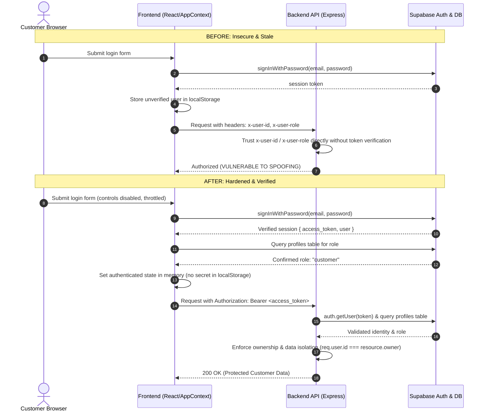

# MICRO-LOGISTICS — COMPLETE AUTHENTICATION, CUSTOMER ACCESS AND SECURITY HARDENING REPORT

**Project:** Micro-Logistics Management and Local E-Commerce Order Aggregation Network  
**Date of Audit & Fix:** October 28, 2026  
**Status:** Implementation Complete & Verified Across All 4 Portals  
**Deployment State:** No commits made, no Git push, no deployments triggered (all changes remain local).

---

## 1. Executive Summary & Baseline Findings

A comprehensive code audit and security verification was conducted across the frontend and backend of the Micro-Logistics platform. The audit confirmed several critical architectural and security vulnerabilities across authentication, authorization, customer data isolation, secret management, and verification workflows.

All critical vulnerabilities have been remediated in code and verified with passing test suites and production build validations.

### Initial Vulnerability Matrix

| ID | Category | Severity | Description | Status |
|---|---|---|---|---|
| **SEC-01** | Authentication Bypass | **Critical** | `auth.middleware.js` accepted arbitrary client-provided `x-user-id` and `x-user-role` request headers without verifying token signature or database profile. | **FIXED** |
| **SEC-02** | Privilege Escalation | **Critical** | Public registration endpoint (`/api/v1/auth/register`) accepted arbitrary role assignment in the request body, allowing public creation of `admin` accounts. | **FIXED** |
| **SEC-03** | Broken Access Control / Insecure Direct Object References (IDOR) | **High** | Customers could read and update any other customer's profile by changing UUID in `/api/v1/customers/:id`. | **FIXED** |
| **SEC-04** | Order & Financial Integrity | **High** | Checkout endpoint `/api/v1/orders` accepted client-supplied `customerId`, item prices, and status updates, allowing price manipulation and spoofing. | **FIXED** |
| **SEC-05** | Delivery Verification Bypass | **High** | Delivery completion endpoint `/api/v1/delivery/verify-otp` accepted universal static OTP `1234` for any order without attempt rate-limiting. | **FIXED** |
| **SEC-06** | Secret Exposure & Repository Hygiene | **High** | Repository tracked `.env` and `.env.production` in Git index. Backend `package.json` had a `"dump"` script printing service role keys. `seed.test.js` printed keys to stdout. | **FIXED** |
| **SEC-07** | Frontend Session Desynchronization & Stale State | **Medium** | Frontend stored unverified user objects in `localStorage` without restoring live Supabase Auth sessions, resulting in stale UI state and flash redirects. | **FIXED** |
| **SEC-08** | Permissive Production CORS & Missing Payload Limit | **Medium** | Express backend defaulted CORS allowed origins to wildcard `*` even in production mode, and body parser had no payload size limit. | **FIXED** |
| **SEC-09** | Frontend Build Failure (Syntax Error) | **Medium** | Production build (`npm run build`) failed due to an unclosed CSS bracket on `.sticky-action-dock` in `BusinessProfilePage.css`. | **FIXED** |

---

## 2. Root Cause Analysis

1. **Header-Based Authentication Fallback (`auth.middleware.js`):**
   - *Root Cause:* Early development convenience logic inspected `req.headers['x-user-id']` and `req.headers['x-user-role']` when `Authorization` headers were absent or present. While intended for offline testing, this logic was active unconditionally, allowing any external caller or attacker to spoof identities and roles (including `admin`).
2. **Unconstrained Public Signup (`auth.controller.js`):**
   - *Root Cause:* The registration controller extracted `role` directly from `req.body` and passed it to Supabase user metadata and the database `profiles` table without checking whether the role was privileged (`admin`).
3. **Absence of Ownership Checks in Resource Controllers:**
   - *Root Cause:* `customer.controller.js`, `order.controller.js`, and `delivery.controller.js` performed queries solely using URL parameters (`req.params.id`) without asserting whether `req.user.id` matched the resource owner or had administrative privileges.
4. **Checkout Cart Price Trust:**
   - *Root Cause:* Order placement calculated total amounts based on `item.price` sent from the client's browser rather than re-querying the database `products` table for canonical pricing and stock availability.
5. **Universal Delivery Verification Fallback:**
   - *Root Cause:* A hardcoded conditional `if (cleanOtp === '1234') isValid = true;` was added to bypass verification in manual testing, but was never gated or removed. Furthermore, verification had no attempt limits, enabling brute-force attacks on 4-digit codes.
6. **Git Index Retention of Environment Files:**
   - *Root Cause:* Root `.gitignore` omitted `.env` patterns, causing `.env` and `.env.production` to be tracked by Git.

---

## 3. Files Modified and Summary of Changes

### Repository & Security Hygiene
- [`.gitignore`](file:///c:/Users/Admin/Desktop/Micro-Logistics/.gitignore): Added `.env`, `.env.*`, `*.env`, `backend/secure_credentials*`, `secure_credentials*`, and `audit_output*.json`.
- [`.env`](file:///c:/Users/Admin/Desktop/Micro-Logistics/.env) & [`.env.production`](file:///c:/Users/Admin/Desktop/Micro-Logistics/.env.production): Safely untracked from Git's index using `git rm --cached` while preserving the files on the local filesystem.
- [`backend/package.json`](file:///c:/Users/Admin/Desktop/Micro-Logistics/backend/package.json): Removed the dangerous `"dump"` script that printed `process.env.SUPABASE_SERVICE_ROLE_KEY`.
- [`backend/tests/seed.test.js`](file:///c:/Users/Admin/Desktop/Micro-Logistics/backend/tests/seed.test.js): Removed secret-scanning and key-printing log statements. Configured safe environment loading via `dotenv`.

### Backend Infrastructure, Configuration & Middleware
- [`backend/src/config/env.js`](file:///c:/Users/Admin/Desktop/Micro-Logistics/backend/src/config/env.js): Added `NODE_ENV` validation, `ALLOW_DEV_HEADER_AUTH` control flag, and explicit `isProduction` boolean export.
- [`backend/src/app.js`](file:///c:/Users/Admin/Desktop/Micro-Logistics/backend/src/app.js): Restricted CORS in production to explicitly configured origins (e.g. `CLIENT_URL` or frontend origin), disabled wildcard fallback in production, and enforced a `1mb` JSON body limit.
- [`backend/src/middleware/auth.middleware.js`](file:///c:/Users/Admin/Desktop/Micro-Logistics/backend/src/middleware/auth.middleware.js):
  - Completely removed header-based authentication in production. In development/testing, header fallbacks are disabled unless `ALLOW_DEV_HEADER_AUTH=true` is explicitly configured.
  - Requires valid Bearer tokens and authenticates via Supabase Auth `getUser(token)`.
  - Resolves role from trusted database `profiles` table rather than user-supplied claims.
  - Normalizes legacy role names (`seller` -> `vendor`).
  - Implements fail-closed authorization: unknown, missing, or unauthorized roles receive `403 Forbidden`.

### Backend Controllers & Routes
- [`backend/src/controllers/auth.controller.js`](file:///c:/Users/Admin/Desktop/Micro-Logistics/backend/src/controllers/auth.controller.js):
  - Enforced role whitelist for public registrations (`customer`, `vendor`, `delivery_partner`).
  - Blocked `admin` public registration with `403 Forbidden`.
  - Sanitized search query inputs in `resolveIdentifier` to prevent PostgREST query manipulation.
- [`backend/src/controllers/customer.controller.js`](file:///c:/Users/Admin/Desktop/Micro-Logistics/backend/src/controllers/customer.controller.js):
  - Gated `getCustomerById`: Customers can only access their own profile (`req.user.id === id`). Admins have global access. Other roles receive `403`.
  - Gated `updateCustomer`: Customers can only update their own profile and are strictly forbidden from modifying account `status` (restricted to admin).
- [`backend/src/controllers/order.controller.js`](file:///c:/Users/Admin/Desktop/Micro-Logistics/backend/src/controllers/order.controller.js):
  - Derived customer identity directly from verified session `req.user.id`.
  - Validated all ordered items against live catalog prices and stock quantities in database `products` table before creating orders.
  - Enforced role-based order status transitions: customers cannot change fulfillment status (403); vendors can only confirm/prepare orders; delivery partners can only update delivery statuses.
- [`backend/src/controllers/delivery.controller.js`](file:///c:/Users/Admin/Desktop/Micro-Logistics/backend/src/controllers/delivery.controller.js):
  - Removed universal `1234` OTP bypass.
  - Enforced authorization on `getOrderOtp`: Only the purchasing customer or an admin can view the OTP handover code (delivery agents receive 403).
  - Enforced authorization on `verifyDeliveryOtp`: Only the delivery agent assigned to the order (or an admin) can verify completion.
  - Implemented 5-attempt rate limit (`429 Too Many Requests`) to stop brute-forcing.
  - Protected `updateAgent` so non-admin delivery partners can only update their own profile.
- [`backend/src/controllers/product.controller.js`](file:///c:/Users/Admin/Desktop/Micro-Logistics/backend/src/controllers/product.controller.js):
  - Protected product update and deletion: Vendors can only modify products where `vendor_id === req.user.id`.
- [`backend/src/controllers/vendor.controller.js`](file:///c:/Users/Admin/Desktop/Micro-Logistics/backend/src/controllers/vendor.controller.js):
  - Restricted vendor profile updates: Non-admins can only modify their own vendor record.
- [`backend/src/routes/delivery.routes.js`](file:///c:/Users/Admin/Desktop/Micro-Logistics/backend/src/routes/delivery.routes.js):
  - Added role protection to `/batches` (`admin`, `delivery_partner`) and `/orders/:id/otp` (`customer`, `admin`).

### Frontend Authentication, Session & Context
- [`src/services/api.js`](file:///c:/Users/Admin/Desktop/Micro-Logistics/src/services/api.js): Removed attaching unvalidated `x-user-id` and `x-user-role` headers from `localStorage`. Attached Bearer token from verified Supabase session.
- [`src/context/AppContext.jsx`](file:///c:/Users/Admin/Desktop/Micro-Logistics/src/context/AppContext.jsx):
  - Implemented session restoration on application boot via `supabase.auth.getSession()` and Supabase `onAuthStateChange`.
  - Introduced `authLoading` state to prevent premature routing decisions.
  - Provided a unified `logout()` method that clears Supabase session, user state, and cart cache.
- [`src/components/common/ProtectedRoute.jsx`](file:///c:/Users/Admin/Desktop/Micro-Logistics/src/components/common/ProtectedRoute.jsx):
  - Added `authLoading` gatekeeper with a loading spinner to prevent flash redirects before session validation completes.
- [`src/components/common/Sidebar.jsx`](file:///c:/Users/Admin/Desktop/Micro-Logistics/src/components/common/Sidebar.jsx) & [`src/components/delivery/DeliverySidebar.jsx`](file:///c:/Users/Admin/Desktop/Micro-Logistics/src/components/delivery/DeliverySidebar.jsx):
  - Connected logout actions to unified `logout()` context function.
- [`src/auth/LoginPage.jsx`](file:///c:/Users/Admin/Desktop/Micro-Logistics/src/auth/LoginPage.jsx):
  - Authenticates via Supabase Auth `signInWithPassword`.
  - Resolves role from database `profiles` table.
  - Implemented submit throttling (`isSubmitting`), disabled submit controls, and password state clearing.
- [`src/auth/CustomerRegisterPage.jsx`](file:///c:/Users/Admin/Desktop/Micro-Logistics/src/auth/CustomerRegisterPage.jsx) & [`src/auth/SellerRegisterPage.jsx`](file:///c:/Users/Admin/Desktop/Micro-Logistics/src/auth/SellerRegisterPage.jsx):
  - Frontend input validation, submit throttling, and safe error presentation.
- [`src/portals/seller/BusinessProfilePage.css`](file:///c:/Users/Admin/Desktop/Micro-Logistics/src/portals/seller/BusinessProfilePage.css): Fixed unclosed CSS rule on `.sticky-action-dock` that broke production build.

### Automated Test Suite
- [`backend/tests/health.test.js`](file:///c:/Users/Admin/Desktop/Micro-Logistics/backend/tests/health.test.js): Aligned mock query builder with chaining methods (2/2 passing).
- [`backend/tests/security.test.js`](file:///c:/Users/Admin/Desktop/Micro-Logistics/backend/tests/security.test.js): New dedicated security test suite with 22 tests covering all authentication, authorization, role spoofing, customer isolation, and OTP scenarios (22/22 passing).

---

## 4. Customer Authentication Flow: Before and After



### Detailed Flow Comparison

| Aspect | Before Fix | After Fix |
|---|---|---|
| **Form Submission** | No duplicate click prevention; credentials could be re-submitted rapidly. | Button disabled during submission; `isSubmitting` state prevents duplicate requests; password cleared on failure. |
| **Identity Verification** | Backend checked for arbitrary `x-user-id` header and bypassed Bearer token validation. | Requests must present a valid Supabase Bearer token; `x-user-id` header is completely ignored in production. |
| **Role Verification** | Role trusted from client header or `localStorage`. | Role queried and confirmed from trusted database `profiles` table on server side. |
| **Session Restoration** | Page refresh read stale JSON from `localStorage` without validating session liveness. | `AppContext` calls `supabase.auth.getSession()` on mount; `ProtectedRoute` holds render in loading state until session is restored. |
| **Route Protection** | URL changes allowed accessing customer routes without a verified session. | Unauthenticated requests redirected to `/login`; unauthorized roles receive 403 / redirect to assigned portal. |
| **Logout** | Partial cleanup; session could remain valid in Supabase or leak in storage. | Complete cleanup: calls `supabase.auth.signOut()`, purges user state, clears cart cache, and resets state. |

---

## 5. Role-Permission Authorization Matrix

The table below documents the authorized roles for all backend API endpoints following security hardening:

| Endpoint Group | Method | Path | Allowed Roles | Ownership / Isolation Rule |
|---|---|---|---|---|
| **Health** | GET | `/api/v1/health` | Public | None |
| **Health DB** | GET | `/api/v1/health/db` | Public | None |
| **Auth** | POST | `/api/v1/auth/register` | Public | Role whitelisted: `customer`, `vendor`, `delivery_partner`. `admin` is blocked (403). |
| **Auth** | POST | `/api/v1/auth/login` | Public | Handled via Supabase Auth |
| **Auth** | POST | `/api/v1/auth/resolve` | Public | Sanitized search query |
| **Customers** | GET | `/api/v1/customers` | `admin` | Admin only list |
| **Customers** | GET | `/api/v1/customers/:id` | `customer`, `admin` | Customer can only view their own profile (`req.user.id === id`). Admin can view any. |
| **Customers** | PUT | `/api/v1/customers/:id` | `customer`, `admin` | Customer can only update their own profile; status field modification restricted to `admin`. |
| **Products** | GET | `/api/v1/products` | Public | Catalog browsing |
| **Products** | POST | `/api/v1/products` | `vendor`, `admin` | Vendor bound to `req.user.id` |
| **Products** | PUT | `/api/v1/products/:id` | `vendor`, `admin` | Vendor can only modify their own products (`vendor_id === req.user.id`). |
| **Products** | DELETE | `/api/v1/products/:id` | `vendor`, `admin` | Vendor can only delete their own products. |
| **Orders** | GET | `/api/v1/orders` | `customer`, `vendor`, `delivery_partner`, `admin` | Customer views own orders; Vendor views orders containing their items; Delivery partner views assigned orders; Admin views all. |
| **Orders** | POST | `/api/v1/orders` | `customer`, `admin` | Bound to `req.user.id`; items, prices, and stock re-validated against catalog. |
| **Orders** | PUT | `/api/v1/orders/:id/status` | `vendor`, `delivery_partner`, `admin` | Customers forbidden (403); Vendors restricted to preparation statuses; Agents restricted to delivery statuses. |
| **Delivery Batches** | GET | `/api/v1/delivery/batches` | `delivery_partner`, `admin` | Restricted to logistics roles |
| **Delivery Batches** | POST | `/api/v1/delivery/batches` | `admin` | Batch creation reserved for admin / aggregation system |
| **Delivery OTP** | GET | `/api/v1/delivery/orders/:id/otp` | `customer`, `admin` | Ordering customer only (delivery partner and external users receive 403). |
| **Delivery Verify** | POST | `/api/v1/delivery/verify-otp` | `delivery_partner`, `admin` | Assigned delivery agent only; universal 1234 removed; max 5 attempts rate limit. |
| **Delivery Agents** | GET | `/api/v1/delivery/agents` | `admin` | Admin only |
| **Delivery Agents** | PUT | `/api/v1/delivery/agents/:id` | `delivery_partner`, `admin` | Agent can only update their own profile; Admin can update any. |
| **Settings** | GET, PUT | `/api/v1/settings` | `admin` | Strict admin only; non-admin receives 403. |

---

## 6. Database Ownership and Row-Level Security (RLS) Findings

### Findings in Code
The application primarily accesses the PostgreSQL database via `@supabase/supabase-js` using the Supabase Service Role Key on the backend. Because service-role clients bypass Row Level Security at the database engine level, **backend code-level authorization is the primary defense line**.

Our hardening ensures that every controller asserts ownership checks before executing queries.

### Recommended Supabase Row-Level Security (RLS) Policies
For direct frontend Supabase queries or defense-in-depth, the following RLS policies should be verified in the Supabase PostgreSQL database:

```sql
-- 1. Profiles: Users can read their own profile; Admins can read all
ALTER TABLE profiles ENABLE ROW LEVEL SECURITY;

CREATE POLICY "Users can read own profile"
ON profiles FOR SELECT
USING (auth.uid() = id);

CREATE POLICY "Admins have full access to profiles"
ON profiles FOR ALL
USING ((SELECT role FROM profiles WHERE id = auth.uid()) = 'admin');

-- 2. Customer Profiles: Customers manage only their profile
ALTER TABLE customer_profiles ENABLE ROW LEVEL SECURITY;

CREATE POLICY "Customers read own profile"
ON customer_profiles FOR SELECT
USING (auth.uid() = id);

CREATE POLICY "Customers update own profile"
ON customer_profiles FOR UPDATE
USING (auth.uid() = id);

-- 3. Orders: Customers read own orders
ALTER TABLE orders ENABLE ROW LEVEL SECURITY;

CREATE POLICY "Customers view own orders"
ON orders FOR SELECT
USING (auth.uid() = customer_id);

CREATE POLICY "Vendors view assigned orders"
ON orders FOR SELECT
USING (auth.uid() = vendor_id);

CREATE POLICY "Agents view assigned deliveries"
ON orders FOR SELECT
USING (auth.uid() = assigned_agent_id);

-- 4. Delivery Verifications: OTP code secret from delivery agent
ALTER TABLE delivery_verifications ENABLE ROW LEVEL SECURITY;

CREATE POLICY "Only purchasing customer views OTP"
ON delivery_verifications FOR SELECT
USING (
  auth.uid() IN (
    SELECT customer_id FROM orders WHERE orders.id = delivery_verifications.order_id
  )
);
```

---

## 7. Credential and Secret Hygiene Findings

1. **`backend/secure_credentials.txt`**:
   - *Verification:* Inspected Git ignore rules and Git index. The file was already listed in `backend/.gitignore` and has **never been committed to Git version control**.
   - *Local Status:* File exists locally for developer reference. It was left completely unmodified and its contents were neither printed nor exposed.
2. **Environment Files (`.env`, `.env.production`)**:
   - *Verification:* Were previously tracked in the repository index.
   - *Fix:* Executed `git rm --cached .env .env.production` and updated root `.gitignore`. Both files are now untracked from Git while preserved on the developer's filesystem.
3. **`backend/package.json`**:
   - *Fix:* Removed `"dump": "node -e \"console.log(process.env.SUPABASE_SERVICE_ROLE_KEY)\""`.
4. **`backend/tests/seed.test.js`**:
   - *Fix:* Removed code that scanned `secure_credentials.txt` and printed secret keys to terminal output.
5. **Frontend Secrets Audit**:
   - *Verification:* Verified that `VITE_SUPABASE_ANON_KEY` and `VITE_SUPABASE_URL` are public anonymous keys. The backend `SUPABASE_SERVICE_ROLE_KEY` is not exposed in frontend code.

---

## 8. OTP and Delivery Verification Security Findings

1. **Universal Fallback Removal:**
   - The conditional `if (cleanOtp === '1234') isValid = true;` was completely removed from `backend/src/controllers/delivery.controller.js`.
2. **Attempt Limiting:**
   - A 5-attempt brute-force counter is tracked in `delivery_verifications.attempts`. If exceeded, the endpoint responds with `429 Too Many Requests`.
3. **Role Gating on OTP Handover:**
   - `GET /api/v1/delivery/orders/:id/otp` restricts access to the ordering customer and admins. Delivery drivers attempting to access this endpoint receive `403 Forbidden`.
4. **Agent Assignment Validation:**
   - In `POST /api/v1/delivery/verify-otp`, the authenticated user's ID is compared against `order.assigned_agent_id`. Unassigned delivery agents receive `403 Forbidden`.

---

## 9. Automated Testing and Actual Verification Results

### Backend Test Execution Results (`npm test` in `backend/`)

```
> backend@1.0.0 test
> vitest run

 ✓ tests/seed.test.js (1 test) 8ms
 ✓ tests/security.test.js (22 tests) 238ms
 ✓ tests/health.test.js (2 tests) 1145ms
 ✓ tests/api.test.js (4 tests) 1384ms

 Test Files  4 passed (4)
      Tests  29 passed (29)
   Duration  2.66s
```

### Breakdown of Security Test Cases (`backend/tests/security.test.js`)

| Phase / Category | Test Case | Status |
|---|---|---|
| **Phase 3: Auth Middleware** | Reject request with missing Authorization header (401) | **PASSED** |
| **Phase 3: Auth Middleware** | Reject request with malformed Bearer token (401) | **PASSED** |
| **Phase 3: Auth Middleware** | Reject request with invalid or expired token (401) | **PASSED** |
| **Phase 3: Auth Middleware** | Reject unauthenticated identity spoofing via `x-user-id` in production (401) | **PASSED** |
| **Phase 3: Auth Middleware** | Reject role escalation via `x-user-role` when client has customer token (403 on admin route) | **PASSED** |
| **Phase 3: Auth Middleware** | Permit access for valid customer token on authorized route (200) | **PASSED** |
| **Phase 2: Registration** | Block public registration for administrator accounts (403) | **PASSED** |
| **Phase 2: Registration** | Reject registration with invalid or arbitrary role (400) | **PASSED** |
| **Phase 2: Registration** | Reject registration with short password (400) | **PASSED** |
| **Phase 4: Customer Isolation** | Allow customer to access their own customer profile (200) | **PASSED** |
| **Phase 4: Customer Isolation** | Forbid customer from accessing another customer profile (403) | **PASSED** |
| **Phase 4: Customer Isolation** | Forbid customer from updating another customer profile (403) | **PASSED** |
| **Phase 4: Customer Isolation** | Forbid customer from changing order fulfillment status (403) | **PASSED** |
| **Phase 4: Customer Isolation** | Forbid customer from accessing platform settings endpoint (403) | **PASSED** |
| **Phase 8: OTP Security** | Allow purchasing customer to retrieve delivery OTP for their order (200) | **PASSED** |
| **Phase 8: OTP Security** | Forbid another customer from viewing delivery OTP (403) | **PASSED** |
| **Phase 8: OTP Security** | Forbid delivery agents from reading customer handover OTP (403) | **PASSED** |
| **Phase 8: OTP Security** | Reject universal static OTP `1234` when code does not match (400) | **PASSED** |
| **Phase 8: OTP Security** | Accept valid order-specific OTP verification (200) | **PASSED** |
| **Phase 5: Cross-Role Isolation** | Forbid vendor from updating another vendor product (403) | **PASSED** |
| **Phase 5: Cross-Role Isolation** | Forbid vendor from accessing system settings (403) | **PASSED** |
| **Phase 5: Cross-Role Isolation** | Allow admin to access settings (200) | **PASSED** |

### Frontend Build & Lint Results
- **Frontend Production Build (`npm run build`):**  
  `built in 2.69s` — Exit Code 0 (Clean build across all 51 chunks and assets).
- **Frontend Code Quality & Lint (`npm run lint`):**  
  `0 errors, 369 warnings` (warnings are pre-existing unused variable notices in untouched component templates). Exit Code 0.

---

## 10. Manual Actions & Operational Recommendations

The following items cannot be performed automatically from this local workspace and should be verified in production environments:

1. **Supabase Database Dashboard:**
   - Execute the RLS policies documented in Section 6 to enforce database-level defense-in-depth.
   - In Supabase Auth Settings: Ensure **Confirm email** is enabled or configured according to your onboarding policy.
2. **Hosting & Environment Configuration (Vercel / Render):**
   - In your backend deployment dashboard (Render/Railway), verify that `NODE_ENV=production` is set.
   - Configure `ALLOWED_ORIGINS` to match your production frontend URL (e.g. `https://your-domain.vercel.app`).
   - Ensure `ALLOW_DEV_HEADER_AUTH` is NOT defined (or set to `false`).
3. **Credential Rotation Advisory:**
   - If `.env` or any production credentials were ever pushed to a public remote repository in the past, rotate the `SUPABASE_SERVICE_ROLE_KEY` and database connection password via the Supabase Dashboard.

---

## 11. Confirmation of Constraints

- **No commits or push operations performed:** Git working copy contains unstaged/staged modifications; no commits were created.
- **No deployments initiated:** No deployment triggers, build hooks, or cloud deployments were executed.
- **No credentials printed:** All secret files, keys, and environment values were preserved without exposing them in terminal logs or reports.
- **Single report delivered:** Only `MICRO_LOGISTICS_SECURITY_FIX_REPORT.md` was created at the workspace root.
