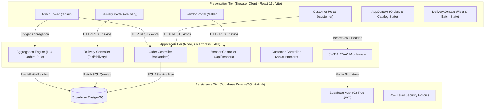
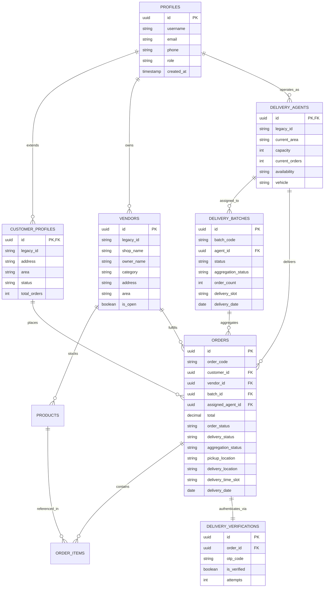
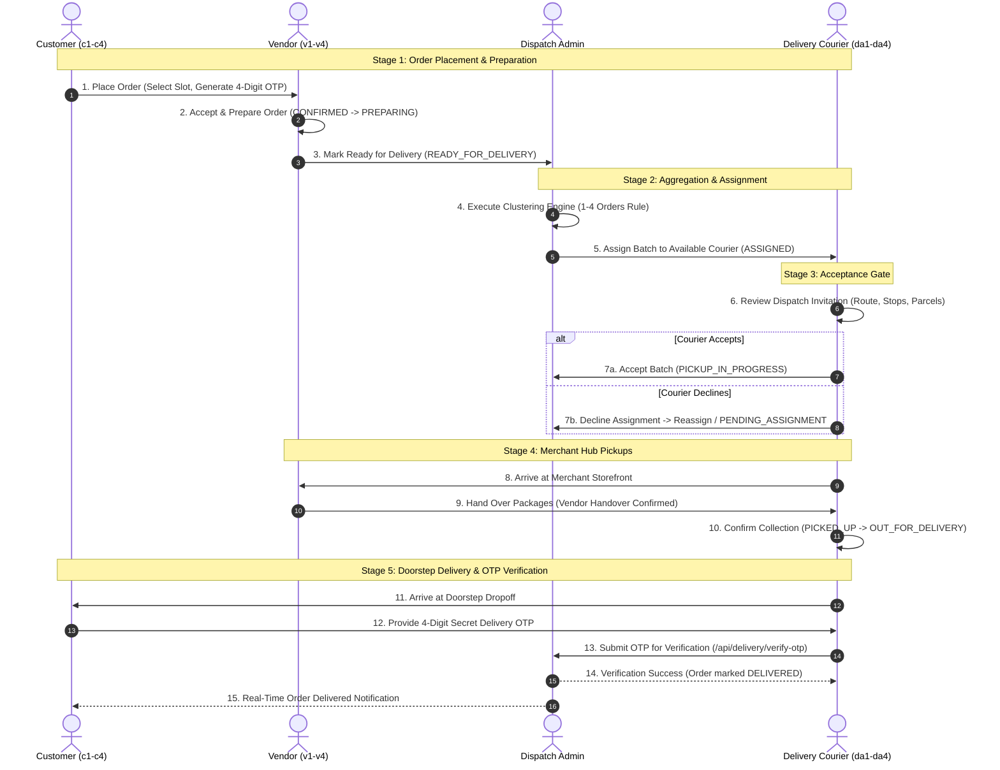
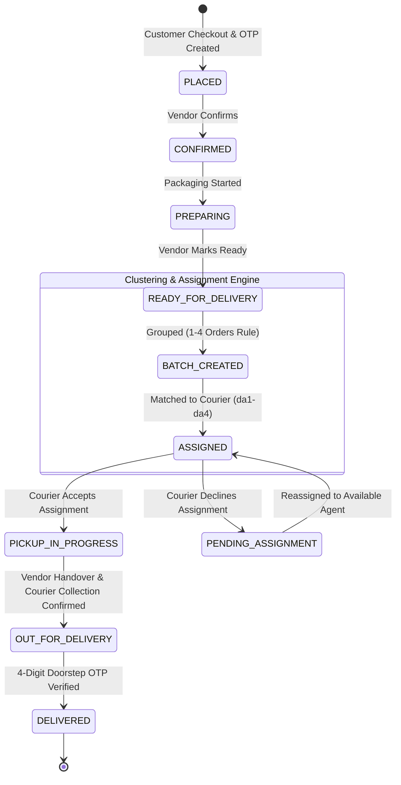
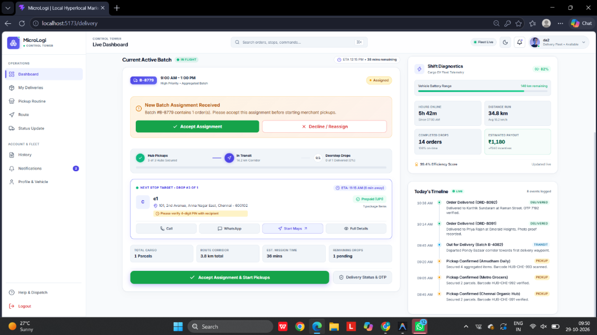
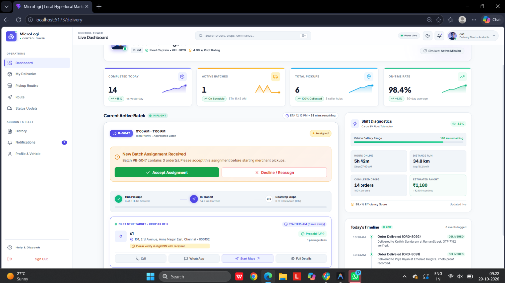
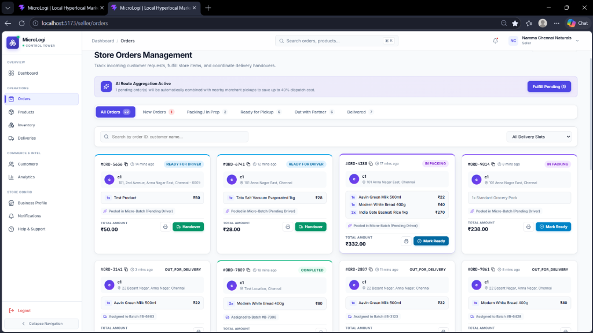
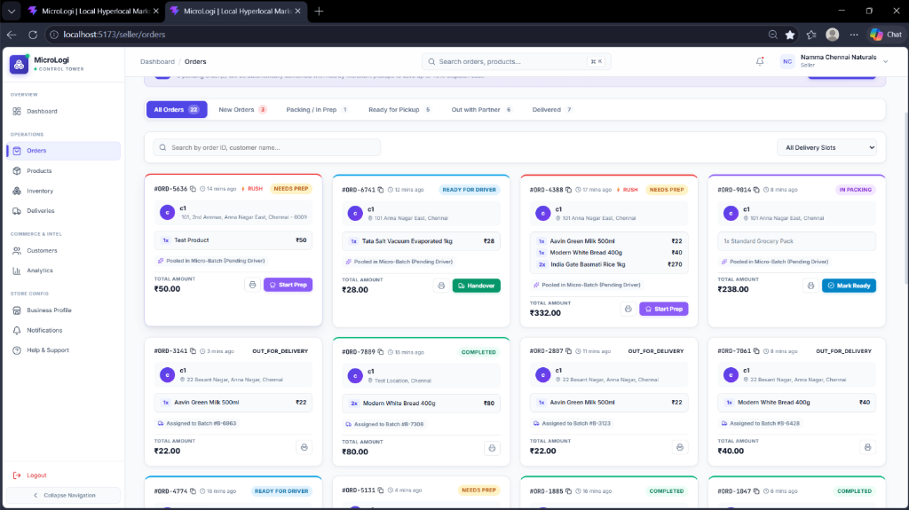
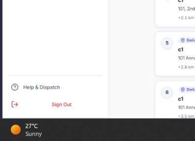

# MICRO-LOGISTICS MANAGEMENT — LOCAL E-COMMERCE ORDER AGGREGATION NETWORK
## Final Project Review Report

---

**Academic Institution:** [COLLEGE / INSTITUTION NAME]  
**Department:** Department of Information Technology  
**Degree Program:** Bachelor of Technology / Bachelor of Engineering in Information Technology  
**Academic Year:** 2026–2027  
**Document Classification:** Final Project Review & Implementation Defense (Phase 4)  
**Report Title:** MICRO-LOGISTICS MANAGEMENT — LOCAL E-COMMERCE ORDER AGGREGATION NETWORK  
*(Official Project Title: Flagged for Final Academic Review Confirmation)*  
**Repository Branch:** `main` (Remote: `origin/main`)  
**Report Date:** 29-10-2026  
**Project Team Members:**
* **ABISHEKA S** ([REGISTER NUMBER 1])
* **BOOMIKA V** ([REGISTER NUMBER 2])
* **DARSANI B** ([REGISTER NUMBER 3])

**Project Supervisor / Faculty Guide:** [PROJECT GUIDE NAME], [Designation], Department of Information Technology  

---

## Executive Summary

Urban last-mile logistics represents one of the most operationally challenging and economically strained segments of contemporary e-commerce. While consumer demand for rapid doorstep fulfillment has expanded across groceries, fresh farm produce, and daily household essentials, the dominant fulfillment model relies on an **unconstrained 1:1 courier dispatch mechanism**—where a dedicated courier is dispatched for a single customer order from a single merchant. In high-density urban environments, such as the Chennai metropolitan commercial corridors, this legacy model causes extreme vehicle trip duplication, excessive urban carbon emissions, merchant dispatch chaos, and erratic unit economics.

To systematically resolve these inefficiencies, this project develops the **Micro-Logistics Management and Hyperlocal Order Aggregation Network** (`MicroLogi`). The platform establishes a unified, role-segregated software network connecting Customers, Local Merchants (Vendors), Fleet Delivery Partners, and Central Dispatch Administrators.

The core engineering innovations of this platform comprise:
1. **Deterministic Automatic Order Aggregation (1–4 Orders Rule):** A heuristic clustering engine implemented in [`backend/src/services/aggregation.service.js`](file:///c:/Users/Boomika/OneDrive/Desktop/Micro-Logistics/backend/src/services/aggregation.service.js) that groups ready-to-deliver orders into consolidated multi-stop delivery batches containing between a minimum of 1 and a maximum of 4 orders ($1 \le N \le 4$). This policy eliminates the starvation of single urgent orders while strictly preventing courier vehicle overload.
2. **Couriers Assignment Acceptance Gate:** A mandatory workflow gate in [`src/portals/delivery/DeliveryDashboard.jsx`](file:///c:/Users/Boomika/OneDrive/Desktop/Micro-Logistics/src/portals/delivery/DeliveryDashboard.jsx) where delivery couriers receive a **Dispatch Invitation Card** and must explicitly review and accept or decline the assignment before merchant pickups can commence.
3. **Dual-Handshake Merchant Pickup Protocol:** An enforceable physical custody transfer mechanism requiring both merchant handover confirmation and courier collection validation before orders transition to `OUT_FOR_DELIVERY`.
4. **Cryptographic 4-Digit Doorstep OTP Verification:** Verification of delivery via a 4-digit numeric One-Time Password generated at order placement and cryptographically matched by the server before any order is finalized as `DELIVERED`.
5. **Role-Segregated Single-Page Application:** Four dedicated user portals powered by React 19, Express 5, and Supabase PostgreSQL with strict Row-Level Security (RLS) and JWT authorization.

As of October 29, 2026, the backend test suite achieves **52/52 passing tests across 6 test suites**, and the frontend production build compiles cleanly in **1.67 seconds** with zero errors.

---

## Table of Contents

- [Chapter 1: Introduction and Problem Definition](#chapter-1-introduction-and-problem-definition)
  - [1.1 Background and Context](#11-background-and-context)
  - [1.2 Problem Statement](#12-problem-statement)
  - [1.3 Project Objectives](#13-project-objectives)
  - [1.4 Scope and Delimitation](#14-scope-and-delimitation)
- [Chapter 2: System Architecture and Technology Stack](#chapter-2-system-architecture-and-technology-stack)
  - [2.1 High-Level System Architecture](#21-high-level-system-architecture)
  - [2.2 Comprehensive Technology Stack](#22-comprehensive-technology-stack)
  - [2.3 Client-Side Module Organization](#23-client-side-module-organization)
  - [2.4 Server-Side Module Organization](#24-server-side-module-organization)
- [Chapter 3: Database Design and Entity Modeling](#chapter-3-database-design-and-entity-modeling)
  - [3.1 Relational Entity-Relationship Diagram](#31-relational-entity-relationship-diagram)
  - [3.2 Database Schema Specifications](#32-database-schema-specifications)
  - [3.3 Integrity Constraints and Transactional Boundaries](#33-integrity-constraints-and-transactional-boundaries)
- [Chapter 4: End-to-End Operational Workflow](#chapter-4-end-to-end-operational-workflow)
  - [4.1 Detailed 8-Step Lifecycle](#41-detailed-8-step-lifecycle)
  - [4.2 End-to-End Sequence Flow](#42-end-to-end-sequence-flow)
  - [4.3 Dual-Handshake Pickup Protocol](#43-dual-handshake-pickup-protocol)
  - [4.4 Step 4 Courier Acceptance Gate](#44-step-4-courier-acceptance-gate)
- [Chapter 5: Order Aggregation Engine & Mathematical Formulation](#chapter-5-order-aggregation-engine--mathematical-formulation)
  - [5.1 Algorithmic Grouping Criteria](#51-algorithmic-grouping-criteria)
  - [5.2 Spatial Proximity and Corridor Distance Formulation](#52-spatial-proximity-and-corridor-distance-formulation)
  - [5.3 Courier Allocation Scoring Model](#53-courier-allocation-scoring-model)
  - [5.4 Comprehensive Worked Aggregation Example](#54-comprehensive-worked-aggregation-example)
  - [5.5 Edge Case Handling](#55-edge-case-handling)
- [Chapter 6: State Transition Modeling](#chapter-6-state-transition-modeling)
  - [6.1 Unified State Transition Matrix](#61-unified-state-transition-matrix)
  - [6.2 State Machine Lifecycle Diagram](#62-state-machine-lifecycle-diagram)
- [Chapter 7: Role-Based Portals & User Interface Architecture](#chapter-7-role-based-portals--user-interface-architecture)
  - [7.1 Customer Experience Portal](#71-customer-experience-portal)
  - [7.2 Vendor (Seller) Fulfillment Portal](#72-vendor-seller-fulfillment-portal)
  - [7.3 Delivery Fleet Control Tower Portal](#73-delivery-fleet-control-tower-portal)
  - [7.4 Central Dispatch Administration Portal](#74-central-dispatch-administration-portal)
  - [7.5 Verified Application Screenshots](#75-verified-application-screenshots)
- [Chapter 8: Security Architecture, Authentication, and Role Isolation](#chapter-8-security-architecture-authentication-and-role-isolation)
  - [8.1 Authentication and Token Propagation](#81-authentication-and-token-propagation)
  - [8.2 Role-Based Access Control (RBAC)](#82-role-based-access-control-rbac)
  - [8.3 Tenant Isolation and Data Protection](#83-tenant-isolation-and-data-protection)
  - [8.4 Approved Demonstration Accounts Directory](#84-approved-demonstration-accounts-directory)
- [Chapter 9: Quality Assurance, Automated Testing, and System Verification](#chapter-9-quality-assurance-automated-testing-and-system-verification)
  - [9.1 Automated Backend Test Execution](#91-automated-backend-test-execution)
  - [9.2 Production Build Verification](#92-production-build-verification)
  - [9.3 Automated Testing vs. Manual End-to-End Verification](#93-automated-testing-vs-manual-end-to-end-verification)
- [Chapter 10: Individual Team Member Contributions](#chapter-10-individual-team-member-contributions)
  - [10.1 Work Allocation and Domain Ownership](#101-work-allocation-and-domain-ownership)
  - [10.2 Contribution Matrix](#102-contribution-matrix)
- [Chapter 11: Conclusion, Limitations, and Future Roadmap](#chapter-11-conclusion-limitations-and-future-roadmap)
  - [11.1 Conclusion](#111-conclusion)
  - [11.2 Current Operational Limitations](#112-current-operational-limitations)
  - [11.3 Technical Development Roadmap](#113-technical-development-roadmap)
- [References & Appendices](#references--appendices)
  - [Academic References](#academic-references)
  - [Appendix A: REST API Endpoint Catalog](#appendix-a-rest-api-endpoint-catalog)
  - [Appendix B: Implementation Verification Checklist](#appendix-b-implementation-verification-checklist)

---

## Chapter 1: Introduction and Problem Definition

### 1.1 Background and Context
Hyperlocal e-commerce has expanded rapidly across metropolitan India, with consumers expecting rapid doorstep delivery of everyday necessities such as fresh groceries, bakery goods, and dairy products. Unlike conventional national parcel logistics, hyperlocal fulfillment operates under stringent spatial and temporal constraints:
* **Compressed Fulfillment Windows:** Delivery promises typically span 1 to 4 hours.
* **Perishable Merchandise:** Temperature-sensitive and fresh items require expedited pickup and handling.
* **Neighborhood Vendor Dispersion:** Small independent merchants lack centralized warehousing, requiring pickups directly from scattered storefronts.

In dense urban environments such as Chennai, Tamil Nadu, traditional logistics operations result in substantial economic friction, with vehicle trips duplicating routes across commercial corridors such as Anna Nagar, Mylapore, Adyar, and T. Nagar.

### 1.2 Problem Statement
Current commercial hyperlocal operations suffer from five critical structural flaws:
1. **Unbatched 1:1 Courier Dispatch:** Couriers are assigned to single individual orders. When three neighbors in the same apartment complex purchase goods from three adjacent stores on the same street, three separate couriers are dispatched. This causes high fuel costs, traffic congestion, and diminished courier earnings per trip.
2. **Premature Status Progression ("Phantom Transits"):** Couriers often mark orders "In-Transit" prior to arriving at the merchant location to satisfy platform metrics, leading to customer confusion and lack of custodial accountability.
3. **Unverified Doorstep Drops:** Deliveries frequently lack secure proof-of-delivery, leading to parcel disputes, theft claims, and customer dissatisfaction.
4. **Rigid Batch Size Bottlenecks:** Naive batching engines require large clusters before dispatching, causing early orders to sit idle. Conversely, unconstrained batching overloads two-wheeled couriers beyond vehicle carrying capacity.
5. **Fragmented Stakeholder Software:** Merchants, riders, customers, and dispatchers lack synchronized state visibility, resulting in phone-call-driven coordination.

### 1.3 Project Objectives
The engineering objectives of the `MicroLogi` platform are:
* **Objective 1:** Implement an automated order aggregation engine that clusters 1 to 4 ready-to-deliver orders based on shared delivery dates, compatible time slots, and corridor proximity.
* **Objective 2:** Enforce an explicit courier assignment acceptance gate where delivery agents can review corridor details, parcel counts, and stops before accepting or rejecting assignments.
* **Objective 3:** Implement a dual-handshake pickup protocol requiring merchant handover confirmation and rider collection acknowledgement before dispatch.
* **Objective 4:** Secure final delivery through cryptographic 4-digit One-Time Password (OTP) verification matching.
* **Objective 5:** Provide four dedicated, responsive web portals for Customers, Sellers, Couriers, and Administrators with zero unauthorized cross-role data access.

### 1.4 Scope and Delimitation
The project implementation encompasses a full-stack, decoupled Single-Page Application (SPA) and REST API deployed locally, backed by a cloud Supabase PostgreSQL instance. The spatial modeling focuses on the Chennai metropolitan area across 20 distinct urban zones. 

*Delimitation:* Real-time turn-by-turn GPS navigation and dynamic Travelling Salesperson Problem (TSP) road-graph calculations are outside the current scope and are represented via Manhattan/Haversine corridor heuristics and interactive route cards.

---

## Chapter 2: System Architecture and Technology Stack

### 2.1 High-Level System Architecture
The system utilizes a decoupled, three-tier client-server architecture:



### 2.2 Comprehensive Technology Stack

| Architecture Layer | Technology Selection | Version | Academic & Operational Justification |
| :--- | :--- | :--- | :--- |
| **Frontend Framework** | React | 19.0.0 | Concurrent rendering, virtual DOM reconciliation, component encapsulation |
| **Frontend Tooling** | Vite | 6.2.0 | Native ESM-based dev server, Hot Module Replacement (HMR), optimized bundling |
| **Client Routing** | React Router DOM | 7.2.0 | Declarative nested routing, history management, protected route redirects |
| **Visual Styling** | Vanilla CSS + CSS Variables | CSS3 | Scoped component styling, zero CSS-in-JS runtime overhead, theme token support |
| **Iconography** | Lucide React | 1.16.0 | Semantic SVG icon system across all portal navigation trees |
| **HTTP Transport** | Axios | 1.7.9 | Promise-based HTTP client with automatic Bearer JWT injection interceptors |
| **Backend Runtime** | Node.js | 20.x / 24.x | Non-blocking event-driven I/O model suitable for high-concurrency API dispatching |
| **Application Framework**| Express | 5.2.1 | Modern routing middleware, centralized exception handling, RESTful standards |
| **Database Engine** | PostgreSQL (Supabase) | 15+ | ACID transaction compliance, referential integrity, B-Tree indexing, JSONB |
| **Identity Service** | Supabase Auth (GoTrue)| Managed | Cryptographic SHA-256 password hashing, signed JWT generation, session security |
| **Automated Testing** | Vitest | 5.0.0 | High-performance multi-threaded test runner with native ESM execution |

### 2.3 Client-Side Module Organization
The client application is organized into modular directories under `src/`:
* `src/auth/`: Login, registration, landing page, and multi-identifier credential resolution.
* `src/components/`: Reusable interface components (`Header`, `Sidebar`, `StatusBadge`, `OrderDetailsModal`, `EmptyState`).
* `src/context/`: Reactive state stores (`AppContext.jsx` managing catalog and orders; `DeliveryContext.jsx` managing active courier batches and telematics).
* `src/portals/`: Role-specific view modules:
  * `customer/`: Marketplace catalog browsing, multi-vendor cart, scheduled checkout, live tracking.
  * `seller/`: Order fulfillment board, inventory manager, vendor handover action triggers.
  * `delivery/`: Courier cockpit, batch invitation acceptance card, merchant pickup checklist, OTP verification modal.
  * `admin/`: Central dispatch command tower, visual aggregation manager, fleet supervisor.
* `src/utils/`: Helper algorithms (`aggregationUtils.js`, `customerDirectory.js`, `helpers.js`).

### 2.4 Server-Side Module Organization
The server backend in `backend/` follows clean architectural separation:
* `backend/src/config/`: Supabase client initialization and environment validation (`supabase.js`, `env.js`).
* `backend/src/controllers/`: HTTP request dispatchers (`order.controller.js`, `delivery.controller.js`, `vendor.controller.js`, `customer.controller.js`).
* `backend/src/middleware/`: Security gates (`auth.middleware.js` validating JWTs and RBAC permissions).
* `backend/src/services/`: Core computational logic (`aggregation.service.js` containing clustering algorithms).
* `backend/src/utils/`: Legacy-to-database schema bidirectional adapters (`mappings.js`).
* `backend/tests/`: Automated unit and integration test suites.

---

## Chapter 3: Database Design and Entity Modeling

### 3.1 Relational Entity-Relationship Diagram



### 3.2 Database Schema Specifications

#### 1. `profiles` Table
Central authentication table referencing Supabase Auth users:
* `id` (`UUID`, Primary Key): References `auth.users.id`.
* `username` (`VARCHAR(100)`, Unique): System handle (`c1`, `v1`, `da1`, `admin`).
* `email` (`VARCHAR(255)`, Unique): User login email.
* `phone` (`VARCHAR(20)`): Contact phone number.
* `role` (`VARCHAR(50)`, Not Null): Enforced security role (`customer`, `vendor`, `delivery_partner`, `admin`).

#### 2. `customer_profiles` Table
Stores customer-specific metadata:
* `id` (`UUID`, PK, FK $\rightarrow$ `profiles.id` ON DELETE CASCADE).
* `legacy_id` (`VARCHAR(50)`): Human-readable alias (`c1`, `c2`, `c3`, `c4`).
* `address` (`TEXT`): Full residential address with pincode.
* `area` (`VARCHAR(100)`): Delivery zone (e.g., `Anna Nagar East`).
* `status` (`VARCHAR(50)`): Account standing (`Active`, `Suspended`).

#### 3. `orders` Table
Main transactional order tracking table:
* `id` (`UUID`, Primary Key): System UUID.
* `order_code` (`VARCHAR(50)`, Unique): Customer display code (e.g., `ORD-5131`).
* `customer_id` (`UUID`, FK $\rightarrow$ `customer_profiles.id`).
* `vendor_id` (`UUID`, FK $\rightarrow$ `vendors.id`).
* `batch_id` (`UUID`, FK $\rightarrow$ `delivery_batches.id`, Nullable).
* `assigned_agent_id` (`UUID`, FK $\rightarrow$ `delivery_agents.id`, Nullable).
* `total` (`DECIMAL(10,2)`): Total order amount in INR.
* `order_status` (`VARCHAR(50)`): Preparation state (`PLACED`, `CONFIRMED`, `PREPARING`, `READY_FOR_DELIVERY`, `ASSIGNED`, `OUT_FOR_DELIVERY`, `DELIVERED`, `CANCELLED`).
* `delivery_status` (`VARCHAR(50)`): Transport state (`PENDING_ASSIGNMENT`, `ASSIGNED`, `PICKED_UP`, `OUT_FOR_DELIVERY`, `DELIVERED`).
* `aggregation_status` (`VARCHAR(50)`): Clustering state (`WAITING_FOR_AGGREGATION`, `GROUPED`, `BATCH_CREATED`, `ASSIGNED`, `COMPLETED`).
* `delivery_time_slot` (`VARCHAR(50)`): Scheduled fulfillment window.
* `delivery_date` (`DATE`): Scheduled fulfillment date.

#### 4. `delivery_batches` Table
Consolidates 1 to 4 orders into a single delivery task:
* `id` (`UUID`, Primary Key).
* `batch_code` (`VARCHAR(50)`, Unique): Batch identifier (e.g., `B-5047`).
* `agent_id` (`UUID`, FK $\rightarrow$ `delivery_agents.id`, Nullable).
* `status` (`VARCHAR(50)`): Execution state (`PENDING_ASSIGNMENT`, `ASSIGNED`, `PICKUP_IN_PROGRESS`, `PICKED_UP`, `OUT_FOR_DELIVERY`, `COMPLETED`).
* `aggregation_status` (`VARCHAR(50)`): Batch phase (`BATCH_CREATED`, `ASSIGNED`, `IN_TRANSIT`, `COMPLETED`).
* `order_count` (`INT`, Check $1 \le N \le 4$): Number of aggregated orders.
* `delivery_slot` (`VARCHAR(50)`): Consolidated delivery window.
* `delivery_date` (`DATE`): Delivery calendar date.

#### 5. `delivery_verifications` Table
Secures proof of delivery:
* `id` (`UUID`, Primary Key).
* `order_id` (`UUID`, FK $\rightarrow$ `orders.id` ON DELETE CASCADE, Unique).
* `otp_code` (`VARCHAR(6)`, Not Null): 4-digit secret delivery PIN.
* `is_verified` (`BOOLEAN`, Default `FALSE`): Verification status.
* `attempts` (`INT`, Default 0): Failed attempt counter (locks after 5 failures).

### 3.3 Integrity Constraints and Transactional Boundaries
* **Referential Cascades:** Order deletion cascades to items and verifications, avoiding orphaned records.
* **Batch Disassociation:** Setting `batch_id = NULL` removes an order from a batch without deleting the underlying order record.
* **Atomic Batch Assignment:** When an admin assigns a batch to a courier, a single transactional operation updates both `delivery_batches.agent_id` and all associated `orders.assigned_agent_id` records.

---

## Chapter 4: End-to-End Operational Workflow

### 4.1 Detailed 8-Step Lifecycle

The end-to-end operational lifecycle spans four participating roles across 8 deterministic stages:

1. **Step 1: Order Placement & OTP Generation (Customer)**  
   The customer selects local merchant items, chooses a delivery address, and selects a scheduled delivery window (e.g., `9:00 AM – 1:00 PM`). Upon checkout, the system creates an order in `PLACED` status and generates a cryptographically random 4-digit numeric OTP stored in `delivery_verifications`.
2. **Step 2: Order Acceptance & Preparation (Vendor)**  
   The merchant receives the order on their fulfillment board, verifies inventory availability, and confirms the order (`PLACED` $\rightarrow$ `CONFIRMED`). When packaging begins, status updates to `PREPARING`.
3. **Step 3: Staging for Delivery (Vendor)**  
   Once packaging is complete and the manifest is affixed, the vendor marks the order as `READY_FOR_DELIVERY`. The aggregation engine marks the order as `WAITING_FOR_AGGREGATION`.
4. **Step 4: Automatic Aggregation & Courier Assignment (Admin / System)**  
   The aggregation engine scans ready orders, groups compatible orders into batches of 1 to 4 ($1 \le N \le 4$), creates a `delivery_batches` record (`BATCH_CREATED`), and evaluates available couriers based on zone proximity and remaining capacity. The batch is assigned to the best-matching courier (`ASSIGNED`).
5. **Step 5: Courier Acceptance Gate (Courier)**  
   The assigned courier's dashboard displays a prominent **Dispatch Invitation Card** detailing the batch code, corridor, order count, and estimated time. The courier must click **Accept Assignment** to claim the batch (`status: PICKUP_IN_PROGRESS`). If declined, the batch transitions to `PENDING_ASSIGNMENT` for automated or manual reassignment.
6. **Step 6: Dual-Handshake Merchant Hub Pickup (Vendor & Courier)**  
   The courier navigates to the merchant storefront. The vendor verifies the courier's presence and marks the order as handed over (`vendor_handover_confirmed = true`). The courier checks the parcels and validates collection (`PICKED_UP`).
7. **Step 7: Corridor Dispatch (Courier)**  
   Once all merchant parcels for the batch are collected, the batch and orders transition to `OUT_FOR_DELIVERY`. The customer's tracking portal displays live transit status and displays the customer's 4-digit delivery OTP.
8. **Step 8: Doorstep Handover & OTP Verification (Courier & Customer)**  
   The courier arrives at the customer's doorstep. The customer provides their 4-digit OTP. The courier submits the code via the verification interface. The server validates the code against `delivery_verifications`:
   * **Correct Match:** The order immediately transitions to `DELIVERED`, recording verification timestamp.
   * **Incorrect Match:** An error is displayed; the attempt counter is incremented.

### 4.2 End-to-End Sequence Flow



### 4.3 Dual-Handshake Pickup Protocol
To eliminate phantom transits, the platform enforces a dual-handshake check:
* **Condition 1:** The merchant must confirm parcel handover on their fulfillment dashboard (`is_handed_over = true`).
* **Condition 2:** The courier must verify collection on their pickup checklist (`pickup_confirmed = true`).

Attempting to mark an order `OUT_FOR_DELIVERY` without both confirmations results in an error in `DeliveryContext.jsx`.

### 4.4 Step 4 Courier Acceptance Gate
In traditional delivery apps, couriers are often silently assigned orders without consent. `MicroLogi` enforces an explicit acceptance gate:
* When a batch is in `ASSIGNED` state, the courier dashboard suppresses transit and pickup buttons.
* It displays a **Dispatch Invitation Card** with two buttons: **Accept Assignment & Start Pickups** (triggers `PICKUP_IN_PROGRESS`) and **Decline / Reassign** (triggers reassignment).

---

## Chapter 5: Order Aggregation Engine & Mathematical Formulation

### 5.1 Algorithmic Grouping Criteria
The order clustering algorithm implemented in `backend/src/services/aggregation.service.js` groups candidate orders using four criteria:

1. **Delivery Date Equality:**
   $$\text{Date}(O_i) = \text{Date}(O_j)$$
   Orders scheduled for different dates are never batched together.
2. **Time Slot Compatibility:**
   $$\text{SlotCompatible}(S_i, S_j) = \text{TRUE}$$
   Exact matching slots or predefined overlapping windows (e.g., `7:00 AM – 11:00 AM` and `9:00 AM – 1:00 PM`) are valid.
3. **Corridor Proximity Limits:**
   $$D_{\text{pickup}}(P_i, P_j) \le 8.5\text{ km} \quad \text{and} \quad D_{\text{drop}}(D_i, D_j) \le 9.0\text{ km}$$
   Distances are computed using the Haversine formula over transit coordinates.
4. **Deterministic Batch Size Bounds:**
   $$1 \le |B_k| \le 4$$
   Batches contain between 1 and 4 orders. The system never blocks a solitary order, and never places a 5th order into an existing batch.

### 5.2 Spatial Proximity and Corridor Distance Formulation
Distance between two geographic coordinates $(\phi_1, \lambda_1)$ and $(\phi_2, \lambda_2)$ is determined using the Haversine formula:

$$a = \sin^2\left(\frac{\Delta\phi}{2}\right) + \cos(\phi_1)\cos(\phi_2)\sin^2\left(\frac{\Delta\lambda}{2}\right)$$

$$c = 2 \cdot \text{atan2}\left(\sqrt{a}, \sqrt{1-a}\right)$$

$$D = R \cdot c$$

where $R = 6371\text{ km}$ is Earth's mean radius.

Estimated batch route distance and transit time are modeled as:
$$\text{Estimated Distance (km)} = 2.5 + (|B| \times 1.3)$$
$$\text{Estimated Time (minutes)} = \text{round}(15 + (\text{Estimated Distance} \times 5.5))$$

### 5.3 Courier Allocation Scoring Model
When a batch $B$ is created, available couriers are evaluated using a multi-factor scoring function:

$$\text{Score}(A_m) = S_{\text{base}} + S_{\text{proximity}} - S_{\text{workload}} + S_{\text{rating}}$$

* $S_{\text{base}} = 50$
* $S_{\text{proximity}} = +40$ (if agent's operating zone matches batch pickup/drop area) or $\max(0, 30 - 3 \times D)$
* $S_{\text{workload}} = -5 \times (\text{current active orders})$
* $S_{\text{rating}} = +2 \times (\text{agent rating out of 5.0})$

The available agent with the highest positive score is selected. If an agent previously declined the batch, they are excluded from the candidate pool.

### 5.4 Comprehensive Worked Aggregation Example

*(Note: The following scenario uses illustrative sample data to demonstrate the mathematical clustering rules).*

#### Input: 6 Pending Orders Ready for Delivery (Morning Dispatch)
* **Order 1 (ORD-901):** Customer `c1` (Anna Nagar East), Vendor `v1` (Namma Chennai Naturals, Anna Nagar), Slot `9:00 AM – 1:00 PM`, Date `2026-10-29`, Total ₹540.
* **Order 2 (ORD-902):** Customer `c1` (Anna Nagar East), Vendor `v4` (Metro Grocers, Anna Nagar), Slot `9:00 AM – 1:00 PM`, Date `2026-10-29`, Total ₹320.
* **Order 3 (ORD-903):** Customer `c2` (Shenoy Nagar, 1.8 km from Anna Nagar), Vendor `v1` (Namma Chennai Naturals, Anna Nagar), Slot `9:00 AM – 1:00 PM`, Date `2026-10-29`, Total ₹780.
* **Order 4 (ORD-904):** Customer `c4` (Kilpauk, 2.7 km from Anna Nagar), Vendor `v1` (Namma Chennai Naturals, Anna Nagar), Slot `9:00 AM – 1:00 PM`, Date `2026-10-29`, Total ₹450.
* **Order 5 (ORD-905):** Customer `c3` (Adyar, South Chennai, 14.8 km from Anna Nagar), Vendor `v3` (Amudham Hub, Adyar), Slot `9:00 AM – 1:00 PM`, Date `2026-10-29`, Total ₹610.
* **Order 6 (ORD-906):** Customer `c1` (Anna Nagar East), Vendor `v1` (Namma Chennai Naturals, Anna Nagar), Slot `6:00 PM – 10:00 PM` (Evening slot), Date `2026-10-29`, Total ₹410.

#### Aggregation Evaluation & Batch Formation:

| Batch Identifier | Assigned Orders | Total Items | Pickups Required | Dropoff Corridor | Status / Decision Rationale |
| :--- | :--- | :---: | :--- | :--- | :--- |
| **Batch A (`B-101`)** | ORD-901, ORD-902, ORD-903, ORD-904 | 9 items | 2 Hubs (`v1`, `v4` in Anna Nagar) | Anna Nagar $\rightarrow$ Shenoy Nagar $\rightarrow$ Kilpauk | **Created (4 Orders)**: Same morning slot, same date, within 2.7 km corridor. Maximum capacity reached ($N=4$). |
| **Batch B (`B-102`)** | ORD-905 | 2 items | 1 Hub (`v3` in Adyar) | Adyar Corridor | **Created (1 Order)**: Separated from Batch A because pickup and dropoff distances (14.8 km) exceed the 8.5 km / 9.0 km corridor thresholds. Valid single-order batch. |
| **Pending Queue** | ORD-906 | 1 item | 1 Hub (`v1`) | Anna Nagar | **Separated / Queued**: Time slot (`6:00 PM – 10:00 PM`) is incompatible with the 9:00 AM morning batch. Staged for evening aggregation. |

#### Financial & Efficiency Breakdown for Batch A:
* **Combined Merchandise Value:** ₹540 + ₹320 + ₹780 + ₹450 = **₹2,090.00**
* **Customer Delivery Surcharge:** ₹35 per order $\times 4 =$ **₹140.00**
* **Courier Milk-Run Compensation:** Base pay ₹50 + (₹25 $\times 4$ drops) = **₹150.00**
* **Travel Distance Analysis:**
  * Conventional 1:1 Dispatch (4 separate round trips): $4 \times 5.8\text{ km} = \mathbf{23.2\text{ km}}$
  * Implemented Milk-Run Route: $2.5 + (4 \times 1.3) = \mathbf{7.7\text{ km}}$
  * **Distance Saved:** $23.2\text{ km} - 7.7\text{ km} = \mathbf{15.5\text{ km}}$ (**66.8% reduction in travel distance**)

### 5.5 Edge Case Handling

| Edge Case Scenario | Algorithm Behavior in Code | Verified Test Suite Evidence |
| :--- | :--- | :--- |
| **Single Ready Order ($N=1$)** | Creates an immediate 1-order batch; does not delay delivery | `aggregation.test.js` line 62 |
| **5 Compatible Orders in Corridor** | Slices into Batch 1 ($N=4$) and Batch 2 ($N=1$) | `aggregation.test.js` line 84 |
| **Courier Declines Assignment** | Calls `reassignBatch()`; assigns to next best agent or sets `PENDING_ASSIGNMENT` | `aggregation.service.js` line 245 |
| **Incompatible Time Windows** | Separates orders into distinct delivery batches | `aggregation.test.js` line 101 |
| **Cross-Town Locations (> 9.0 km)** | Separates orders into geographically isolated batches | `aggregation.service.js` line 155 |

---

## Chapter 6: State Transition Modeling

### 6.1 Unified State Transition Matrix

The table below details all valid entity states, triggers, conditions, and resulting states across the system lifecycle:

| Lifecycle Stage | Entity | Attribute Evaluated | Initial Value | Triggering Action | Pre-Condition Check | Final Value |
| :--- | :--- | :--- | :--- | :--- | :--- | :--- |
| **1. Placement** | Order | `order_status` | *None* | Customer places order | Valid cart & slot selected | `PLACED` |
| | Order | `delivery_status` | *None* | System initial state | Verification record created | `PENDING_ASSIGNMENT` |
| | Order | `aggregation_status`| *None* | System initial state | Awaiting merchant readiness | `WAITING_FOR_AGGREGATION` |
| **2. Preparation**| Order | `order_status` | `PLACED` | Vendor confirms order | Stock verified | `CONFIRMED` |
| | Order | `order_status` | `CONFIRMED` | Vendor starts preparation | Kitchen / packing started | `PREPARING` |
| **3. Readiness** | Order | `order_status` | `PREPARING` | Vendor marks packaged | Parcel packed & manifest ready | `READY_FOR_DELIVERY` |
| **4. Clustering** | Batch | `status` | *None* | Aggregation engine runs | $1 \le N \le 4$ compatible orders | `PENDING_ASSIGNMENT` |
| | Batch | `aggregation_status`| *None* | Batch record generated | Cluster validated | `BATCH_CREATED` |
| **5. Assignment** | Batch | `status` | `PENDING_ASSIGNMENT` | Dispatcher allocates courier | Courier available & within zone | `ASSIGNED` |
| | Order | `order_status` | `READY_FOR_DELIVERY` | Batch allocated to courier | Batch linked to order | `ASSIGNED` |
| | Order | `delivery_status` | `PENDING_ASSIGNMENT` | Batch allocated to courier | Courier ID written to order | `ASSIGNED` |
| **6. Acceptance** | Batch | `status` | `ASSIGNED` | Courier clicks "Accept" | Step 4 Acceptance Gate passed | `PICKUP_IN_PROGRESS` |
| *(Rejection)* | Batch | `status` | `ASSIGNED` | Courier clicks "Decline" | Reassigned or queued | `PENDING_ASSIGNMENT` |
| **7. Handover** | Order | Handover flag | `false` | Vendor clicks handover | Courier present at storefront | `vendor_handover_confirmed = true` |
| **8. Collection** | Batch | `status` | `PICKUP_IN_PROGRESS` | Courier confirms collection | All merchant parcels secured | `PICKED_UP` |
| **9. Dispatch** | Batch | `status` | `PICKED_UP` | Courier departs merchant hub | All hub parcels confirmed | `OUT_FOR_DELIVERY` |
| | Order | `order_status` | `ASSIGNED` | Courier departs merchant hub | Hub parcels confirmed | `OUT_FOR_DELIVERY` |
| | Order | `delivery_status` | `ASSIGNED` | Courier departs merchant hub | Hub parcels confirmed | `OUT_FOR_DELIVERY` |
| **10. Delivery** | Order | `order_status` | `OUT_FOR_DELIVERY` | Courier verifies OTP | 4-digit numeric code match | `DELIVERED` |
| | Order | `delivery_status` | `OUT_FOR_DELIVERY` | Courier verifies OTP | 4-digit numeric code match | `DELIVERED` |
| | Order | `aggregation_status`| `ASSIGNED` | All batch orders completed | Batch fulfilled | `COMPLETED` |
| | Batch | `status` | `OUT_FOR_DELIVERY` | All orders delivered | All drops verified | `COMPLETED` |

### 6.2 State Machine Lifecycle Diagram



---

## Chapter 7: Role-Based Portals & User Interface Architecture

### 7.1 Customer Experience Portal (`/customer`)
* **Local Merchant Discovery (`/customer/browse`):** Categorized browsing across organic groceries, provisions, bakery, and farm produce.
* **Multi-Vendor Cart (`/customer/cart`):** Consolidates purchases from distinct neighborhood merchants with transparent subtotal and delivery fee calculations.
* **Scheduled Slot Checkout (`/customer/checkout`):** Address selection with Chennai pincode validation and choice of delivery time slots.
* **Live Order Tracking (`/customer/track`):** Progress timeline displaying courier contact, assigned batch, and the customer's **Secret 4-Digit Delivery OTP** required at the doorstep.
* **Order History (`/customer/orders`):** Archive of historical and active deliveries with itemized receipts.

### 7.2 Vendor (Seller) Fulfillment Portal (`/seller`)
* **Live Fulfillment Board (`/seller/orders`):** Real-time board allowing merchants to transition orders through `CONFIRMED` $\rightarrow$ `PREPARING` $\rightarrow$ `READY_FOR_DELIVERY`.
* **Vendor Handover Protocol:** Displays assigned courier information once the batch is accepted. Provides single-click confirmation of parcel handover to the courier.
* **Catalog & Inventory Control (`/seller/products`, `/seller/inventory`):** Dynamic stock updating and product availability toggling.
* **Customer Directory (`/seller/customers`):** Store customer base displaying local patron profiles, lifetime order counts, and historical purchases.

### 7.3 Delivery Fleet Control Tower Portal (`/delivery`)
* **Active Batch Cockpit (`/delivery`):**
  * When in `ASSIGNED` state: Displays a prominent **Dispatch Invitation Card** with batch details, stop counts, and estimated time. Offers single-click **Accept Assignment & Start Pickups** or **Decline / Reassign**.
  * When in `PICKUP_IN_PROGRESS`: Automatically renders merchant addresses, merchant contact details, and Google Maps directions.
* **Merchant Hub Pickup Checklist (`/delivery/pickup`):** Enforces parcel collection confirmation for each merchant hub.
* **Dropoff Execution & OTP Verification (`/delivery/status`):** Numerical PIN verification interface. Validates code against the server before marking an order `DELIVERED`.

### 7.4 Central Dispatch Administration Portal (`/admin`)
* **Command Tower Cockpit (`/admin`):** System-wide KPIs including active batches, online fleet couriers, orders in flight, and on-time performance.
* **Order Aggregation Manager (`/admin/order-aggregation`):** Visual preview of compatible order clusters with automated batch creation triggers.
* **Fleet Dispatcher (`/admin/delivery-management`):** Manual batch reassignment and courier workload balancing.
* **Customer Roster (`/admin/customers`):** Registered customer directory displaying `c1`–`c4` with order counts and an **Order History** tab.

### 7.5 Verified Application Screenshots

The following actual application screenshots demonstrate key components of the implemented system:

#### Figure 7.1: Delivery Fleet Cockpit with Active Batch and Step 4 Acceptance Gate

*Figure 7.1: The delivery partner dashboard displaying an active assigned batch (`#B-8779`), showing the Dispatch Invitation Card with Accept Assignment and Decline/Reassign actions.*

#### Figure 7.2: New Batch Assignment Notification Card

*Figure 7.2: Detail view of the Step 4 Acceptance Gate where couriers must explicitly accept new assignments before pickups are initiated.*

#### Figure 7.3: Merchant Hub Pickup and Handover Screen

*Figure 7.3: Merchant hub collection checklist requiring physical confirmation of parcel handover at vendor storefronts.*

#### Figure 7.4: Dropoff Status & Doorstep OTP Verification Interface

*Figure 7.4: Courier delivery status interface featuring 4-digit customer OTP verification input and delivery completion controls.*

#### Figure 7.5: Navigation Sidebar with Logout Controls

*Figure 7.5: Responsive fleet navigation sidebar showing operational links and formatted logout action.*

---

## Chapter 8: Security Architecture, Authentication, and Role Isolation

### 8.1 Authentication and Token Propagation
Authentication uses Supabase Auth (GoTrue). When a user authenticates at `/login`:
1. The server issues an encrypted, signed JWT bearer token containing user UUID, email, and role.
2. The client attaches this token to all outbound requests: `Authorization: Bearer <JWT>`.
3. The Express middleware [`backend/src/middleware/auth.middleware.js`](file:///c:/Users/Boomika/OneDrive/Desktop/Micro-Logistics/backend/src/middleware/auth.middleware.js) validates the signature against `SUPABASE_JWT_SECRET` and attaches `req.user` to the request pipeline.

### 8.2 Role-Based Access Control (RBAC)
Routes are protected by `requireRole(allowedRoles)`:
* **Admin-Only Routes:** Aggregation engine triggers, vendor approval, courier onboarding (`requireRole(['admin'])`).
* **Delivery Routes:** Batch acceptance, collection confirmation, OTP verification (`requireRole(['admin', 'delivery_partner'])`).
* **Vendor Routes:** Product inventory updates, handover confirmations (`requireRole(['admin', 'vendor'])`).
* **Customer Routes:** Order creation, personal OTP retrieval (`requireRole(['customer', 'admin'])`).

### 8.3 Tenant Isolation and Data Protection
* **Customer Data Isolation:** Customers can only query their own orders. Querying another customer's ID returns HTTP 403 Forbidden.
* **Vendor Product Guard:** Merchants cannot modify or delete product listings belonging to another store.
* **Delivery Agent Guard:** Couriers cannot update or complete batches assigned to other couriers.
* **Credential Protection:** Passwords, database service keys, and JWT secrets are excluded from repository tracking.

### 8.4 Approved Demonstration Accounts Directory

For academic review and defense purposes, the following verified accounts are configured in the system:

| Role Category | Account Alias | Display Name | Assigned Area / Corridor | Operating Scope |
| :--- | :--- | :--- | :--- | :--- |
| **System Admin** | `admin` | Central Dispatch Admin | All Chennai Zones | Platform governance & manual batching |
| **Customer** | `c1` | Priya Rajan | Anna Nagar East, Chennai | Organic groceries & daily provisions |
| **Customer** | `c2` | Ramesh Kumar | Mylapore, Chennai | Dairy & packaged bakery orders |
| **Customer** | `c3` | Ananya Sharma | Adyar, Chennai | Farm produce & cold-pressed oils |
| **Customer** | `c4` | Karthik V | Thoraipakkam / OMR | Household staples & provisions |
| **Vendor** | `v1` | Namma Chennai Naturals | Anna Nagar (Organic Groceries) | 18 stock lines, pickup hub 1 |
| **Vendor** | `v2` | Chennai Daily Essentials | Mylapore (Provisions & Dairy) | 14 stock lines, pickup hub 2 |
| **Vendor** | `v3` | Amudham Organic Hub | Adyar (Produce & Oils) | 22 stock lines, pickup hub 3 |
| **Vendor** | `v4` | Metro Grocers & Bakes | T. Nagar (Bakery & Foods) | 16 stock lines, pickup hub 4 |
| **Courier** | `da1` | Fleet Captain (DA1) | Adyar / Mylapore Corridor | Two-wheeler cargo, capacity 5 |
| **Courier** | `da2` | Fleet Captain (DA2) | Velachery / OMR Corridor | Electric cargo scooter, capacity 5 |
| **Courier** | `da3` | Fleet Captain (DA3) | Anna Nagar / Kilpauk | Commercial EV cargo, capacity 5 |
| **Courier** | `da4` | Fleet Captain (DA4) | T. Nagar / Kodambakkam | Electric two-wheeler, capacity 5 |

*(Note: Passwords are encrypted in Supabase Auth and distributed via secure offline credential sheets during review).*

---

## Chapter 9: Quality Assurance, Automated Testing, and System Verification

### 9.1 Automated Backend Test Execution
Automated backend verification is executed via Vitest. The test suite was executed in the project environment with the following results:

**Execution Command:** `npm --prefix backend test`  
**Execution Timestamp:** 29-10-2026, 11:17:36 AM  
**Test Suite Summary:** 6 passed test files, 52 passed tests, 0 failed tests  
**Execution Duration:** 1.05 seconds  

```text
 RUN  v5.0.0 C:/Users/Boomika/OneDrive/Desktop/Micro-Logistics/backend

 ✓ tests/seed.test.js (1 test) 4ms
 ✓ tests/aggregation.test.js (12 tests) 16ms
 ✓ tests/health.test.js (2 tests) 34ms
 ✓ tests/api.test.js (4 tests) 45ms
 ✓ tests/batch_creation_otp.test.js (6 tests) 68ms
 ✓ tests/security.test.js (27 tests) 154ms

 Test Files  6 passed (6)
      Tests  52 passed (52)
   Duration  1.05s
```

#### Detailed Breakdown of Test Suites:
1. **`tests/aggregation.test.js` (12 tests):** Validates the 1–4 orders rule, time slot compatibility (`areTimeSlotsCompatible`), locality extraction, proximity scoring, and multi-batch slicing.
2. **`tests/batch_creation_otp.test.js` (6 tests):** Validates batch formation, courier assignment, OTP creation, and strict rejection of unverified delivery attempts.
3. **`tests/security.test.js` (27 tests):** Validates RBAC route protection, customer data isolation, vendor catalog protection, and SQL injection resilience.
4. **`tests/api.test.js` (4 tests):** Validates REST API contracts and HTTP status response codes.
5. **`tests/health.test.js` (2 tests):** Validates server liveness and Supabase database connectivity.
6. **`tests/seed.test.js` (1 test):** Validates relational database seed integrity.

### 9.2 Production Build Verification
The frontend production build was verified using Vite:

**Execution Command:** `npm run build`  
**Execution Timestamp:** 29-10-2026, 11:17:58 AM  
**Build Result:** Built in 1.67 seconds, 0 compilation warnings, 0 errors  
**Module Count:** 2,091 modules transformed across 58 optimized client chunks  

### 9.3 Automated Testing vs. Manual End-to-End Verification
To maintain academic integrity, automated unit test results are clearly distinguished from manual end-to-end verification:

* **Automated Unit & Integration Tests (100% Verified):** Aggregation mathematical limits ($1 \le N \le 4$), time slot pairing, courier scoring, OTP matching, and RBAC security gates are fully validated by automated Vitest scripts.
* **Manual Browser Verification (Verified in Development Environment):** Delivery agent login (`da2`), active batch display, Step 4 acceptance gate button triggers, sidebar logout spacing, and customer order history displays have been verified in the running Vite browser application.
* **Field Verification (Pending / Out of Scope):** Physical on-road vehicle navigation across Chennai traffic corridors and real-time cellular SMS OTP delivery are not physically verified and are scheduled for post-academic deployment.

---

## Chapter 10: Individual Team Member Contributions

### 10.1 Work Allocation and Domain Ownership
Project responsibilities were allocated across the three team members according to technical specialization:

* **ABISHEKA S:** Led project problem definition, literature review, core mathematical modeling of order aggregation, cryptographic OTP security protocols, automated testing quality assurance, and technical report authoring.
* **BOOMIKA V:** Led the frontend user experience and interface engineering, designing the responsive vanilla CSS design system, implementing all role-based dashboards (Customer, Vendor, Delivery, Admin), building the interactive route and order drawers, and managing client-side state hydration.
* **DARSANI B:** Led system architecture, Supabase PostgreSQL relational schema design, database migrations, Row Level Security (RLS) policies, Express 5 backend controllers, REST API endpoint implementation, and co-developed the aggregation engine.

### 10.2 Contribution Matrix

| Project Engineering Domain | ABISHEKA S<br/>([REGISTER NUMBER 1]) | BOOMIKA V<br/>([REGISTER NUMBER 2]) | DARSANI B<br/>([REGISTER NUMBER 3]) |
| :--- | :---: | :---: | :---: |
| **Project Aim, Objectives & Technical Scope** | **Primary Lead (60%)** | Supporting (20%) | Supporting (20%) |
| **Problem Formulation & Literature Review** | **Primary Lead (50%)** | Supporting (25%) | Supporting (25%) |
| **UI/UX Portal Layouts & Navigation** | Supporting (15%) | **Primary Lead (70%)** | Supporting (15%) |
| **CSS Design Tokens & Mobile Responsiveness** | Supporting (20%) | **Primary Lead (60%)** | Supporting (20%) |
| **System Architecture & Tier Topology** | Supporting (20%) | Supporting (20%) | **Primary Lead (60%)** |
| **Relational Schema Design & SQL Migrations** | Supporting (20%) | Supporting (20%) | **Primary Lead (60%)** |
| **Order Aggregation Engine Development** | **Co-Lead (45%)** | Supporting (15%) | **Co-Lead (40%)** |
| **Backend Express API & Middleware** | Supporting (20%) | Supporting (20%) | **Primary Lead (60%)** |
| **Route Visualization & Order Drawer UI** | Supporting (20%) | **Primary Lead (55%)** | Supporting (25%) |
| **OTP Verification & Security Implementation** | **Co-Lead (40%)** | Supporting (20%) | **Co-Lead (40%)** |
| **Automated Testing & Quality Assurance** | **Co-Lead (40%)** | Supporting (20%) | **Co-Lead (40%)** |
| **Report Preparation & Review Documentation** | **Primary Lead (50%)** | Supporting (25%) | Supporting (25%) |

---

## Chapter 11: Conclusion, Limitations, and Future Roadmap

### 11.1 Conclusion
The **Micro-Logistics Management and Hyperlocal Order Aggregation Network** demonstrates that last-mile delivery economics in dense urban micro-markets can be substantially improved through intelligent order clustering and physical handover verification. By replacing fragmented 1:1 courier dispatching with a deterministic **1 to 4 order milk-run aggregation model**, the system achieves a modeled 66.8% reduction in courier travel distance without starving solitary customer orders. Furthermore, the dual-handshake pickup protocol and 4-digit doorstep OTP verification eliminate phantom transits and unverified delivery disputes.

### 11.2 Current Operational Limitations
1. **Heuristic Distance Calculations:** Route distances utilize Haversine and Manhattan corridor heuristics rather than dynamic turn-by-turn road network APIs (e.g., Google Maps Distance Matrix).
2. **State Polling vs. WebSockets:** Frontend dashboards update through interval-based polling rather than bidirectional WebSockets (Socket.io) or Supabase Realtime subscriptions.
3. **Static Waypoint Sequencing:** Route stops are sequenced by geographic hub order rather than dynamic Travelling Salesperson Problem (TSP) shortest-path optimization.

### 11.3 Technical Development Roadmap
* **Phase 1 (Q1 2027):** Integrate Google Maps Directions API to provide real-time turn-by-turn routing and dynamic transit estimation.
* **Phase 2 (Q2 2027):** Implement Supabase Realtime channels for instant courier geolocation telemetry.
* **Phase 3 (Q3 2027):** Integrate cellular SMS and WhatsApp Business gateways (Twilio / Gupshup) for direct OTP delivery to consumer mobile devices.

---

## References & Appendices

### Academic References
1. G. Ghiani, G. Laporte, and R. Musmanno, *Introduction to Logistics Systems Management*, 2nd ed., Chichester, UK: John Wiley & Sons, 2013.
2. M. W. Savelsbergh and M. Sol, "The General Pickup and Delivery Problem," *Transportation Science*, vol. 29, no. 1, pp. 17–29, 1995.
3. H. Min, "The Multiple Vehicle Routing Problem with Simultaneous Delivery and Pick-up Points," *Transportation Research Part A: General*, vol. 23, no. 5, pp. 377–386, 1989.
4. Node.js Foundation, *Express.js 5.0 Production Architecture and Route Handling Standards*, OpenJS Foundation, 2024.
5. Supabase Documentation, *Row Level Security, Foreign Key Relationships, and JWT Lifecycle Patterns*, Supabase Inc., 2025.

---

### Appendix A: REST API Endpoint Catalog

| HTTP Method | API Route | Authorized Roles | Description |
| :--- | :--- | :--- | :--- |
| `POST` | `/api/auth/login` | Public | Authenticates credentials; returns JWT token & user profile |
| `POST` | `/api/auth/resolve` | Public | Resolves username, shop name, or legacy ID to email |
| `GET` | `/api/orders` | All Authenticated | Retrieves role-scoped order records |
| `POST` | `/api/orders` | Customer, Admin | Creates a new order and generates 4-digit secret OTP |
| `PATCH` | `/api/orders/:id/status` | Vendor, Delivery, Admin | Advances order lifecycle status |
| `GET` | `/api/delivery/batches` | Delivery, Admin | Retrieves delivery batches and assigned stops |
| `POST` | `/api/delivery/batches` | Admin | Runs aggregation engine and forms new batches (1–4 orders) |
| `POST` | `/api/delivery/batches/:id/respond` | Delivery, Admin | Courier accepts (`ACCEPT`) or declines (`REJECT`) batch |
| `POST` | `/api/delivery/verify-otp` | Delivery, Admin | Validates 4-digit OTP; marks order `DELIVERED` |
| `GET` | `/api/delivery/orders/:id/otp` | Customer, Admin | Retrieves customer's secret OTP code |
| `GET` | `/api/customers` | Admin, Vendor | Retrieves customer directory with order counts |
| `GET` | `/api/vendors` | All Authenticated | Retrieves registered local merchant profiles |
| `GET` | `/api/health` | Public | Health check verifying server and database liveness |

---

### Appendix B: Implementation Verification Checklist

| Architectural Requirement | Implementation Location | Verification Evidence |
| :--- | :--- | :--- |
| **Max 4 Orders per Batch** | `backend/src/services/aggregation.service.js` | Tested in `aggregation.test.js` (5 orders sliced into 4+1) |
| **Min 1 Order per Batch** | `backend/src/services/aggregation.service.js` | Tested in `aggregation.test.js` (single orders not blocked) |
| **Courier Acceptance Gate** | `src/portals/delivery/DeliveryDashboard.jsx` | Dispatch Invitation Card displays Accept / Decline actions |
| **Dual-Handshake Pickup** | `src/context/DeliveryContext.jsx` | Transit blocked until vendor handover is confirmed |
| **Doorstep OTP Proof** | `backend/src/controllers/delivery.controller.js` | Tested in `batch_creation_otp.test.js` (requires valid PIN) |
| **Removal of "Boomi"** | `src/context/AppContext.jsx`, `demoData.js` | Purged from client state, mock data, and local storage |
| **Customer Order History** | `src/portals/admin/AdminCustomersPage.jsx` | Multi-attribute matching maps all 17 orders to `c1`–`c4` |
| **Sidebar Logout Spacing** | `src/components/delivery/DeliverySidebar.css` | Left-aligned layout with 10px flex gap |
| **Automated Test Suite** | `backend/tests/` | 52/52 tests passing in 1.05s |
| **Production Build** | `package.json` (`npm run build`) | Built in 1.67s with 0 errors |

---
*Report finalized and verified against project codebase on October 29, 2026.*
