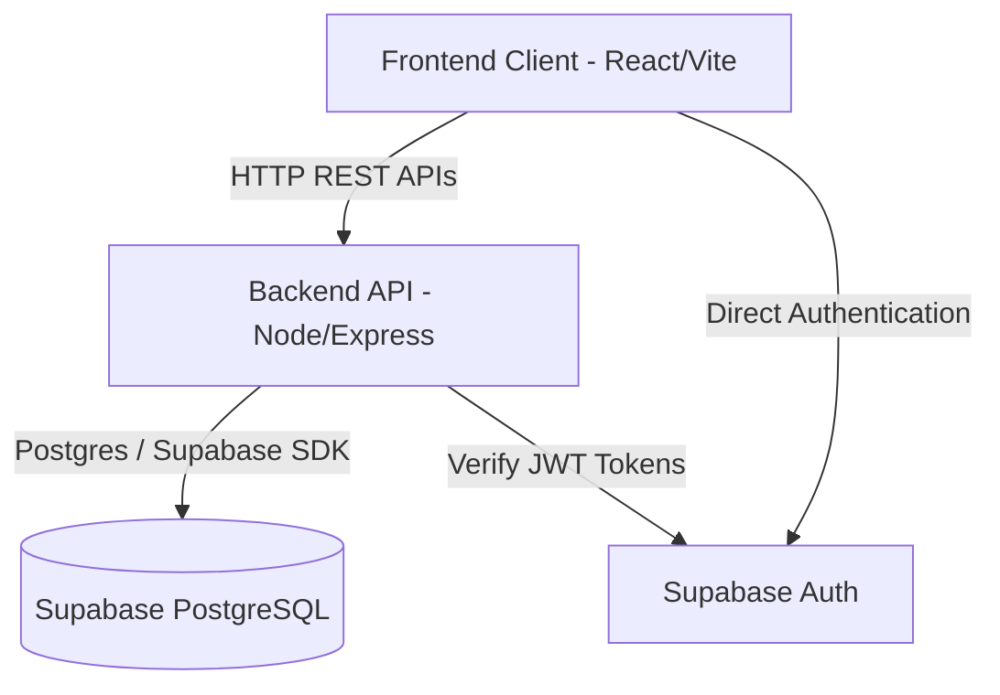

# Smart Micro-Logistics Management System

## 1. Project Overview
The **Smart Micro-Logistics Management System** is a unified, role-based single-page application (SPA) designed to seamlessly coordinate operations across Customers, Local Vendors (Sellers), Delivery Partners, and System Administrators.

**Problem Solved:** Localized retail and logistics are often fragmented, relying on manual coordination, phone calls, and disparate tools. 
**Solution & Benefits:** This platform provides a centralized hub to manage vendor catalogs, process customer orders, aggregate deliveries into optimized batches, and grant role-specific access—improving efficiency, transparency, and operational speed.

---

## 2. Features
The platform delivers dedicated interfaces based on the user's role:

- **Admin Portal**: Comprehensive vendor management (approval, suspension), customer oversight, delivery-partner management, and system-wide monitoring.
- **Vendor/Seller Portal**: Robust product catalog management, real-time inventory tracking, order fulfillment, and a business performance dashboard.
- **Customer Portal**: A marketplace for browsing local vendors and products, placing orders, and scheduling deliveries.
- **Delivery Partner Portal**: A dedicated view for assigned delivery batches, routing information, and real-time delivery status updates.
- **Quick Demo Mode**: The login screen features four isolated "Quick Demo" options (Customer, Seller, Delivery, Admin). Demo mode is completely separated from real authentication; it uses local mock data to allow immediate exploration of the UI without accessing, exposing, or modifying any real production data.

*(Note: Certain advanced routing optimizations or real-time GPS tracking features are planned for future iterations and are currently represented as static or foundational UI elements).*

---

## 3. Technology Stack
This project leverages a modern JavaScript stack for both the client and server:

- **Frontend**: React 19, Vite (for rapid bundling), Vanilla CSS, and React Router v7. Hosted and deployed via **Vercel**.
- **Backend**: Node.js and Express 5, utilizing Vitest for robust unit testing. Hosted and deployed via **Render**.
- **Database & Authentication**: **Supabase** (PostgreSQL) handles all relational data storage, while **Supabase Auth** provides secure, JWT-based user authentication.
- **Communication Tools**: Standard `fetch` API and `axios` are utilized for RESTful HTTP communication between the frontend and backend.

---

## 4. Project Architecture

### Architecture Diagram


### Folder Structure
```text
.
├── backend/
│   ├── src/
│   │   ├── config/          # Environment variables and Supabase client setup
│   │   ├── controllers/     # Core business logic for all routes
│   │   ├── middleware/      # Authentication validation and global error handling
│   │   ├── routes/          # Express API route definitions
│   │   ├── utils/           # Helper functions (e.g., ID mapping)
│   │   ├── app.js           # Express application configuration
│   │   └── server.js        # Backend entry point
│   ├── tests/               # Vitest test suites
│   └── package.json         # Backend dependencies
├── src/
│   ├── auth/                # Login pages, routing logic, and identity resolution
│   ├── components/          # Reusable UI elements (buttons, modals, badges)
│   ├── context/             # Global React Context (AppContext, DeliveryContext)
│   ├── layouts/             # Structural layouts for dashboards
│   ├── portals/             # Segmented UIs (Admin, Customer, Delivery, Seller)
│   ├── styles/              # Global and scoped CSS files
│   ├── App.jsx              # Application router and protected route wrappers
│   └── main.jsx             # React entry point
├── package.json             # Frontend dependencies
└── vite.config.js           # Vite build configuration
```

---

## 5. Installation and Local Setup
Follow these steps to run the project locally. These instructions assume a **Windows PowerShell** environment.

**1. Clone the repository**
```powershell
git clone https://github.com/abishekasivaram/Micro-Logistics.git
cd Micro-Logistics
```

**2. Install Frontend Dependencies**
```powershell
npm install
```

**3. Install Backend Dependencies**
```powershell
cd backend
npm install
cd ..
```

**4. Configure Environment Variables**
Create the necessary `.env` files (See Section 6 for details).

**5. Start the Backend Server**
Open a new PowerShell terminal:
```powershell
cd backend
npm run dev
```

**6. Start the Frontend Development Server**
Open a second PowerShell terminal from the project root:
```powershell
npm run dev
```

**7. Run Backend Tests**
```powershell
cd backend
npm run test
```

**8. Create a Production Frontend Build**
From the project root:
```powershell
npm run build
```

---

## 6. Environment Variables and Security
**CRITICAL:** Environment variables contain sensitive keys. Never commit `.env` files or generated credential manifests (e.g., `backend/secure_credentials.txt`) to Git. Ensure they remain listed in `.gitignore`.

You will need two separate `.env` files. Use the placeholders below to structure them:

**1. Frontend Configuration (`.env` in the root directory):**
```env
# Backend API connection
VITE_API_BASE_URL=http://localhost:5000/api/v1

# Supabase Public Keys
VITE_SUPABASE_URL=https://<YOUR-PROJECT-ID>.supabase.co
VITE_SUPABASE_ANON_KEY=eyJhbGci...<YOUR-ANON-KEY>...
```

**2. Backend Configuration (`backend/.env` in the backend directory):**
```env
PORT=5000
FRONTEND_URL=http://localhost:5173

# Supabase Admin Keys
SUPABASE_URL=https://<YOUR-PROJECT-ID>.supabase.co
SUPABASE_SERVICE_ROLE_KEY=eyJhbGci...<YOUR-SERVICE-ROLE-KEY>...
```

---

## 7. Authentication and Test Accounts
The platform employs two completely distinct methods for accessing the UI:

1. **Quick Demo Access**: Designed for rapid UI exploration. By clicking a "Demo" button on the login screen, the app enters an isolated offline state. It loads dummy data entirely locally, completely bypassing real database queries and ensuring production data remains secure and unseen.
2. **Real Supabase Authentication**: Real users log in through the main form. The login field is highly flexible and accepts an **Email**, **Username**, or **Shop Name**. If a username or shop name is provided, the frontend hits the backend `/api/v1/auth/resolve` endpoint to securely map the identifier to the registered email address, which is then used to authenticate via Supabase Auth.

**Account Provisioning & Passwords:**
For security, passwords are never stored in plain text or hardcoded in the repository. 
- If a password is unknown, it must be reset securely via the Supabase Dashboard.
- When bulk provisioning accounts, temporary passwords are generated locally (e.g., into `backend/secure_credentials.txt`). These manifests must be distributed via secure private channels and users should change their passwords upon their first login.

---

## 8. Database and API

### Core Database Tables
The application relies on a strictly structured Supabase PostgreSQL database:
- `profiles`: The central identity table linking Supabase Auth UUIDs to roles (admin, customer, vendor, delivery_partner).
- `vendors`: Vendor business information (shop names, locations, operating hours).
- `customer_profiles`: Extended customer data (delivery addresses, active order counts).
- `delivery_agents`: Delivery partner metadata (current area, vehicle, capacity).
- `products`: Vendor inventory and catalog details.
- `orders`: Transactional records of customer purchases.
- `delivery_batches`: Aggregated delivery tasks for optimized last-mile routing.

### Key API Routes
All backend routes are prefixed with `/api/v1`.
- **Health**: `GET /health` (Server status), `GET /health/db` (Database connectivity)
- **Authentication**: `POST /auth/resolve` (Identity resolution for login)
- **Products**: `GET /products` (Fetch global active catalog)
- **Vendors**: `GET /vendors` (Fetch verified sellers)
- **Orders**: `GET /orders` (List orders), `POST /orders` (Create new order), `PATCH /orders/:id/status` (Update progression)
- **Deliveries**: `GET /delivery/batches` (List assigned batches), `POST /delivery/batches` (Admin aggregation action)
