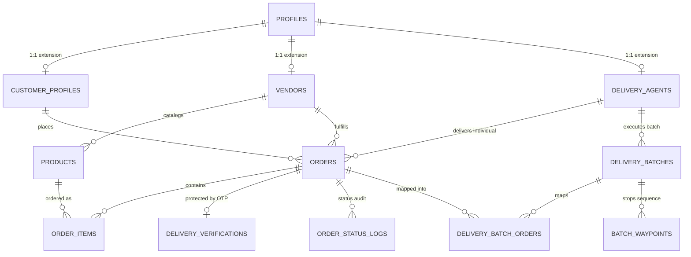

# Aggregation & Delivery Gap Analysis: Current vs Required Architecture
**Project:** Micro-Logistics Management and Local E-Commerce Order Aggregation Network  
**Target Environment:** Node.js 20, Express 5.2.1, React 19, Supabase PostgreSQL  
**Document Purpose:** In-depth technical gap analysis comparing current codebase behavior against required system workflow, identifying architectural deficiencies, and auditing database security.

---

## 1. Required System Workflow (Intended Architecture)

The central objective of the **Micro-Logistics Management and Local E-Commerce Order Aggregation Network** is to reduce hyper-local delivery costs, minimize delivery courier transit distance, and improve order fulfillment predictability for neighborhood merchants through **spatio-temporal order grouping and coordinated multi-stop dispatch**.

To achieve a defensible, production-viable final-year implementation within realistic development constraints, the system must separate **Mandatory Core Capabilities** from **Optional Advanced Enhancements**.

### 1.1 Scope Boundaries

```mermaid
graph TD
    subgraph Mandatory Core Scope (Essential for Demonstration)
        M1[Real Zone & Pincode-Based Spatial Matching]
        M2[Time-Window Overlap Compatibility Engine]
        M3[Server-Side Batch Creation with Concurrency Locks]
        M4[Vehicle Capacity vs Order Count Assignment Guard]
        M5[Multi-Stop Pickup & Drop Sequencing]
        M6[Full API Integration for Delivery Portal]
        M7[Strict Non-Bypassable OTP Handover at Doorstep]
        M8[Automatic Batch & Order Status Cascade]
        M9[Order Cancellation & Stock Restoration Recovery]
    end

    subgraph Optional Future Scope (Not Blocker for Defense)
        O1[Autonomous Cron/Worker Dispatch Without Admin]
        O2[Real-Time WebSocket GPS Telematics & Breadcrumbs]
        O3[Live Dynamic Travelling Salesperson TSP API Engine]
        O4[Machine Learning Predictive Demand Clustering]
        O5[Automated In-Transit Rerouting]
    end

    M1 --> M3
    M2 --> M3
    M3 --> M4
    M4 --> M5
    M5 --> M6
    M6 --> M7
    M7 --> M8
```

### 1.2 Mandatory Core Workflow Specifications

1. **Structured Order Ingestion & Address Normalization:**
   - Orders must capture structured spatial metadata: destination zone or postal code, validated pickup hub location, delivery date, and standardized 4-hour delivery time window.
   - Pricing must be derived exclusively from trusted database catalog snapshots; client pricing is discarded.
2. **Deterministic Order Aggregation Engine:**
   - Eligibility: Orders must be in `READY_FOR_DELIVERY` (or verified `PREPARING` within SLA), unbatched (`batch_id IS NULL`), and active (`order_status != 'CANCELLED'`).
   - Spatial Clustering: Grouping must require either identical neighborhood zones or adjacent postal codes within a predefined radius ($\le 3.5$ km).
   - Temporal Clustering: Time windows must match or share a minimum 1-hour overlap.
   - Batch Ceiling: Strict ceiling of $N$ orders per batch (default 3–5) to prevent delivery partner overloading.
3. **Atomic Batch Creation & Concurrency Guard:**
   - When an aggregation recommendation is approved, batch creation must execute in a database transaction (`BEGIN ... COMMIT`) or check that all candidate orders still have `batch_id IS NULL`.
   - Prevent duplicate batching if two dispatchers review recommendations simultaneously.
4. **Fleet Assignment with Capacity Validation:**
   - An agent cannot be assigned a batch exceeding their registered vehicle parcel capacity (`orders.length <= delivery_agents.capacity`).
   - Agent status must transition from `Available` to `On Delivery` upon assignment.
5. **Multi-Stop Route Generation & Synchronization:**
   - For a batch containing $V$ distinct vendors and $C$ distinct customers, the system must generate a logical stop sequence:
     $$\text{Stop 1 to } V: \text{Pickups at Vendor Hubs} \longrightarrow \text{Stop } V+1 \text{ to } V+C: \text{Deliveries to Customers}$$
   - Waypoints must be persisted in `batch_waypoints` with sequence indices so the delivery partner sees a clear itinerary.
6. **Delivery Partner App Real API Integration:**
   - The driver portal must fetch live assigned batches from `GET /api/v1/delivery/batches`, retrieve waypoints, update stop progress, and transmit status changes directly to the backend.
7. **Strict Doorstep Verification (Zero-Bypass OTP):**
   - The courier cannot mark an individual order `DELIVERED` without submitting the correct 4-digit OTP supplied by the customer.
   - Batch status cannot transition to `COMPLETED` until **all member orders** have been verified and marked `DELIVERED`. Direct completion of a batch without order-level verification must be blocked.
8. **Failure & Cancellation Recovery Path:**
   - If an order is cancelled prior to dispatch, its reserved items must be returned to `products.stock`.
   - If an order cannot be delivered at the doorstep (customer absent), the courier must log a `FAILED` transition with a structured failure reason, leaving the batch open for remaining drops and staging the failed parcel for return to vendor.

---

## 2. Current vs Required Comparison: Detailed Gap Matrix

The following table details every identified architectural, algorithmic, and security gap between the current codebase and the required system workflow.

| # | Feature / Workflow Step | Current Implementation | Required Behavior | Evidence & Source File | Gap / Defect | Severity | Dependencies | Recommended Correction | Acceptance Criteria | Test Required to Verify |
| :---: | :--- | :--- | :--- | :--- | :--- | :---: | :--- | :--- | :--- | :--- |
| **G-01** | **Delivery Portal Backend Integration** | Uses `DeliveryContext.jsx` with static mock objects (`INITIAL_ACTIVE_BATCH`). No Axios calls to backend. | Delivery app must consume real backend endpoints (`/delivery/batches`, `/delivery/verify-otp`, `/orders/:id/status`). | [DeliveryContext.jsx:93-98](file:///c:/Users/Admin/Desktop/Micro-Logistics/src/context/DeliveryContext.jsx#L93-L98), [RoutePage.jsx:14-16](file:///c:/Users/Admin/Desktop/Micro-Logistics/src/portals/delivery/RoutePage.jsx#L14-L16) | **Complete Disconnect:** Delivery partner UI operates in complete isolation from the live Express backend and live database. | **CRITICAL** | Backend `/delivery` routes | Refactor `DeliveryContext.jsx` to consume `src/services/api.js` and sync with `AppContext`. | Courier sees live assigned batches in DB; status updates mutate live PostgreSQL tables. | Integration test asserting courier status update alters `orders` row in DB. |
| **G-02** | **OTP Verification Bypass in Batch Completion** | Calling `PATCH /delivery/batches/:id/status` with `Completed` marks all member orders `DELIVERED` with zero OTP checks. | Batch completion must require 100% of member orders to be individually verified via OTP first. Batch cannot be force-completed. | [delivery.controller.js:199-205](file:///c:/Users/Admin/Desktop/Micro-Logistics/backend/src/controllers/delivery.controller.js#L199-L205), [DeliveryManagementPage.jsx:36-39](file:///c:/Users/Admin/Desktop/Micro-Logistics/src/portals/admin/DeliveryManagementPage.jsx#L36-L39) | **Security Hole:** Couriers or admins can bypass customer handover verification and forge delivery proof by completing the batch. | **CRITICAL** | `delivery.controller.js` | In `updateBatchStatus`, if `status === 'COMPLETED'`, query member orders and reject with HTTP 400 if any order is not already `DELIVERED`. | Attempting to complete a batch with unverified orders returns HTTP 400 error. | Vitest test attempting batch completion on unverified orders. |
| **G-03** | **OTP Fallback Derivation Security Flaw** | If `delivery_verifications` query fails or record missing, OTP is deterministically calculated from `order_code`. | OTP must strictly originate from cryptographically secure random generator in database. Never fall back to deterministic hash. | [delivery.controller.js:367-369](file:///c:/Users/Admin/Desktop/Micro-Logistics/backend/src/controllers/delivery.controller.js#L367-L369), [delivery.controller.js:439-444](file:///c:/Users/Admin/Desktop/Micro-Logistics/backend/src/controllers/delivery.controller.js#L439-L444) | **Predictable PIN:** Anyone with the order receipt or code can compute the PIN and steal the parcel without customer consent. | **HIGH** | `delivery_verifications` table | Remove deterministic fallback hash. If verification record is absent, fail safe and return HTTP 400/500 requiring support intervention. | Submitting calculated hash against order without DB record fails with HTTP 400. | Unit test verifying invalid/arbitrary PINs are rejected. |
| **G-04** | **Geographic Clustering Logic Flaw** | Addresses extracted via naive comma split. Orders grouped if `primaryArea === targetArea` OR `primarySlot === targetSlot`. | Spatial proximity must be mandatory. Matching time slot alone must NEVER bundle orders in distant zones. | [aggregationUtils.js:122-124](file:///c:/Users/Admin/Desktop/Micro-Logistics/src/utils/aggregationUtils.js#L122-L124) | **Logical Flaw:** The `||` condition groups orders 40 km apart simply because both chose the "9 AM – 1 PM" slot! | **HIGH** | `aggregationUtils.js` | Change condition from `||` to `&&`: orders must share compatible time slots AND compatible geographic zones/neighborhoods. | Orders with same slot but different areas (e.g. "Adyar" vs "Anna Nagar") are never batched. | Unit test with orders in distinct zones verifying they are not grouped. |
| **G-05** | **Batch Creation Concurrency & Duplicate Batching** | `createBatch` in backend inserts batch and updates orders sequentially without checking if orders were already batched. | Backend must enforce atomic check: verify all requested order IDs currently have `batch_id IS NULL`. | [delivery.controller.js:104-112](file:///c:/Users/Admin/Desktop/Micro-Logistics/backend/src/controllers/delivery.controller.js#L104-L112) | **Race Condition:** Two concurrent admin requests can assign the same order to multiple batches simultaneously. | **HIGH** | PostgreSQL transactions | Add SQL check `WHERE id IN (...) AND batch_id IS NULL`. If count mismatch, abort with HTTP 409 Conflict. | Submitting duplicate batch request fails gracefully without corrupting order mapping. | Concurrency integration test with two simultaneous batch creation requests. |
| **G-06** | **Cancellation Stock Restoration Missing** | Cancelling an order sets `order_status = 'CANCELLED'` but never increments `products.stock`. | Order cancellation must release reserved quantities and restore `products.stock`. | [order.controller.js:302-315](file:///c:/Users/Admin/Desktop/Micro-Logistics/backend/src/controllers/order.controller.js#L302-L315) | **Inventory Leak:** Cancelled orders cause permanent inventory phantom depletion. | **MEDIUM** | `order_items`, `products` | In `updateOrderStatus`, if `status === 'CANCELLED'`, iterate over `order_items` and add `qty` back to `products.stock`. | Cancelling order ORD-123 increases product inventory by ordered quantity. | Vitest test cancelling order and asserting stock restoration. |
| **G-07** | **Waypoint Generation & Persistence Missing** | Table `batch_waypoints` exists in PostgreSQL schema but is never populated by backend. Frontend generates ad-hoc SVG nodes. | When a batch is created, backend must generate and insert waypoints into `batch_waypoints` (Pickups $\rightarrow$ Deliveries). | [0001_initial_schema.sql:102-113](file:///c:/Users/Admin/Desktop/Micro-Logistics/backend/supabase/migrations/0001_initial_schema.sql#L102-L113), [delivery.controller.js:84-124](file:///c:/Users/Admin/Desktop/Micro-Logistics/backend/src/controllers/delivery.controller.js#L84-L124) | **Unused Schema & Ephemeral Routes:** Courier cannot see persistent sequence of stops; manual reordering in UI is lost on refresh. | **MEDIUM** | `batch_waypoints` table | Populate `batch_waypoints` in `delivery.controller.js:createBatch` with sequential `sequence_index`, stop type, and coordinates. | Querying `/delivery/batches/:id` returns ordered array of waypoints from database. | API test asserting `batch_waypoints` contains correct ordered pickup and drop stops. |
| **G-08** | **Courier Capacity Validation Missing** | Admin can assign a batch with 10 orders to a courier with a registered capacity of 3 parcels on a bicycle. | Assignment endpoint must check `batch.order_count <= agent.capacity`. | [delivery.controller.js:126-150](file:///c:/Users/Admin/Desktop/Micro-Logistics/backend/src/controllers/delivery.controller.js#L126-L150) | **Physical Overload:** Violates real micro-logistics physical constraints. | **MEDIUM** | `delivery_agents.capacity` | In `assignBatch`, fetch agent capacity and reject with HTTP 400 if batch size exceeds agent limit. | Assigning 5-order batch to agent with capacity 3 returns HTTP 400 error. | Unit test attempting oversized batch assignment. |
| **G-09** | **Client-Side Only Aggregation Execution** | Aggregation logic resides entirely in `src/utils/aggregationUtils.js` and runs only when Admin visits page. | Aggregation should have a backend service endpoint (`POST /api/v1/delivery/aggregate`) so it can run on demand or via background job. | [OrderAggregationPage.jsx:93](file:///c:/Users/Admin/Desktop/Micro-Logistics/src/portals/admin/OrderAggregationPage.jsx#L93) | **No Autonomous Backend Capability:** System cannot compute aggregations headless or support background scheduling. | **MEDIUM** | Backend Express routes | Port `findSuitableOrderGroups` logic into a backend `aggregation.service.js` and expose via API. | Admin UI fetches computed groups from backend rather than running in client memory. | Automated backend test evaluating aggregation output against test order dataset. |
| **G-10** | **Unapplied RLS Hardening Migration** | `0003_complete_rls_hardening.sql` contains essential security policies and triggers but is unapplied on remote Supabase. | Database tables must enforce Row-Level Security so direct PostgREST calls cannot bypass backend business rules. | [0003_complete_rls_hardening.sql:1-350](file:///c:/Users/Admin/Desktop/Micro-Logistics/backend/supabase/migrations/0003_complete_rls_hardening.sql#L1-L350) | **Direct Access Exposure:** If anonymous clients connect directly to Supabase URL, tables lack hardened policies. | **HIGH** | Supabase database instance | Review and test `0003` migration in staging before executing against live Supabase instance. | Direct PostgREST queries by non-admin are restricted to own rows. | Security audit test verifying RLS prevents unauthorized row reads. |

---

### 2.1 Impact of In-Flight Customer and Vendor Changes

Recent modifications in the Customer and Vendor modules impact the core aggregation and delivery workflows as follows:

1. **Customer Module Address Normalization:**
   - *Current State:* The customer profile and checkout were recently updated to capture structured address fields (`address`, `area`, `phone`, `deliveryLocation`).
   - *Impact on Aggregation:* **Direct positive impact.** If customer addresses supply standardized `area` strings (e.g., "T. Nagar", "Velachery", "Adyar"), `aggregationUtils.js` extracts consistent neighborhood tokens instead of falling back to `"Central Zone"`.
   - *Risk:* If the checkout form allows freeform unvalidated text without area tagging, spatial clustering will fail and produce low compatibility scores ($< 70\%$).
2. **Vendor Module Preparation Staging & `sellerUtils.js`:**
   - *Current State:* The vendor portal was refactored with `sellerUtils.js` and order status buttons for `PREPARING` and `READY_FOR_DELIVERY`. Handover requires an assigned courier.
   - *Impact on Aggregation:* **Direct operational dependency.** The aggregation algorithm specifically rewards orders marked `READY_FOR_DELIVERY` with $+10$ points. If vendors do not advance orders from `CONFIRMED` to `READY_FOR_DELIVERY`, aggregation recommendations score lower and indicate unready orders.
   - *Risk:* If a vendor marks an order `HANDED_OVER` before the courier is physically dispatched, the delivery status becomes `PICKED_UP` prematurely.

---

## 3. Database Schema, Query & Security Analysis

### 3.1 Entity Relationship Architecture

The database comprises 21 tables across two applied migrations (`0001_initial_schema.sql` and `0002_extended_schema.sql`).



#### Core Entities Summary
1. **`profiles`** (`id` UUID PRIMARY KEY $\rightarrow$ `auth.users`, `email`, `role`, `username`, `phone`).
2. **`customer_profiles`** (`id` UUID PRIMARY KEY $\rightarrow$ `profiles`, `legacy_id`, `address`, `city`, `pincode`).
3. **`vendors`** (`id` UUID PRIMARY KEY $\rightarrow$ `profiles`, `legacy_id`, `shop_name`, `address`, `status`, `rating`).
4. **`delivery_agents`** (`id` UUID PRIMARY KEY $\rightarrow$ `profiles`, `legacy_id`, `vehicle`, `capacity`, `current_area`, `status`, `availability`).
5. **`products`** (`id` UUID PRIMARY KEY, `vendor_id` $\rightarrow$ `vendors`, `name`, `price`, `stock`, `status`, `category`).
6. **`orders`** (`id` UUID PRIMARY KEY, `order_code` UNIQUE, `customer_id` $\rightarrow$ `customer_profiles`, `vendor_id` $\rightarrow$ `vendors`, `batch_id` $\rightarrow$ `delivery_batches`, `assigned_agent_id` $\rightarrow$ `delivery_agents`, `total`, `order_status`, `delivery_status`, `aggregation_status`, `delivery_date`, `delivery_time_slot`).
7. **`order_items`** (`id` UUID PRIMARY KEY, `order_id` $\rightarrow$ `orders`, `product_id` $\rightarrow$ `products`, `qty`, `price`).
8. **`delivery_batches`** (`id` UUID PRIMARY KEY, `batch_code` UNIQUE, `agent_id` $\rightarrow$ `delivery_agents`, `order_count`, `estimated_distance`, `estimated_time`, `status`, `aggregation_status`).
9. **`delivery_batch_orders`** (`id` UUID PRIMARY KEY, `batch_id` $\rightarrow$ `delivery_batches`, `order_id` $\rightarrow$ `orders`).
10. **`batch_waypoints`** (`id` UUID PRIMARY KEY, `batch_id` $\rightarrow$ `delivery_batches`, `sequence_index`, `stop_type`, `location`, `latitude`, `longitude`, `eta`, `is_completed`).
11. **`delivery_verifications`** (`id` UUID PRIMARY KEY, `order_id` $\rightarrow$ `orders`, `otp_code`, `is_verified`, `attempts`, `verified_at`).
12. **`order_status_logs`** (`id` UUID PRIMARY KEY, `order_id` $\rightarrow$ `orders`, `previous_status`, `new_status`, `notes`).

---

### 3.2 Inconsistencies: Frontend Assumptions vs Backend Queries vs Schema

| Inconsistency | Frontend Assumption | Backend Query Implementation | Database Schema Reality | Impact / Risk |
| :--- | :--- | :--- | :--- | :--- |
| **Batch Waypoints** | Assumes stops are stored or can be re-ordered. | Controller never queries or writes `batch_waypoints`. | Table `batch_waypoints` exists with complete columns. | Waypoint sequences are not persisted; stops regenerate synthetically on client reload. |
| **Address Entity** | `CartPage` sends freeform string `deliveryLocation: "12 Main St, Adyar"`. | Inserts string directly into `orders.delivery_location`. | Table `customer_addresses` exists in `0002` schema but is bypassed. | Structured coordinates (`lat`, `lng`, `pincode`) are not captured for orders. |
| **Identifier Formats** | Mixes `legacy_id` (e.g. `da-01`, `c-101`) and UUIDs (`550e8400-...`). | Controllers contain branching logic: `if (id.includes('-') && id.length > 15) ... else eq('legacy_id', id)`. | Tables have both `id` (UUID PK) and `legacy_id` (VARCHAR UNIQUE). | High complexity in query joins; potential edge cases when searching across foreign keys. |
| **Batch Completion** | Admin clicks "Complete Batch" expecting order statuses to update. | Updates batch and forcefully overwrites member orders to `DELIVERED`. | Orders have individual `delivery_status` and OTP verification records. | Completely bypasses customer OTP verification at the doorstep. |
| **Stock on Cancel** | Frontend shows "Order Cancelled". | `updateOrderStatus` updates `orders.order_status = 'CANCELLED'`. | No trigger exists in database to restore stock. | Phantom inventory depletion: cancelled items are permanently missing from inventory. |

---

### 3.3 Audit of Unapplied Migration `0003_complete_rls_hardening.sql`

The migration `backend/supabase/migrations/0003_complete_rls_hardening.sql` was authored to harden database-level security by enabling PostgreSQL Row-Level Security on all 21 tables.

#### Current Status
- **UNAPPLIED ON LIVE SUPABASE.**
- Active database security currently relies entirely on the Node.js Express backend using `SUPABASE_SERVICE_ROLE_KEY` to execute queries with administrative privileges.
- Direct PostgREST access via the public anonymous key (`VITE_SUPABASE_ANON_KEY`) is largely unrestricted on tables without active policies.

#### Technical Audit Findings in `0003`

1. **Trusted Caller Validation Helper:**
   ```sql
   CREATE OR REPLACE FUNCTION public.is_trusted_backend_or_admin()
   RETURNS boolean AS $$
   BEGIN
     RETURN (
       auth.jwt() ->> 'role' = 'service_role' OR
       auth.jwt() -> 'app_metadata' ->> 'role' = 'service_role' OR
       EXISTS (
         SELECT 1 FROM public.profiles
         WHERE profiles.id = auth.uid() AND profiles.role = 'admin'
       )
     );
   END;
   $$ LANGUAGE plpgsql SECURITY DEFINER SET search_path = public, pg_temp;
   ```
   - *Assessment:* Well-formed. Uses `SECURITY DEFINER` with fixed `search_path` (`public, pg_temp`), correctly mitigating search path hijacking. Reliably distinguishes service-role calls from client sessions.
2. **Profile Role Escalation Protection:**
   - Function `check_profile_integrity()` checks `OLD.role != NEW.role`.
   - Prevents users from executing direct SQL/PostgREST updates to grant themselves the `admin` role.
3. **Recursive RLS Avoidance:**
   - The policy `profiles_update_own_or_admin` avoids recursive subqueries by evaluating `auth.uid() = id` for own updates, delegating admin role checks to the `SECURITY DEFINER` helper.
4. **Order State Transition Trigger (`check_order_update_integrity`):**
   - Validates that non-admin callers cannot illegally alter `customer_id`, `total`, or jump to `DELIVERED` without satisfying status transition rules.
5. **Remaining Blocker Before Application:**
   - **Column Privilege Conflicts:** `0003` includes `REVOKE UPDATE ON orders FROM authenticated` followed by `GRANT UPDATE (notes) TO authenticated`. If applied while the frontend makes direct Supabase calls (in offline or demo fallback), frontend calls will fail with PostgreSQL permission denied errors.
   - **Recommendation:** Do NOT apply `0003` directly to production without testing on an isolated Supabase branch. Because the application currently routes all production traffic through the Express backend service-role key, applying `0003` immediately could break client direct subscriptions if any exist.
