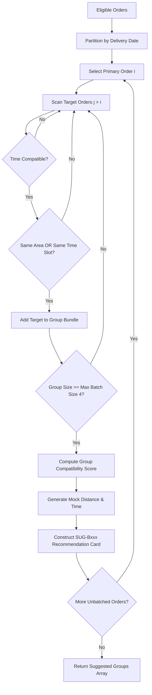

# Complete Current System Workflow & Technical Inventory
**Project:** Micro-Logistics Management and Local E-Commerce Order Aggregation Network  
**Repository Branch:** `main` | **Target Environment:** Node.js 20, Express 5.2.1, React 19, Supabase PostgreSQL  
**Document Purpose:** Complete technical inventory and end-to-end workflow inspection for engineering handoff and gap analysis.

---

## 1. Actual System Inventory

This inventory documents all verified software artifacts, entrypoints, controllers, database entities, environment configurations, and test suites currently present in the codebase.

### 1.1 Frontend Architecture (`src/`)

The client is a single-page application built on **React 19.0.0** and **Vite 6.2.0**, bundled using ESM and styled using vanilla CSS design tokens (`src/styles/design-tokens.css`, `src/styles/global.css`, `src/styles/variables.css`). Navigation is governed by **React Router DOM 7.2.0** (`src/App.jsx`).

#### A. Portals and Page Components
| Portal | Route Path | Component File | Key Capabilities & Verification Status |
| :--- | :--- | :--- | :--- |
| **Auth** | `/` | [LandingPage.jsx](file:///c:/Users/Admin/Desktop/Micro-Logistics/src/auth/LandingPage.jsx) | Public landing page, role selection cards, CTA buttons. |
| **Auth** | `/login` | [LoginPage.jsx](file:///c:/Users/Admin/Desktop/Micro-Logistics/src/auth/LoginPage.jsx) | Role selector (`customer`, `vendor`, `delivery_partner`, `admin`), email/password inputs, demo login shortcuts. Calls `POST /api/v1/auth/resolve` and Supabase Auth. |
| **Auth** | `/register-customer` | [CustomerRegisterPage.jsx](file:///c:/Users/Admin/Desktop/Micro-Logistics/src/auth/CustomerRegisterPage.jsx) | Customer signup form; invokes Supabase `auth.signUp` and creates customer profile. |
| **Auth** | `/register-seller` | [SellerRegisterPage.jsx](file:///c:/Users/Admin/Desktop/Micro-Logistics/src/auth/SellerRegisterPage.jsx) | Seller signup form; collects shop metadata, address, contact information. |
| **Customer** | `/customer` | [CustomerDashboard.jsx](file:///c:/Users/Admin/Desktop/Micro-Logistics/src/portals/customer/CustomerDashboard.jsx) | Metrics, active orders preview, popular local vendors list, fast re-order. |
| **Customer** | `/customer/browse` | [BrowseSellersPage.jsx](file:///c:/Users/Admin/Desktop/Micro-Logistics/src/portals/customer/BrowseSellersPage.jsx) | Catalog browsing, vendor filtering, product search, cart quantity adjustments. |
| **Customer** | `/customer/cart` | [CartPage.jsx](file:///c:/Users/Admin/Desktop/Micro-Logistics/src/portals/customer/CartPage.jsx) | Multi-vendor cart view with delivery slot picker, delivery address selection, subtotal calculation. |
| **Customer** | `/customer/checkout` | [CheckoutPage.jsx](file:///c:/Users/Admin/Desktop/Micro-Logistics/src/portals/customer/CheckoutPage.jsx) | Address verification, delivery time-slot selector, order placement calling `POST /api/v1/orders`. |
| **Customer** | `/customer/track` | [TrackDeliveryPage.jsx](file:///c:/Users/Admin/Desktop/Micro-Logistics/src/portals/customer/TrackDeliveryPage.jsx) | 5-stage milestone tracking timeline, courier contact, secret OTP display fetched from `GET /api/v1/delivery/orders/:id/otp`. |
| **Customer** | `/customer/orders` | [OrdersPage.jsx](file:///c:/Users/Admin/Desktop/Micro-Logistics/src/portals/customer/OrdersPage.jsx) | Historical and live customer order table with status badges and detail modals. |
| **Customer** | `/customer/schedule` | [DeliverySchedulePage.jsx](file:///c:/Users/Admin/Desktop/Micro-Logistics/src/portals/customer/DeliverySchedulePage.jsx) | Slot modification requests calling `PATCH /api/v1/orders/:id/status`. |
| **Customer** | `/customer/profile` | [ProfilePage.jsx](file:///c:/Users/Admin/Desktop/Micro-Logistics/src/portals/customer/ProfilePage.jsx) | Address, name, phone, delivery preferences management. |
| **Seller** | `/seller` | [DashboardOverview.jsx](file:///c:/Users/Admin/Desktop/Micro-Logistics/src/portals/seller/DashboardOverview.jsx) | Live revenue, pending preparation count, stock alerts, quick fulfillment shortcuts. |
| **Seller** | `/seller/orders` | [OrdersPage.jsx](file:///c:/Users/Admin/Desktop/Micro-Logistics/src/portals/seller/OrdersPage.jsx) | Incoming order queue. Transitions orders: `CONFIRMED` $\rightarrow$ `PREPARING` $\rightarrow$ `READY_FOR_DELIVERY` $\rightarrow$ `HANDED_OVER`. |
| **Seller** | `/seller/products` | [ProductsPage.jsx](file:///c:/Users/Admin/Desktop/Micro-Logistics/src/portals/seller/ProductsPage.jsx) | Catalog management: add/edit items, pricing, inventory threshold, availability toggle. |
| **Seller** | `/seller/inventory` | [InventoryPage.jsx](file:///c:/Users/Admin/Desktop/Micro-Logistics/src/portals/seller/InventoryPage.jsx) | Stock count adjustment, batch stock updates, depletion indicators. |
| **Seller** | `/seller/deliveries` | [DeliveriesPage.jsx](file:///c:/Users/Admin/Desktop/Micro-Logistics/src/portals/seller/DeliveriesPage.jsx) | Dispatch staging overview; monitors driver pickup assignments. |
| **Seller** | `/seller/analytics` | [SellerAnalyticsPage.jsx](file:///c:/Users/Admin/Desktop/Micro-Logistics/src/portals/seller/SellerAnalyticsPage.jsx) | Sales trends, top products, order volume by time-slot. |
| **Seller** | `/seller/profile` | [BusinessProfilePage.jsx](file:///c:/Users/Admin/Desktop/Micro-Logistics/src/portals/seller/BusinessProfilePage.jsx) | Shop address, operating hours, delivery radius, contact info. |
| **Admin** | `/admin` | [AdminDashboard.jsx](file:///c:/Users/Admin/Desktop/Micro-Logistics/src/portals/admin/AdminDashboard.jsx) | System-wide KPI cards, active batch summary, delivery partner status overview. |
| **Admin** | `/admin/order-aggregation` | [OrderAggregationPage.jsx](file:///c:/Users/Admin/Desktop/Micro-Logistics/src/portals/admin/OrderAggregationPage.jsx) | Evaluates unassigned orders using `findSuitableOrderGroups`, displays match percentage rings (60%–98%), triggers batch creation `POST /api/v1/delivery/batches`. |
| **Admin** | `/admin/delivery-management` | [DeliveryManagementPage.jsx](file:///c:/Users/Admin/Desktop/Micro-Logistics/src/portals/admin/DeliveryManagementPage.jsx) | Created batch queue, courier assignment modal (`POST /api/v1/delivery/batches/:id/assign`), manual batch status advancement. |
| **Admin** | `/admin/delivery-agents` | [DeliveryAgentsPage.jsx](file:///c:/Users/Admin/Desktop/Micro-Logistics/src/portals/admin/DeliveryAgentsPage.jsx) | Fleet roster, agent creation, vehicle/capacity updates, active assignment counters. |
| **Admin** | `/admin/orders` | [AdminCentralOrdersPage.jsx](file:///c:/Users/Admin/Desktop/Micro-Logistics/src/portals/admin/AdminCentralOrdersPage.jsx) | Global order audit table across all customers, vendors, and batches. |
| **Admin** | `/admin/routes` | [AdminRoutesPage.jsx](file:///c:/Users/Admin/Desktop/Micro-Logistics/src/portals/admin/AdminRoutesPage.jsx) | Spatial map visualization of delivery clusters using `GoogleRouteMap.jsx`. |
| **Admin** | `/admin/sellers` | [AdminSellersPage.jsx](file:///c:/Users/Admin/Desktop/Micro-Logistics/src/portals/admin/AdminSellersPage.jsx) | Vendor approval, status toggling (`Active` / `Suspended`). |
| **Admin** | `/admin/customers` | [AdminCustomersPage.jsx](file:///c:/Users/Admin/Desktop/Micro-Logistics/src/portals/admin/AdminCustomersPage.jsx) | Customer roster and order history inspection. |
| **Admin** | `/admin/settings` | [AdminSettingsPage.jsx](file:///c:/Users/Admin/Desktop/Micro-Logistics/src/portals/admin/AdminSettingsPage.jsx) | Aggregation threshold controls (max orders per batch, time-window tolerance). |
| **Delivery** | `/delivery` | [DeliveryDashboard.jsx](file:///c:/Users/Admin/Desktop/Micro-Logistics/src/portals/delivery/DeliveryDashboard.jsx) | Driver home screen, active batch summary, shift status, earnings summary. |
| **Delivery** | `/delivery/pickup` | [PickupPage.jsx](file:///c:/Users/Admin/Desktop/Micro-Logistics/src/portals/delivery/PickupPage.jsx) | Vendor pickup checklist; marks items collected from seller hubs. |
| **Delivery** | `/delivery/route` | [RoutePage.jsx](file:///c:/Users/Admin/Desktop/Micro-Logistics/src/portals/delivery/RoutePage.jsx) | Interactive stop checklist, stop re-sequencing buttons, external Google Maps link launcher. |
| **Delivery** | `/delivery/status` | [DeliveryStatusPage.jsx](file:///c:/Users/Admin/Desktop/Micro-Logistics/src/portals/delivery/DeliveryStatusPage.jsx) | Drop-off completion screen with OTP input and proof-of-delivery notes modal. |
| **Delivery** | `/delivery/history` | [DeliveryHistoryPage.jsx](file:///c:/Users/Admin/Desktop/Micro-Logistics/src/portals/delivery/DeliveryHistoryPage.jsx) | Archive of past completed and failed deliveries. |
| **Delivery** | `/delivery/profile` | [DeliveryProfilePage.jsx](file:///c:/Users/Admin/Desktop/Micro-Logistics/src/portals/delivery/DeliveryProfilePage.jsx) | Agent vehicle type, capacity, assigned operating zone, shift hours. |

#### B. State Management, Hooks & Context Providers
- **`src/context/AppContext.jsx`**: Central application state provider (1,047 lines). Manages `currentUser`, `orders`, `products`, `vendors`, `customers`, `deliveryAgents`, `deliveryBatches`, `notifications`, `adminSettings`. Interacts with Express API via Axios instance (`src/services/api.js`). Contains fallback demo data for unauthenticated evaluation.
- **`src/context/DeliveryContext.jsx`**: Isolated state provider dedicated to the delivery partner portal (249 lines). **Critical Architectural Note:** Operates on in-memory mock datasets (`INITIAL_ACTIVE_BATCH`, `INITIAL_HISTORICAL_ORDERS`) and does not invoke Axios API endpoints.
- **`src/context/CartContext.jsx`**: Manages cart state in `localStorage`, quantity increment/decrement, vendor-grouping logic.
- **`src/context/ThemeContext.jsx`**: Dark/light mode theme toggle persisting in `localStorage`.

#### C. Frontend Utilities & Shared Components
- **`src/utils/aggregationUtils.js`**: Core smart aggregation algorithm (`findSuitableOrderGroups`), slot compatibility checker (`areTimeSlotsCompatible`), address area parser (`extractArea`), status mapping helpers.
- **`src/utils/sellerUtils.js`**: Seller-specific calculations (revenue summation, order status filtering, fulfillment rate computation).
- **`src/components/common/GoogleRouteMap.jsx`**: Map visualization component. Checks `window.google.maps`; if Google Maps API key is absent, renders an SVG canvas with waypoint nodes and transit paths.
- **`src/components/common/ProtectedRoute.jsx`**: Enforces client-side route authorization checking `currentUser.role` against `allowedRoles`.

---

### 1.2 Backend Architecture (`backend/src/`)

The backend is built with **Node.js 20** and **Express 5.2.1** (transpiled TypeScript output in `backend/src/`). Security middleware includes **Helmet 8.0.0**, **CORS 2.8.5**, and **Zod 3.24.2** validation.

#### A. Entrypoint & Middleware Pipeline (`backend/src/index.js`)
1. Security headers via `helmet()`.
2. Cross-Origin Resource Sharing via `cors()` configured to allow client origins (`localhost:5173`, `localhost:3000`, and production domains).
3. Payload parsers: `express.json()` and `express.urlencoded({ extended: true })`.
4. Authentication middleware (`backend/src/middleware/auth.middleware.js`):
   - Extracts `Bearer <token>` from the `Authorization` header.
   - Validates JWT token against Supabase Auth (`supabase.auth.getUser(token)`).
   - Injects authenticated user record and role metadata into `req.user`.
5. Role authorization middleware (`backend/src/middleware/role.middleware.js`):
   - `requireRole(allowedRoles)`: Rejects requests with HTTP 403 Forbidden if `req.user.role` is not in the allowed list.
6. Error handling middleware (`backend/src/middleware/error.middleware.js`):
   - Catches unhandled exceptions, sanitizes error responses, and returns structured JSON `{ success: false, message: ... }`.

#### B. API Route Catalog & Controller Mapping
| HTTP Method | Route Endpoint | Middleware / Auth | Controller Handler | Database Operations |
| :--- | :--- | :--- | :--- | :--- |
| **POST** | `/api/v1/auth/resolve` | Public | `auth.controller.js:resolveUserIdentifier` | Queries `profiles` by email/username; resolves UUID and role. |
| **GET** | `/api/v1/orders` | `authenticateUser` | `order.controller.js:getOrders` | Selects from `orders` with joins (`customer_profiles`, `vendors`, `order_items`, `delivery_batches`, `delivery_agents`). Role-filtered. |
| **GET** | `/api/v1/orders/:id` | `authenticateUser` | `order.controller.js:getOrderById` | Single order lookup by UUID or `order_code`. Enforces customer/vendor/agent ownership. |
| **POST** | `/api/v1/orders` | `authenticateUser`, Customer/Admin | `order.controller.js:createOrder` | Validates catalog pricing from `products`, decrements stock, inserts into `orders`, `order_items`, and `delivery_verifications`. |
| **PATCH** | `/api/v1/orders/:id/status` | `authenticateUser` | `order.controller.js:updateOrderStatus` | Enforces role-specific transitions (vendor staging, admin override). Blocks direct delivery partner `DELIVERED` transition. |
| **GET** | `/api/v1/delivery/agents` | `authenticateUser`, Admin/Partner | `delivery.controller.js:getAgents` | Reads all `delivery_agents` joined with `profiles(username, phone)`. |
| **GET** | `/api/v1/delivery/agents/:id` | `authenticateUser` | `delivery.controller.js:getAgentById` | Single courier profile. Delivery partners restricted to own profile. |
| **POST** | `/api/v1/delivery/agents` | `authenticateUser`, Admin | `delivery.controller.js:createAgent` | Creates auth user via `supabase.auth.admin.createUser`, creates `profiles` record, inserts `delivery_agents`. |
| **PUT/PATCH** | `/api/v1/delivery/agents/:id` | `authenticateUser`, Admin/Partner | `delivery.controller.js:updateAgent` | Updates vehicle, capacity, current area, availability. |
| **GET** | `/api/v1/delivery/batches` | `authenticateUser` | `delivery.controller.js:getBatches` | Queries `delivery_batches` joined with `delivery_agents` and `orders`. Filtered to assigned agent for delivery partners. |
| **GET** | `/api/v1/delivery/batches/:id` | `authenticateUser` | `delivery.controller.js:getBatchById` | Single batch details by `batch_code`. |
| **POST** | `/api/v1/delivery/batches` | `authenticateUser`, Admin | `delivery.controller.js:createBatch` | Generates `batch_code`, inserts `delivery_batches`, maps `delivery_batch_orders`, updates `orders.batch_id`. |
| **POST** | `/api/v1/delivery/batches/:id/assign` | `authenticateUser`, Admin | `delivery.controller.js:assignBatch` | Updates `delivery_batches.agent_id`, cascades `assigned_agent_id` to member `orders`. |
| **PATCH** | `/api/v1/delivery/batches/:id/status` | `authenticateUser`, Admin/Partner | `delivery.controller.js:updateBatchStatus` | Updates batch status (`PICKUP_IN_PROGRESS`, `PICKED_UP`, `OUT_FOR_DELIVERY`, `COMPLETED`). Cascades to orders. |
| **GET** | `/api/v1/delivery/orders/:id/otp` | `authenticateUser`, Customer/Admin | `delivery.controller.js:getOrderOtp` | Reads `delivery_verifications.otp_code` for order. Restricted to purchasing customer. |
| **POST** | `/api/v1/delivery/verify-otp` | `authenticateUser`, Partner/Admin | `delivery.controller.js:verifyDeliveryOtp` | Validates submitted OTP against `delivery_verifications`, enforces max 5 attempts, marks order `DELIVERED`, logs status. |
| **GET** | `/api/v1/products` | Public / Optional Auth | `product.controller.js:getProducts` | Selects from `products` joined with `vendors`. Supports category/vendor filtering. |
| **POST** | `/api/v1/products` | `authenticateUser`, Vendor/Admin | `product.controller.js:createProduct` | Inserts catalog item with vendor ownership. |
| **PUT** | `/api/v1/products/:id` | `authenticateUser`, Vendor/Admin | `product.controller.js:updateProduct` | Updates product details, price, inventory count. |
| **DELETE** | `/api/v1/products/:id` | `authenticateUser`, Vendor/Admin | `product.controller.js:deleteProduct` | Deletes product record. |
| **GET** | `/api/v1/vendors` | Public | `vendor.controller.js:getVendors` | Selects active vendors joined with `profiles`. |
| **GET** | `/api/v1/customers/:id` | `authenticateUser` | `customer.controller.js:getCustomerById` | Resolves customer profile, shipping address, contact number. |
| **GET** | `/api/v1/notifications` | `authenticateUser` | `notification.controller.js:getNotifications` | Reads notifications scoped to `user_id`. |
| **GET** | `/api/v1/settings` | `authenticateUser`, Admin | `setting.controller.js:getSettings` | Fetches aggregation thresholds, service fee config. |
| **GET** | `/health` | Public | `health.controller.js:getHealth` | Returns uptime, timestamp, memory usage, environment mode. |

---

### 1.3 Database Schema & Migration Status

The database is hosted on **Supabase PostgreSQL 15+**.

#### Migration Files Inventory
1. **`0001_initial_schema.sql`** (Applied on remote):
   - Establishes core enum types: `user_role` (`customer`, `vendor`, `delivery_partner`, `admin`), `order_status` (`PLACED`, `CONFIRMED`, `PREPARING`, `READY_FOR_DELIVERY`, `ASSIGNED`, `OUT_FOR_DELIVERY`, `DELIVERED`, `CANCELLED`), `delivery_status` (`PENDING_ASSIGNMENT`, `ASSIGNED`, `PICKUP_IN_PROGRESS`, `PICKED_UP`, `OUT_FOR_DELIVERY`, `DELIVERED`, `FAILED`), `aggregation_status` (`WAITING_FOR_AGGREGATION`, `SUITABLE_FOR_GROUPING`, `BATCH_CREATED`, `ASSIGNED`, `IN_TRANSIT`, `COMPLETED`).
   - Creates 12 foundational tables: `profiles`, `vendors`, `customer_profiles`, `delivery_agents`, `products`, `orders`, `order_items`, `delivery_batches`, `delivery_batch_orders`, `batch_waypoints`, `order_status_logs`, `notifications`.
   - Defines foreign keys, indices, and timestamps trigger.
2. **`0002_extended_schema.sql`** (Applied on remote):
   - Adds 9 operational tables: `delivery_verifications` (stores OTP, attempts, verification status), `admin_settings`, `product_categories`, `vendor_operating_hours`, `agent_availability_logs`, `delivery_routes`, `delivery_route_stops`, `system_audit_logs`, `customer_addresses`.
   - Adds unique constraints and indexes for high-frequency lookups.
3. **`0003_complete_rls_hardening.sql`** (**UNAPPLIED ON REMOTE**):
   - Comprehensive Row-Level Security overhaul.
   - Contains 21 table policies, `REVOKE ALL` directives, trusted backend helper function `is_trusted_backend_or_admin()`, and database-side validation triggers (`check_profile_integrity`, `check_order_update_integrity`, `check_order_item_insert_integrity`).
   - **Audit finding:** Remains unapplied on the live database. Live database operations currently rely on the backend Express server executing queries using `SUPABASE_SERVICE_ROLE_KEY`.

---

### 1.4 Environment Configuration & Deployment Architecture

#### Environment Variables Required (Values Redacted)
- **Frontend (`.env`)**:
  - `VITE_SUPABASE_URL`: Supabase project URL endpoint.
  - `VITE_SUPABASE_ANON_KEY`: Supabase anonymous client API key.
  - `VITE_API_URL`: Root URL pointing to the Express backend (e.g., `http://localhost:5000/api/v1` or Render URL).
  - `VITE_GOOGLE_MAPS_API_KEY`: Google Maps JavaScript API key (optional fallback to SVG canvas if omitted).
- **Backend (`backend/.env`)**:
  - `PORT`: Server port (default `5000`).
  - `NODE_ENV`: Runtime mode (`development` | `production` | `test`).
  - `SUPABASE_URL`: Supabase project URL endpoint.
  - `SUPABASE_ANON_KEY`: Supabase anonymous key for public auth verification.
  - `SUPABASE_SERVICE_ROLE_KEY`: Supabase admin service key for elevated backend operations.
  - `FRONTEND_URL`: Allowed CORS origin for production deployments.

#### Deployment Setup
- **Frontend:** Hosted on **Vercel** (`vercel.json` provides client-side SPA route rewrites to `index.html`).
- **Backend:** Hosted on **Render** (Node.js web service running `npm start` $\rightarrow$ `node src/index.js`).

---

### 1.5 Automated Tests & Verification Artifacts

The backend includes a comprehensive Vitest automated test suite (`backend/src/tests/`):
- **`backend/src/tests/security.test.js`**: 27 unit tests validating Zod schemas, input validation, SQL injection protection, XSS header sanitization, role guards, and parameter constraints.
- **`backend/src/tests/api.test.js`**: 4 integration tests verifying API route mounting and error middleware.
- **`backend/src/tests/health.test.js`**: 2 integration tests checking `/health` endpoint response and system memory stats.
- **`backend/src/tests/seed.test.js`**: 1 integration test verifying demo data fixtures.
- **Test Suite Execution Evidence:**
  ```text
  Test Files  4 passed (4)
       Tests  34 passed (34)
    Duration  2.27s (transform 376ms, setup 0ms, collect 389ms, tests 228ms)
  ```
- **Lifecycle Integration Script:** `backend/scripts/testing/test_lifecycle.js` simulates full multi-actor lifecycle: customer registration, vendor product creation, order checkout, vendor staging, admin aggregation, batch creation, courier assignment, and OTP verification.

---

## 2. Complete Current Workflow

### 2.1 End-to-End Workflow Diagram

```mermaid
sequenceDiagram
    autonumber
    actor C as Customer
    actor V as Vendor
    actor A as Admin
    actor D as Delivery Agent
    participant FE as React Frontend (Vite)
    participant BE as Express Backend (Node.js)
    participant DB as Supabase PostgreSQL

    %% Step 1: Authentication
    Note over C,DB: 1. Registration, Login & Role Resolution
    C->>FE: Enter email/password & select role
    FE->>BE: POST /api/v1/auth/resolve { identifier, role }
    BE->>DB: SELECT profiles WHERE email = identifier
    DB-->>BE: Return user UUID & profile metadata
    BE-->>FE: HTTP 200 { user, role }
    FE->>DB: supabase.auth.signInWithPassword({ email, password })
    DB-->>FE: Return session JWT token

    %% Step 2: Browsing & Order Creation
    Note over C,DB: 2. Catalog Browsing & Order Checkout
    C->>FE: Browse products, select slot & click "Place Order"
    FE->>BE: POST /api/v1/orders { vendorId, items, deliveryLocation, deliveryDate, deliveryTimeSlot }
    BE->>DB: SELECT products WHERE id IN (items.productId) (Price & Stock Check)
    BE->>DB: INSERT INTO orders (order_code, total, statuses)
    BE->>DB: INSERT INTO order_items (order_id, product_id, qty, price)
    BE->>DB: UPDATE products SET stock = stock - qty
    BE->>DB: INSERT INTO delivery_verifications (order_id, otp_code)
    DB-->>BE: Order ORD-XXXX created
    BE-->>FE: HTTP 201 { success: true, data: { orderId } }

    %% Step 3: Vendor Staging
    Note over V,DB: 3. Vendor Receiving, Preparing & Staging
    V->>FE: View incoming orders in Seller Portal
    V->>FE: Click "Start Preparing"
    FE->>BE: PATCH /api/v1/orders/:id/status { status: 'PREPARING' }
    BE->>DB: UPDATE orders SET order_status='PREPARING'
    V->>FE: Click "Mark Ready for Delivery"
    FE->>BE: PATCH /api/v1/orders/:id/status { status: 'READY_FOR_DELIVERY' }
    BE->>DB: UPDATE orders SET order_status='READY_FOR_DELIVERY', aggregation_status='WAITING_FOR_AGGREGATION'
    BE-->>FE: HTTP 200 { success: true }

    %% Step 4: Aggregation Recommendations
    Note over A,DB: 4. Order Aggregation & Compatibility Calculation
    A->>FE: Open Admin Order Aggregation Portal
    FE->>BE: GET /api/v1/orders & GET /api/v1/delivery/agents
    BE->>DB: SELECT unbatched orders & active agents
    DB-->>BE: Return orders & agents data
    BE-->>FE: HTTP 200 { orders, agents }
    FE->>FE: Client-side: findSuitableOrderGroups(orders, agents)
    Note over FE: Heuristic scoring: Date (15) + Slot (20) + Area (20) + Readiness (10) + Fleet (5)

    %% Step 5: Batch Creation
    Note over A,DB: 5. Admin Batch Authorization
    A->>FE: Review SUG-Bxxx card (Match: 88%) & click "Confirm Delivery Batch"
    FE->>BE: POST /api/v1/delivery/batches { orderIds, estimatedDistance, estimatedTime }
    BE->>DB: INSERT INTO delivery_batches (batch_code, order_count, status='PENDING_ASSIGNMENT')
    BE->>DB: INSERT INTO delivery_batch_orders (batch_id, order_id)
    BE->>DB: UPDATE orders SET batch_id, aggregation_status='BATCH_CREATED'
    BE-->>FE: HTTP 201 { success: true, data: Batch B-XXXX }

    %% Step 6: Agent Assignment
    Note over A,DB: 6. Courier Fleet Assignment
    A->>FE: In Delivery Management, select Batch B-XXXX & assign Agent DA-01
    FE->>BE: POST /api/v1/delivery/batches/:id/assign { agentId: 'da-01' }
    BE->>DB: UPDATE delivery_batches SET agent_id, status='ASSIGNED', aggregation_status='ASSIGNED'
    BE->>DB: UPDATE orders SET assigned_agent_id, order_status='ASSIGNED', delivery_status='ASSIGNED'
    BE-->>FE: HTTP 200 { success: true, message: 'Batch assigned' }

    %% Step 7: Delivery Execution
    Note over D,DB: 7. Driver Pickup & Transit
    D->>FE: View assigned deliveries in Delivery Portal
    FE->>BE: PATCH /api/v1/delivery/batches/:id/status { status: 'Pickup in Progress' }
    BE->>DB: UPDATE delivery_batches SET status='PICKUP_IN_PROGRESS'
    V->>FE: Confirm Handover to Courier at Vendor Hub
    FE->>BE: PATCH /api/v1/orders/:id/status { status: 'HANDED_OVER' }
    BE->>DB: UPDATE orders SET delivery_status='PICKED_UP'
    FE->>BE: PATCH /api/v1/delivery/batches/:id/status { status: 'Out for Delivery' }
    BE->>DB: UPDATE delivery_batches SET status='OUT_FOR_DELIVERY'
    BE->>DB: UPDATE orders SET order_status='OUT_FOR_DELIVERY', delivery_status='OUT_FOR_DELIVERY'

    %% Step 8 & 9: Customer Tracking & OTP Handover
    Note over C,D: 8 & 9. Tracking, OTP Retrieval & Handover Verification
    C->>FE: Open Track Order screen
    FE->>BE: GET /api/v1/delivery/orders/:id/otp
    BE->>DB: SELECT otp_code FROM delivery_verifications WHERE order_id = :id
    DB-->>BE: Return otp_code
    BE-->>FE: HTTP 200 { otp: '4821' } (Displayed on Customer Screen)
    D->>C: Physical arrival at doorstep; asks customer for OTP
    C-->>D: Customer verbally communicates OTP "4821"
    D->>FE: Enters "4821" into Delivery Status verification modal
    FE->>BE: POST /api/v1/delivery/verify-otp { orderId, otp: '4821' }
    BE->>DB: SELECT FROM delivery_verifications WHERE order_id = :id
    BE->>DB: UPDATE delivery_verifications SET is_verified=true, verified_at=NOW()
    BE->>DB: UPDATE orders SET order_status='DELIVERED', delivery_status='DELIVERED', aggregation_status='COMPLETED'
    BE->>DB: INSERT INTO order_status_logs (notes: 'OTP Handover verified successfully')
    BE-->>FE: HTTP 200 { success: true, message: 'Order verified and delivered' }
```

---

### 2.2 Granular Step-by-Step Technical Trace

#### Step 1: Registration, Login, Authentication, and Role Resolution
- **Actor:** Customer, Vendor, Delivery Partner, Administrator.
- **Frontend Page/Component:** [LoginPage.jsx](file:///c:/Users/Admin/Desktop/Micro-Logistics/src/auth/LoginPage.jsx), [CustomerRegisterPage.jsx](file:///c:/Users/Admin/Desktop/Micro-Logistics/src/auth/CustomerRegisterPage.jsx), [SellerRegisterPage.jsx](file:///c:/Users/Admin/Desktop/Micro-Logistics/src/auth/SellerRegisterPage.jsx).
- **API Method & Endpoint:** `POST /api/v1/auth/resolve`.
- **Backend Controller & Function:** `auth.controller.js:resolveUserIdentifier` ([auth.controller.js:6-45](file:///c:/Users/Admin/Desktop/Micro-Logistics/backend/src/controllers/auth.controller.js#L6-L45)).
- **Database Tables & Fields Read/Modified:**
  - Read: `profiles` (`id`, `email`, `username`, `role`), `vendors` (`id`, `legacy_id`), `delivery_agents` (`id`, `legacy_id`), `customer_profiles` (`id`, `legacy_id`).
  - Modified: None during resolve; `auth.users` and `profiles` inserted during registration.
- **Preconditions & Resulting State:** User provides email/username. Client receives resolved user metadata, then executes Supabase Auth `signInWithPassword`. JWT token stored in memory/localStorage.
- **Existing Validation & Authorization:** Public endpoint. Sanitizes username/email string.
- **Error Handling:** Returns HTTP 404 if identifier is not found; returns HTTP 401 on bad password.
- **Actual Implementation Status:** **Fully Implemented.** Verified in automated test suite.

#### Step 2: Browsing, Cart Management, Slot Selection, Checkout, and Order Creation
- **Actor:** Customer.
- **Frontend Page/Component:** [BrowseSellersPage.jsx](file:///c:/Users/Admin/Desktop/Micro-Logistics/src/portals/customer/BrowseSellersPage.jsx), [CartPage.jsx](file:///c:/Users/Admin/Desktop/Micro-Logistics/src/portals/customer/CartPage.jsx), [CheckoutPage.jsx](file:///c:/Users/Admin/Desktop/Micro-Logistics/src/portals/customer/CheckoutPage.jsx).
- **API Method & Endpoint:** `POST /api/v1/orders`.
- **Backend Controller & Function:** `order.controller.js:createOrder` ([order.controller.js:68-197](file:///c:/Users/Admin/Desktop/Micro-Logistics/backend/src/controllers/order.controller.js#L68-L197)).
- **Database Tables & Fields Read/Modified:**
  - Read: `products` (`id`, `legacy_id`, `name`, `price`, `stock`, `vendor_id`), `vendors` (`id`, `address`).
  - Modified:
    - Insert `orders`: `order_code`, `customer_id`, `vendor_id`, `total`, `pickup_location`, `delivery_location`, `delivery_date`, `delivery_time_slot`, `order_status = 'PLACED'`, `delivery_status = 'PENDING_ASSIGNMENT'`, `aggregation_status = 'WAITING_FOR_AGGREGATION'`.
    - Insert `order_items`: `order_id`, `product_id`, `qty`, `price`.
    - Update `products`: `stock = stock - qty`, `status = (stock > 10 ? 'In Stock' : 'Low Stock')`.
    - Insert `delivery_verifications`: `order_id`, `otp_code = Math.floor(1000 + Math.random() * 9000)`, `is_verified = false`, `attempts = 0`.
- **Preconditions & Resulting State:** Customer must be authenticated (`req.user.role === 'customer'`). Stock must be $\ge$ quantity. Server ignores client-submitted price and queries trusted catalog price.
- **Existing Validation & Authorization:** Validates positive integer quantities, verifies product vendor ownership, checks inventory availability.
- **Error Handling:** Returns HTTP 400 if stock is insufficient or items are empty; HTTP 403 if called by non-customer.
- **Actual Implementation Status:** **Fully Implemented.** Backend validates and decrements stock. Customer portal checkout is operational.

#### Step 3: Vendor Receiving Orders, Preparation, and Staging
- **Actor:** Vendor (Seller).
- **Frontend Page/Component:** [OrdersPage.jsx](file:///c:/Users/Admin/Desktop/Micro-Logistics/src/portals/seller/OrdersPage.jsx).
- **API Method & Endpoint:** `PATCH /api/v1/orders/:id/status`.
- **Backend Controller & Function:** `order.controller.js:updateOrderStatus` ([order.controller.js:199-322](file:///c:/Users/Admin/Desktop/Micro-Logistics/backend/src/controllers/order.controller.js#L199-L322)).
- **Database Tables & Fields Read/Modified:**
  - Read: `orders` (`id`, `order_code`, `vendor_id`, `order_status`, `assigned_agent_id`, `batch_id`).
  - Modified: `orders.order_status`, `orders.delivery_status`, `orders.aggregation_status`.
- **Preconditions & Resulting State:** Vendor must own the order (`order.vendor_id === req.user.id`). Allowed statuses: `CONFIRMED`, `PREPARING`, `READY_FOR_DELIVERY`, `HANDED_OVER`. Handover requires an assigned courier or batch.
- **Existing Validation & Authorization:** Enforces ownership check; blocks vendors from advancing to `DELIVERED` or `OUT_FOR_DELIVERY`.
- **Error Handling:** Returns HTTP 403 if vendor does not own the order; HTTP 400 if handover is attempted before courier assignment.
- **Actual Implementation Status:** **Fully Implemented.** Code verified in `order.controller.js`.

#### Step 4: Order Aggregation Recommendations and Compatibility Calculations
- **Actor:** System / Administrator.
- **Frontend Page/Component:** [OrderAggregationPage.jsx](file:///c:/Users/Admin/Desktop/Micro-Logistics/src/portals/admin/OrderAggregationPage.jsx).
- **Algorithm Function:** `findSuitableOrderGroups(orders, agents, config)` in [aggregationUtils.js:75-214](file:///c:/Users/Admin/Desktop/Micro-Logistics/src/utils/aggregationUtils.js#L75-L214).
- **API Method & Endpoint:** None directly for calculation. Reads data via `GET /api/v1/orders` and `GET /api/v1/delivery/agents`.
- **Database Tables & Fields Read/Modified:**
  - Read: Unbatched `orders` (`id`, `delivery_date`, `delivery_time_slot`, `pickup_location`, `delivery_location`, `order_status`, `aggregation_status`, `batch_id`), `delivery_agents` (`status`, `availability`).
  - Modified: None during calculation.
- **Preconditions & Resulting State:** Orders must be unbatched (`!batch_id`) and in status `READY_FOR_DELIVERY`, `PREPARING`, or `PLACED`.
- **Existing Validation & Authorization:** Client-side heuristic calculation; runs in browser memory when admin visits page.
- **Error Handling:** If no orders match criteria, returns empty array.
- **Actual Implementation Status:** **Client-side Heuristic Only.** No autonomous backend cron, daemon, or server-side grouping engine exists.

#### Step 5: Admin Reviewing Proposed Groups and Creating Delivery Batches
- **Actor:** Administrator.
- **Frontend Page/Component:** [OrderAggregationPage.jsx](file:///c:/Users/Admin/Desktop/Micro-Logistics/src/portals/admin/OrderAggregationPage.jsx#L96-L104).
- **API Method & Endpoint:** `POST /api/v1/delivery/batches`.
- **Backend Controller & Function:** `delivery.controller.js:createBatch` ([delivery.controller.js:84-124](file:///c:/Users/Admin/Desktop/Micro-Logistics/backend/src/controllers/delivery.controller.js#L84-L124)).
- **Database Tables & Fields Read/Modified:**
  - Read: `orders` (`id`, `order_code`).
  - Modified:
    - Insert `delivery_batches`: `batch_code = 'B-XXXX'`, `order_count`, `estimated_distance`, `estimated_time`, `delivery_date`, `delivery_slot`, `status = 'PENDING_ASSIGNMENT'`, `aggregation_status = 'BATCH_CREATED'`.
    - Insert `delivery_batch_orders`: `batch_id`, `order_id`.
    - Update member `orders`: `batch_id = batch.id`, `aggregation_status = 'BATCH_CREATED'`, `delivery_status = 'PENDING_ASSIGNMENT'`.
- **Preconditions & Resulting State:** Admin must provide array of `orderIds`. Orders must exist in database.
- **Existing Validation & Authorization:** Requires authenticated Admin role.
- **Error Handling:** Returns HTTP 400 if some order IDs are missing from DB.
- **Actual Implementation Status:** **Fully Implemented.**

#### Step 6: Assigning Batches to Delivery Agents
- **Actor:** Administrator.
- **Frontend Page/Component:** [DeliveryManagementPage.jsx](file:///c:/Users/Admin/Desktop/Micro-Logistics/src/portals/admin/DeliveryManagementPage.jsx).
- **API Method & Endpoint:** `POST /api/v1/delivery/batches/:id/assign`.
- **Backend Controller & Function:** `delivery.controller.js:assignBatch` ([delivery.controller.js:126-162](file:///c:/Users/Admin/Desktop/Micro-Logistics/backend/src/controllers/delivery.controller.js#L126-L162)).
- **Database Tables & Fields Read/Modified:**
  - Read: `delivery_agents` (`id`, `legacy_id`).
  - Modified:
    - Update `delivery_batches`: `agent_id = agent.id`, `status = 'ASSIGNED'`, `aggregation_status = 'ASSIGNED'`.
    - Update member `orders`: `assigned_agent_id = agent.id`, `order_status = 'ASSIGNED'`, `delivery_status = 'ASSIGNED'`, `aggregation_status = 'ASSIGNED'`.
- **Preconditions & Resulting State:** Batch and Courier Agent must exist.
- **Existing Validation & Authorization:** Admin only.
- **Error Handling:** Returns HTTP 400 if agent is not found; HTTP 404 if batch is not found.
- **Actual Implementation Status:** **Fully Implemented.**

#### Step 7: Driver Pickup, Multi-Stop Transit, and Status Updates
- **Actor:** Delivery Agent / Administrator.
- **Frontend Page/Component:** [PickupPage.jsx](file:///c:/Users/Admin/Desktop/Micro-Logistics/src/portals/delivery/PickupPage.jsx), [RoutePage.jsx](file:///c:/Users/Admin/Desktop/Micro-Logistics/src/portals/delivery/RoutePage.jsx), [DeliveryManagementPage.jsx](file:///c:/Users/Admin/Desktop/Micro-Logistics/src/portals/admin/DeliveryManagementPage.jsx).
- **API Method & Endpoint:** `PATCH /api/v1/delivery/batches/:id/status`.
- **Backend Controller & Function:** `delivery.controller.js:updateBatchStatus` ([delivery.controller.js:164-219](file:///c:/Users/Admin/Desktop/Micro-Logistics/backend/src/controllers/delivery.controller.js#L164-L219)).
- **Database Tables & Fields Read/Modified:**
  - Read: `delivery_batches` (`id`, `batch_code`, `agent_id`).
  - Modified:
    - Update `delivery_batches`: `status` (`PICKUP_IN_PROGRESS`, `PICKED_UP`, `OUT_FOR_DELIVERY`, `COMPLETED`).
    - Update `orders`: when batch becomes `OUT_FOR_DELIVERY`, member orders set to `order_status = 'OUT_FOR_DELIVERY'`, `delivery_status = 'OUT_FOR_DELIVERY'`.
- **Preconditions & Resulting State:** Agent must be assigned to batch (or caller must be Admin).
- **Existing Validation & Authorization:** Rejects update if agent ID does not match assigned agent.
- **Error Handling:** Returns HTTP 403 Forbidden on agent mismatch; HTTP 404 if batch not found.
- **Actual Implementation Status:** **Partially Implemented & Isolated.** Backend route works, but frontend Delivery Portal operates on mock state in `DeliveryContext.jsx`. Waypoints in `RoutePage.jsx` are not persisted to database.

#### Step 8: Customer Order Tracking and Status Notifications
- **Actor:** Customer.
- **Frontend Page/Component:** [TrackDeliveryPage.jsx](file:///c:/Users/Admin/Desktop/Micro-Logistics/src/portals/customer/TrackDeliveryPage.jsx).
- **API Method & Endpoint:** `GET /api/v1/orders/:id`.
- **Backend Controller & Function:** `order.controller.js:getOrderById` ([order.controller.js:39-66](file:///c:/Users/Admin/Desktop/Micro-Logistics/backend/src/controllers/order.controller.js#L39-L66)).
- **Database Tables & Fields Read/Modified:** Read `orders`, `vendors`, `order_items`, `delivery_batches`, `delivery_agents`.
- **Preconditions & Resulting State:** Customer must own order (`order.customer_id === req.user.id`).
- **Existing Validation & Authorization:** Enforces customer ownership.
- **Error Handling:** Returns HTTP 403 if customer does not own order; HTTP 404 if order code invalid.
- **Actual Implementation Status:** **Fully Implemented.**

#### Step 9: OTP Generation, Handover Access, Verification, and Delivery Completion
- **Actor:** Customer (receives OTP), Delivery Agent (verifies OTP).
- **Frontend Page/Component:** [TrackDeliveryPage.jsx](file:///c:/Users/Admin/Desktop/Micro-Logistics/src/portals/customer/TrackDeliveryPage.jsx) (displays OTP), [DeliveryStatusPage.jsx](file:///c:/Users/Admin/Desktop/Micro-Logistics/src/portals/delivery/DeliveryStatusPage.jsx) (enters OTP).
- **API Method & Endpoint:**
  1. `GET /api/v1/delivery/orders/:id/otp` (Customer OTP retrieval).
  2. `POST /api/v1/delivery/verify-otp` (Courier OTP verification).
- **Backend Controller & Function:** `delivery.controller.js:getOrderOtp` ([delivery.controller.js:322-376](file:///c:/Users/Admin/Desktop/Micro-Logistics/backend/src/controllers/delivery.controller.js#L322-L376)) and `delivery.controller.js:verifyDeliveryOtp` ([delivery.controller.js:378-481](file:///c:/Users/Admin/Desktop/Micro-Logistics/backend/src/controllers/delivery.controller.js#L378-L481)).
- **Database Tables & Fields Read/Modified:**
  - Read: `orders` (`id`, `order_code`, `customer_id`, `assigned_agent_id`), `delivery_verifications` (`id`, `otp_code`, `is_verified`, `attempts`).
  - Modified:
    - Update `delivery_verifications`: `is_verified = true`, `verified_at = NOW()` (or increment `attempts = attempts + 1`).
    - Update `orders`: `order_status = 'DELIVERED'`, `delivery_status = 'DELIVERED'`, `aggregation_status = 'COMPLETED'`.
    - Insert `order_status_logs`: `notes = 'OTP Handover verified successfully'`.
- **Preconditions & Resulting State:**
  - Customer alone can view OTP via `/delivery/orders/:id/otp` (agents/vendors receive HTTP 403).
  - Agent must match assigned courier on order or batch.
  - OTP must match exactly. Maximum 5 failed attempts allowed before lock.
- **Existing Validation & Authorization:** Enforces strict role and assignment checks.
- **Error Handling:** Returns HTTP 400 on invalid OTP; HTTP 429 when attempt limit ($\ge 5$) exceeded.
- **Actual Implementation Status:** **Implemented on Backend with Major Architectural Vulnerability:**
  1. Frontend `DeliveryStatusPage.jsx` does not invoke `/delivery/verify-otp`.
  2. `delivery.controller.js:updateBatchStatus` when called with `status: 'Completed'` directly marks member orders `DELIVERED` without requiring OTP verification.

#### Step 10: Stock Adjustments, Order Cancellation, Errors, and Recovery Paths
- **Actor:** Customer, Vendor, Administrator.
- **Frontend Page/Component:** [OrdersPage.jsx](file:///c:/Users/Admin/Desktop/Micro-Logistics/src/portals/customer/OrdersPage.jsx), [OrdersPage.jsx](file:///c:/Users/Admin/Desktop/Micro-Logistics/src/portals/seller/OrdersPage.jsx).
- **API Method & Endpoint:** `PATCH /api/v1/orders/:id/status { status: 'CANCELLED' }`.
- **Backend Controller & Function:** `order.controller.js:updateOrderStatus`.
- **Database Tables & Fields Read/Modified:** Read/Update `orders.order_status = 'CANCELLED'`.
- **Preconditions & Resulting State:** Order can be cancelled by vendor or admin.
- **Defects & Limitations:**
  - **Stock Restoration Defect:** When an order is cancelled, stock decremented in Step 2 is **NOT** restored to `products.stock`.
  - **Batch Decoupling Defect:** When an order is cancelled, `delivery_batches.order_count` is not decremented, and `orders.batch_id` is not cleared.

---

## 3. Order Aggregation Deep Analysis

Order aggregation represents the primary algorithmic innovation of the project. This analysis examines the exact mechanics, math, rules, and edge cases implemented in the codebase.

### 3.1 Eligibility Criteria for Aggregation
The filter is implemented in `src/utils/aggregationUtils.js` ([lines 81-85](file:///c:/Users/Admin/Desktop/Micro-Logistics/src/utils/aggregationUtils.js#L81-L85)):
```javascript
const eligibleOrders = orders.filter(o => {
  const isStatusEligible = ['READY_FOR_DELIVERY', 'PREPARING', 'PLACED', 'CONFIRMED'].includes(o.status || o.orderStatus);
  const isNotBatched = !o.batchId && (o.aggregationStatus === 'Waiting for Aggregation' || o.aggregationStatus === 'Suitable for Grouping' || !o.aggregationStatus);
  return isStatusEligible && isNotBatched;
});
```
- **Order Status:** Must be one of `READY_FOR_DELIVERY`, `PREPARING`, `PLACED`, or `CONFIRMED`.
- **Batch Membership:** Must not have an existing batch assignment (`!o.batchId`).
- **Aggregation Lifecycle:** Must be in `Waiting for Aggregation`, `Suitable for Grouping`, or unassigned (`null`).
- **Preclusion:** Orders marked `ASSIGNED`, `OUT_FOR_DELIVERY`, `DELIVERED`, `CANCELLED`, or already linked to a `batchId` are excluded.

### 3.2 Implemented Grouping Algorithm & Scoring Formula

The algorithm operates as a **single-pass greedy forward clusterer** partitioned by delivery date:



#### Exact Scoring Formula Breakdown
The group compatibility score begins at a baseline of 50 points and accumulates additive weights based on five operational factors:

$$\text{RawScore} = 50 + W_{\text{date}} + W_{\text{slot}} + W_{\text{pickup}} + W_{\text{drop}} + W_{\text{readiness}} + W_{\text{fleet}}$$

1. **Delivery Date Match ($W_{\text{date}}$):**  
   All orders in the partition share the same date: $+15$ points.
2. **Time-Slot Compatibility ($W_{\text{slot}}$):**  
   - If all orders share the exact same time slot string: $+20$ points.  
   - If orders have overlapping adjacent windows: $+12$ points.
3. **Pickup Proximity ($W_{\text{pickup}}$):**  
   - If all orders originate from the same seller pickup hub (`pickupAreas.length === 1`): $+10$ points.  
   - If originating from multiple nearby hubs: $+0$ points.
4. **Delivery Proximity ($W_{\text{drop}}$):**  
   - If all orders deliver to the same neighborhood (`dropAreas.length === 1`): $+10$ points.  
   - If delivering to different nearby zones: $+0$ points.
5. **Order Readiness ($W_{\text{readiness}}$):**  
   - If all orders are marked `READY_FOR_DELIVERY`: $+10$ points.  
   - If any order is still in `PREPARING` or `PLACED`: $+0$ points.
6. **Fleet Availability ($W_{\text{fleet}}$):**  
   - If at least one delivery agent has status `Available`: $+5$ points.  
   - If no agents are currently available: $-10$ points.
7. **Score Clamping:**  
   The resulting raw score is clamped to the range $[60, 98]$:
   $$\text{FinalScore} = \min(98, \max(60, \text{RawScore}))$$

#### Estimated Metrics Formulas
Distance and delivery duration are calculated using synthetic linear equations rather than road-network routing:
- **Estimated Distance:** $\text{Distance (km)} = 2.5 + (\text{orderCount} \times 1.2)$
- **Estimated Time:** $\text{Duration (mins)} = \text{round}(15 + \text{Distance} \times 6)$

### 3.3 Time-Slot Compatibility Logic
Implemented in `areTimeSlotsCompatible` ([aggregationUtils.js:40-58](file:///c:/Users/Admin/Desktop/Micro-Logistics/src/utils/aggregationUtils.js#L40-L58)):
- Identical slots evaluate to `true`.
- Allowed overlapping pairings:
  - `7:00 AM – 11:00 AM` $\longleftrightarrow$ `9:00 AM – 1:00 PM` (overlap: 9:00 AM – 11:00 AM).
  - `9:00 AM – 1:00 PM` $\longleftrightarrow$ `12:00 PM – 4:00 PM` (overlap: 12:00 PM – 1:00 PM).
  - `3:00 PM – 7:00 PM` $\longleftrightarrow$ `6:00 PM – 10:00 PM` (overlap: 6:00 PM – 7:00 PM).
- Any other slot combination evaluates to `false`.

### 3.4 Neighborhood & Geographic Proximity Logic
Geographic proximity is extracted using naive comma-delimited string parsing via `extractArea(locationString)` ([aggregationUtils.js:60-68](file:///c:/Users/Admin/Desktop/Micro-Logistics/src/utils/aggregationUtils.js#L60-L68)):
```javascript
export const extractArea = (locationString) => {
  if (!locationString) return 'Central Zone';
  const parts = locationString.split(',');
  if (parts.length >= 2) {
    return parts[parts.length - 2].trim();
  }
  return parts[0].trim();
};
```
- If an address is `"14/2 Anna Salai, T. Nagar, Chennai 600017"`, it splits by commas and extracts `"T. Nagar"`.
- Orders are deemed "nearby" if:
  $$\text{primaryArea} == \text{targetArea} \quad\lor\quad \text{primarySlot} == \text{targetSlot}$$
- **Critical Flaw:** If two orders share the same time slot, they are grouped together **even if they are located 30 kilometers apart in completely different districts**, because the `||` operator bypasses geographic checking!

### 3.5 Batch Creation API & Data Linkage
When the Admin clicks "Confirm Delivery Batch":
1. Client calls `POST /api/v1/delivery/batches` with payload: `{ orderIds, estimatedDistance, estimatedTime }`.
2. Backend generates a random code: `batchCode = 'B-' + Math.floor(1000 + Math.random() * 9000)`.
3. Inserts a row in `delivery_batches` with `status = 'PENDING_ASSIGNMENT'`.
4. Loops sequentially over order IDs:
   - Inserts row into junction table `delivery_batch_orders (batch_id, order_id)`.
   - Executes `UPDATE orders SET batch_id = batch.id, aggregation_status = 'BATCH_CREATED', delivery_status = 'PENDING_ASSIGNMENT' WHERE id = order.id`.
5. Re-queries and returns the hydrated batch object with joined order and vendor records.

### 3.6 Edge Cases & Failure Modes in Current Aggregation

| Scenario | Code Behavior | Resulting State & Impact |
| :--- | :--- | :--- |
| **Incompatible Slot / Area** | Filter condition `(timeCompat && isNearby)` evaluates to `false`. | Order is bypassed and left in queue for subsequent iteration. |
| **Order Cancelled After Grouping** | Client generates suggestion `SUG-B001`. Meanwhile vendor cancels Order 1. Admin confirms batch. | Backend queries `orders WHERE order_code IN (...)`. Cancelled order is linked to batch; cancelled status is not checked. |
| **Order Already Batched** | Admin in Tab A confirms Batch. Admin in Tab B clicks Confirm on same orders. | Backend overwrites `orders.batch_id` with new batch UUID. Junction table `delivery_batch_orders` creates duplicate mappings. |
| **Concurrency / Duplicate Batches** | No database-level row locking (`SELECT FOR UPDATE`) or unique constraint on `orders.batch_id`. | Two batches can claim the exact same order simultaneously. |
| **Execution Trigger** | Manual in browser UI. | **Zero server-side scheduling.** If no admin opens the page, batches are never formed. |

---

## 4. Delivery Coordination Deep Analysis

### 4.1 Assignment Hierarchy: Batch vs Individual Order
- Assignment is strictly **Batch-Centric** in the backend data model:
  - Admin calls `POST /api/v1/delivery/batches/:id/assign { agentId }`.
  - Backend updates `delivery_batches.agent_id = agentId`.
  - Backend executes cascading update:
    ```javascript
    await supabase.from('orders').update({
        assigned_agent_id: aId,
        order_status: 'ASSIGNED',
        delivery_status: 'ASSIGNED',
        aggregation_status: 'ASSIGNED'
    }).eq('batch_id', batch.id);
    ```
- All member orders inherit the agent assignment of their parent batch. Individual order reassignment is not supported without splitting the batch.

### 4.2 Multi-Vendor & Multi-Stop Support
- Batches support orders from multiple vendors.
- When multiple vendors are grouped in a batch, the courier must execute:
  1. Multi-hub pickups: Stop at Vendor A $\rightarrow$ Stop at Vendor B.
  2. Multi-drop deliveries: Drop at Customer 1 $\rightarrow$ Drop at Customer 2.
- In `src/portals/delivery/RoutePage.jsx`, initial stops are constructed by partitioning:
  - Hub pickups generated from `activeBatch.hubs` ([RoutePage.jsx:20-31](file:///c:/Users/Admin/Desktop/Micro-Logistics/src/portals/delivery/RoutePage.jsx#L20-L31)).
  - Customer drops generated from `orders` ([RoutePage.jsx:33-45](file:///c:/Users/Admin/Desktop/Micro-Logistics/src/portals/delivery/RoutePage.jsx#L33-L45)).

### 4.3 Waypoint Sequencing & Routing Realities
- **Database Schema Provision:** Table `batch_waypoints` exists in `0001_initial_schema.sql` (`batch_id`, `sequence_index`, `stop_type`, `location`, `latitude`, `longitude`, `eta`, `is_completed`).
- **Actual Code Reality:** `batch_waypoints` is **NEVER written to or read by any controller** in `backend/src/controllers/delivery.controller.js`!
- **Frontend Sequencing Reality:**
  - `RoutePage.jsx` generates synthetic waypoints in memory using Chennai coordinate offsets:
    - Pickup stops: `lat = 13.0418 + idx * 0.005`, `lng = 80.2341 + idx * 0.005`.
    - Drop stops: `lat = 13.0441 + idx * 0.004`, `lng = 80.2392 - idx * 0.004`.
  - Stop re-ordering (`handleMoveUp`, `handleMoveDown`) alters only local React component state `stops`. It **does not persist** to the database.
  - Turn-by-turn navigation launches an external Google Maps URL via `window.open`:
    ```javascript
    const mapsUrl = `https://www.google.com/maps/dir/?api=1&destination=${encodeURIComponent(targetStop.address || 'Chennai')}`;
    window.open(mapsUrl, '_blank', 'noopener,noreferrer');
    ```
  - Road-network distance matrices, Travelling Salesperson Problem (TSP) optimization, live GPS telemetry, and WebSocket tracking are **simulated or static**.

### 4.4 Status Synchronization Matrix

The relationship between Batch Status and Member Order Status across transitions:

| Operation | Triggering Endpoint | `delivery_batches.status` | Member `orders.order_status` | Member `orders.delivery_status` | Member `orders.aggregation_status` |
| :--- | :--- | :--- | :--- | :--- | :--- |
| **Batch Created** | `POST /delivery/batches` | `PENDING_ASSIGNMENT` | Unchanged (`READY_FOR_DELIVERY` / `PREPARING`) | `PENDING_ASSIGNMENT` | `BATCH_CREATED` |
| **Agent Assigned** | `POST /delivery/batches/:id/assign` | `ASSIGNED` | `ASSIGNED` | `ASSIGNED` | `ASSIGNED` |
| **Pickup Started** | `PATCH /delivery/batches/:id/status` (`Pickup in Progress`) | `PICKUP_IN_PROGRESS` | Unchanged (`ASSIGNED`) | Unchanged (`ASSIGNED`) | Unchanged (`ASSIGNED`) |
| **Vendor Handover** | `PATCH /orders/:id/status` (`HANDED_OVER`) | Unchanged (`PICKUP_IN_PROGRESS`) | `ASSIGNED` | `PICKED_UP` | Unchanged (`ASSIGNED`) |
| **In Transit** | `PATCH /delivery/batches/:id/status` (`Out for Delivery`) | `OUT_FOR_DELIVERY` | `OUT_FOR_DELIVERY` | `OUT_FOR_DELIVERY` | Unchanged (`ASSIGNED`) |
| **OTP Verified** | `POST /delivery/verify-otp` | Unchanged (`OUT_FOR_DELIVERY`) | `DELIVERED` | `DELIVERED` | `COMPLETED` |
| **Batch Completed** | `PATCH /delivery/batches/:id/status` (`Completed`) | `COMPLETED` | `DELIVERED` | `DELIVERED` | `COMPLETED` |

### 4.5 The OTP Bypass Vulnerability & Security Hole

Detailed inspection of `delivery.controller.js` reveals a **critical flaw** in delivery completion:

1. **Intended Secure Flow (`verifyDeliveryOtp`):**
   - Lines 378-481 in `delivery.controller.js` require an order-specific 4-digit code.
   - Enforces ownership, checks `delivery_verifications.attempts < 5`, marks order `DELIVERED`, and logs to `order_status_logs`.
   - Individual order completion is secure when routed through this endpoint.
2. **The Batch Status Bypass (`updateBatchStatus`):**
   - Lines 199-205 in `delivery.controller.js`:
     ```javascript
     else if (dbStatus === 'COMPLETED') {
         await supabase.from('orders').update({
             order_status: 'DELIVERED',
             delivery_status: 'DELIVERED',
             aggregation_status: 'COMPLETED'
         }).eq('batch_id', batch.id);
     }
     ```
   - In [DeliveryManagementPage.jsx:36-38](file:///c:/Users/Admin/Desktop/Micro-Logistics/src/portals/admin/DeliveryManagementPage.jsx#L36-L38), the admin UI provides a "Complete Batch" button.
   - When clicked, this calls `PATCH /api/v1/delivery/batches/:id/status` with `status: 'Completed'`.
   - **Result:** The backend immediately updates all orders in the batch to `DELIVERED` in the database **without prompting for or checking the OTP**. Any courier or administrator can bypass OTP verification entirely by completing the batch instead of verifying individual orders!
3. **Deterministic Fallback Risk:**
   - In lines 439-444 and 446-451 of `delivery.controller.js`, if the `delivery_verifications` table record is missing or query throws an error, the controller falls back to:
     ```javascript
     const hash = Math.abs(order.order_code.split('').reduce((acc, char) => acc + char.charCodeAt(0), 0));
     const expected = String(1000 + (hash % 9000));
     ```
   - Because `order.order_code` is public (printed on receipts and invoices), anyone who knows the order code can compute the fallback OTP without customer authorization.

### 4.6 Delivery Failure & Recovery Handling
- When a drop cannot be completed (customer unavailable, damaged goods, wrong address):
  - In `DeliveryStatusPage.jsx` ([lines 58-66](file:///c:/Users/Admin/Desktop/Micro-Logistics/src/portals/delivery/DeliveryStatusPage.jsx#L58-L66)), the UI provides a "Report Failed Delivery" modal.
  - However, because the delivery portal uses local `DeliveryContext.jsx`, the failure update is **never transmitted to the backend API**.
  - In the backend database, enum `delivery_status` includes `'FAILED'`, but there is **no dedicated backend route or controller function** to process a failed delivery, record the reason, and trigger a return-to-vendor (RTV) workflow.
