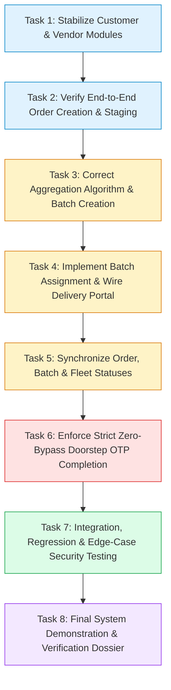

# Implementation Roadmap: Engineering Plan & Execution Milestones
**Project:** Micro-Logistics Management and Local E-Commerce Order Aggregation Network  
**Target Architecture:** Node.js 20, Express 5.2.1, React 19, Supabase PostgreSQL  
**Document Purpose:** Sequential, dependency-aware engineering roadmap guiding developers or AI agents to complete, verify, and demonstrate all core platform capabilities without architectural regressions.

---

## 1. Roadmap Architecture & Execution Flow



---

## 2. Granular Task Specifications

---

### Task 1: Stabilize Customer and Vendor Module Changes
- **Primary Objective:** Ensure that recent frontend modifications to customer address selection and vendor order staging capture valid, normalized metadata required by downstream aggregation and delivery algorithms.
- **Exact Files to Change:**
  - `src/portals/customer/CheckoutPage.jsx`
  - `src/portals/customer/CartPage.jsx`
  - `src/portals/seller/OrdersPage.jsx`
  - `src/utils/sellerUtils.js`
- **Required Inputs & Preconditions:** Authenticated customer and vendor sessions in local development.
- **Dependencies:** None (Baseline stabilization).
- **Implementation Actions:**
  1. In `CheckoutPage.jsx`, enforce mandatory selection of a delivery area / neighborhood (e.g. "T. Nagar", "Adyar", "Velachery", "Anna Nagar") in addition to street address.
  2. Ensure order payload sends structured spatial metadata (`deliveryLocation: "14/2 Anna Salai, T. Nagar"`, `deliveryArea: "T. Nagar"`).
  3. In `seller/OrdersPage.jsx`, verify vendor order transition sequence:
     $$\text{PLACED} \longrightarrow \text{CONFIRMED} \longrightarrow \text{PREPARING} \longrightarrow \text{READY\_FOR\_DELIVERY}$$
  4. Ensure vendor status changes invoke `PATCH /api/v1/orders/:id/status` and update the order's `order_status` in `AppContext`.
- **Expected Output & State Changes:**
  - Newly created orders have clean, parseable neighborhood strings in `orders.delivery_location`.
  - Vendors can consistently transition orders to `READY_FOR_DELIVERY`.
- **Tests Required to Verify:**
  - Frontend smoke test: Complete checkout in Customer portal; verify order appears in Seller portal with correct delivery slot and address.
  - Seller portal test: Click "Start Preparing", then "Mark Ready for Delivery"; verify status badge updates.
- **Definition of Done (DoD):**
  - Customer checkout cannot submit without a valid delivery time slot and neighborhood.
  - Orders reach `READY_FOR_DELIVERY` status in PostgreSQL database with verified stock decrements.

---

### Task 2: Verify End-to-End Order Creation & Staging Integrity
- **Primary Objective:** Verify that order ingestion enforces catalog price validation, inventory reservation, and initial OTP record creation in the database, with proper error handling on stock exhaustion.
- **Exact Files to Change:**
  - `backend/src/controllers/order.controller.js`
  - `src/context/AppContext.jsx`
- **Required Inputs & Preconditions:** Task 1 completed. Active Supabase database connection.
- **Dependencies:** Task 1.
- **Implementation Actions:**
  1. Inspect `order.controller.js:createOrder` to confirm client-supplied prices are completely ignored and catalog prices from `products` are used exclusively.
  2. Verify that stock decrementing logic properly updates `products.stock` and triggers status changes (`In Stock` $\rightarrow$ `Low Stock` $\rightarrow$ `Out of Stock`).
  3. Ensure a corresponding row is inserted into `delivery_verifications` with a fresh 4-digit numeric OTP code (`otp_code`) and `is_verified = false`.
  4. In `AppContext.jsx`, ensure `setOrders` properly stores the returned order object from the backend without dropping foreign key relationships.
- **Expected Output & State Changes:**
  - New row in `orders` with `order_status = 'PLACED'`, `delivery_status = 'PENDING_ASSIGNMENT'`, `aggregation_status = 'WAITING_FOR_AGGREGATION'`.
  - Rows in `order_items` with catalog price.
  - Row in `delivery_verifications` linked via `order_id`.
- **Tests Required to Verify:**
  - API Integration test: Submit order via `POST /api/v1/orders` with item price `1.00`; assert database contains actual catalog price `150.00`.
  - Stock exhaust test: Order quantity exceeding inventory; assert HTTP 400 with message `"Insufficient stock"`.
- **Definition of Done (DoD):**
  - Automated test confirms price integrity, stock decrements, and OTP row creation on every order.

---

### Task 3: Implement & Correct Aggregation Algorithm & Batch Creation
- **Primary Objective:** Fix the critical geographic clustering flaw in `aggregationUtils.js`, add database concurrency protection during batch creation, and optionally expose aggregation calculation through a backend service endpoint.
- **Exact Files to Change:**
  - `src/utils/aggregationUtils.js`
  - `backend/src/controllers/delivery.controller.js`
  - `src/portals/admin/OrderAggregationPage.jsx`
- **Required Inputs & Preconditions:** Tasks 1 and 2 completed. Multiple test orders in `READY_FOR_DELIVERY` status.
- **Dependencies:** Task 2.
- **Implementation Actions:**
  1. **Fix Geographic Logic Flaw:** In `src/utils/aggregationUtils.js` ([lines 120-124](file:///c:/Users/Admin/Desktop/Micro-Logistics/src/utils/aggregationUtils.js#L120-L124)), change:
     ```javascript
     // BEFORE (BUGGY):
     const isNearby = primaryArea === targetArea || primary.deliveryTimeSlot === target.deliveryTimeSlot;
     
     // AFTER (CORRECTED):
     const isNearby = primaryArea === targetArea;
     ```
     Enforce that orders MUST share both compatible time slots AND identical/adjacent neighborhood areas.
  2. **Add Concurrency Protection in Backend Batch Creation:** In `delivery.controller.js:createBatch`:
     - Before inserting `delivery_batches`, verify that **all** target orders currently have `batch_id IS NULL` and `order_status != 'CANCELLED'`.
     - If any order is already batched, return HTTP 409 Conflict: `"One or more selected orders have already been grouped into a delivery batch"`.
  3. In `OrderAggregationPage.jsx`, ensure batch confirmation displays real calculated distance and estimated transit time based on stop count.
- **Expected Output & State Changes:**
  - Suggested batches only cluster orders that are genuinely in the same neighborhood and compatible delivery windows.
  - Duplicate batch creation requests are rejected by the backend.
- **Tests Required to Verify:**
  - Unit test in `aggregationUtils.test.js`: Pass two orders with the same time slot but different areas ("Adyar" and "Anna Nagar"); assert they are NOT grouped into the same batch.
  - API concurrency test: Attempt to create two batches with overlapping order IDs; assert second request fails with HTTP 409.
- **Definition of Done (DoD):**
  - Disparate neighborhood orders are never bundled together.
  - Race conditions in batch creation return clean HTTP 409 errors without corrupting database state.

---

### Task 4: Implement Batch Assignment & Wire Delivery Portal to Live Backend
- **Primary Objective:** Eliminate the complete architectural isolation of the delivery portal by connecting `DeliveryContext.jsx` and delivery portal pages to the live Express API.
- **Exact Files to Change:**
  - `src/context/DeliveryContext.jsx`
  - `src/portals/delivery/DeliveryDashboard.jsx`
  - `src/portals/delivery/PickupPage.jsx`
  - `src/portals/delivery/RoutePage.jsx`
  - `src/portals/delivery/DeliveryStatusPage.jsx`
  - `backend/src/controllers/delivery.controller.js`
- **Required Inputs & Preconditions:** Task 3 completed. Delivery agent accounts created in database.
- **Dependencies:** Task 3.
- **Implementation Actions:**
  1. **Add Vehicle Capacity Guard:** In `delivery.controller.js:assignBatch`, check `delivery_agents.capacity`:
     ```javascript
     if (batch.order_count > agent.capacity) {
         return res.status(400).json({ 
             success: false, 
             message: `Batch order count (${batch.order_count}) exceeds agent vehicle capacity (${agent.capacity})` 
         });
     }
     ```
  2. **Wire DeliveryContext to Backend API:**
     - Replace static `INITIAL_ACTIVE_BATCH` with an `api.get('/delivery/batches')` query scoped to the logged-in courier (`agent_id = req.user.id`).
     - Wire `updateOrderStatus` in `DeliveryContext.jsx` to call `PATCH /api/v1/orders/:id/status` and `PATCH /api/v1/delivery/batches/:id/status`.
  3. **Populate Waypoints:** In `delivery.controller.js:createBatch`, insert sequential pickup and delivery stops into `batch_waypoints` table.
  4. In `RoutePage.jsx`, fetch real waypoints from backend and render actual customer addresses and seller hub coordinates.
- **Expected Output & State Changes:**
  - Delivery partner logs in and sees their real assigned batch fetched from Supabase via Express.
  - Route page displays real ordered stops instead of hardcoded sample items.
- **Tests Required to Verify:**
  - Admin assigns batch to Courier DA-01 $\rightarrow$ Log in as DA-01 $\rightarrow$ Verify assigned batch renders on `DeliveryDashboard.jsx`.
  - Attempt to assign a 6-order batch to a 3-capacity agent; assert HTTP 400 rejection.
- **Definition of Done (DoD):**
  - Delivery portal operates completely against the live backend API with zero hardcoded mock data dependencies.

---

### Task 5: Synchronize Order, Batch, and Fleet Statuses
- **Primary Objective:** Ensure state transitions at the batch level, order level, and agent level stay completely synchronized without orphaned states or unreflected transitions.
- **Exact Files to Change:**
  - `backend/src/controllers/delivery.controller.js`
  - `backend/src/controllers/order.controller.js`
  - `src/portals/admin/DeliveryManagementPage.jsx`
  - `src/portals/delivery/PickupPage.jsx`
- **Required Inputs & Preconditions:** Task 4 completed.
- **Dependencies:** Task 4.
- **Implementation Actions:**
  1. **Pickup Synchronization:** When courier marks seller pickups collected in `PickupPage.jsx`, send status update transitioning batch to `PICKED_UP`.
  2. **In-Transit Synchronization:** When batch advances to `OUT_FOR_DELIVERY`, ensure all member orders simultaneously update to `order_status = 'OUT_FOR_DELIVERY'` and `delivery_status = 'OUT_FOR_DELIVERY'`.
  3. **Agent Status Synchronization:** When an agent is assigned a batch, set `delivery_agents.availability = 'Busy'` and `status = 'On Delivery'`. When batch reaches completion, restore agent to `'Available'`.
  4. Ensure order status changes trigger records in `order_status_logs`.
- **Expected Output & State Changes:**
  - Consistent statuses across `orders`, `delivery_batches`, and `delivery_agents` in PostgreSQL.
  - Customer tracking timeline updates to "Out for Delivery" immediately when courier starts transit.
- **Tests Required to Verify:**
  - Lifecycle milestone test verifying that advancing batch status to `OUT_FOR_DELIVERY` updates every member order's status in the database.
- **Definition of Done (DoD):**
  - No orphaned status states exist across the three related entities.

---

### Task 6: Enforce Strict Zero-Bypass Doorstep OTP Completion
- **Primary Objective:** Close the critical security hole where batches can be force-completed without OTP verification, and connect courier drop-off confirmation to the backend OTP verification endpoint.
- **Exact Files to Change:**
  - `backend/src/controllers/delivery.controller.js`
  - `src/portals/delivery/DeliveryStatusPage.jsx`
  - `src/portals/admin/DeliveryManagementPage.jsx`
- **Required Inputs & Preconditions:** Task 5 completed. Order with status `OUT_FOR_DELIVERY` and generated OTP.
- **Dependencies:** Task 5.
- **Implementation Actions:**
  1. **Block Batch Completion Bypass:** In `delivery.controller.js:updateBatchStatus` ([lines 199-205](file:///c:/Users/Admin/Desktop/Micro-Logistics/backend/src/controllers/delivery.controller.js#L199-L205)), remove the direct overwrite of order statuses to `DELIVERED`.
     - Replace with an integrity check: If `dbStatus === 'COMPLETED'`, query all member orders in the batch:
       ```javascript
       const { data: memberOrders } = await supabase.from('orders').select('id, delivery_status').eq('batch_id', batch.id);
       const unverified = memberOrders.filter(o => o.delivery_status !== 'DELIVERED');
       if (unverified.length > 0) {
           return res.status(400).json({
               success: false,
               message: `Cannot complete batch: ${unverified.length} orders have not been verified with customer OTP`
           });
       }
       ```
  2. **Remove Deterministic Fallback Hash:** In `delivery.controller.js:getOrderOtp` and `verifyDeliveryOtp`, remove the code-derived hash fallback. If `delivery_verifications` is missing, return an error.
  3. **Connect DeliveryStatusPage to Backend:** In `DeliveryStatusPage.jsx:handleConfirmDelivered`, invoke:
     `POST /api/v1/delivery/verify-otp { orderId: selectedOrder.id, otp: otpInput }`.
     - Display backend verification message on success; display error alert if code is incorrect or attempt limit is exceeded.
  4. Ensure order `aggregation_status` updates to `COMPLETED` only after successful OTP verification.
- **Expected Output & State Changes:**
  - Couriers cannot mark an order delivered without the customer's actual OTP.
  - Admins cannot force-complete batches containing unverified orders.
  - `delivery_verifications.is_verified` set to `true` with `verified_at` timestamp.
- **Tests Required to Verify:**
  - Security test: Call `POST /api/v1/delivery/verify-otp` with incorrect OTP; assert HTTP 400 error and attempt counter incremented.
  - Security test: Submit 5 incorrect OTPs; assert 6th attempt returns HTTP 429 Rate Limit / Lockout.
  - Security test: Attempt `PATCH /api/v1/delivery/batches/:id/status` with `Completed` while orders are unverified; assert HTTP 400 rejection.
  - Happy path test: Call with correct OTP; assert order transitions to `DELIVERED` and batch can now be completed.
- **Definition of Done (DoD):**
  - Zero possibility of completing delivery without customer OTP verification.

---

### Task 7: Integration, Regression, and Security Testing
- **Primary Objective:** Execute comprehensive end-to-end integration testing and automated regression testing across all four user portals and the backend API.
- **Exact Files to Change:**
  - `backend/src/tests/delivery.test.js` (New test suite for batching & OTP)
  - `backend/scripts/testing/test_lifecycle.js`
- **Required Inputs & Preconditions:** Tasks 1 through 6 completed.
- **Dependencies:** Task 6.
- **Implementation Actions:**
  1. Create automated Vitest test suite `backend/src/tests/delivery.test.js` covering:
     - Aggregation eligibility filtering.
     - Batch creation and junction table mapping.
     - Courier capacity checks.
     - OTP generation, customer confidentiality (courier cannot view customer's OTP via API), and OTP verification at drop-off.
     - Batch completion blocking on unverified orders.
  2. Run full backend test suite (`npm run test`) and verify 100% pass rate.
  3. Execute `node backend/scripts/testing/test_lifecycle.js` to validate all 8 sequential lifecycle milestones from registration to OTP verification.
- **Expected Output & State Changes:**
  - All automated test suites execute with zero failures.
  - Clean lifecycle script output demonstrating multi-actor orchestration.
- **Tests Required to Verify:**
  - `npm run test` in `backend/` passes all tests.
  - Multi-actor lifecycle script completes all 8 milestones successfully.
- **Definition of Done (DoD):**
  - Vitest test suite includes aggregation, batching, and OTP verification tests; all passing.

---

### Task 8: Demonstration Preparation & Verified Results Dossier
- **Primary Objective:** Prepare a deterministic, repeatable demonstration scenario and compile a verified technical results dossier showcasing the core project objectives.
- **Exact Files to Change:**
  - `docs/technical/DEMO_RUNBOOK.md` (Demonstration script & walkthrough)
  - `backend/src/utils/seedData.js` (Demo data fixtures)
- **Required Inputs & Preconditions:** All previous tasks completed and verified.
- **Dependencies:** Task 7.
- **Implementation Actions:**
  1. Seed database with a realistic neighborhood cluster scenario:
     - 4 customers in "T. Nagar, Chennai".
     - 2 local grocery/produce sellers in "T. Nagar".
     - 2 delivery agents (1 bike with capacity 5, 1 scooter with capacity 8).
     - Standard slot: "9:00 AM – 1:00 PM".
  2. Document the step-by-step demonstration runbook:
     - Step 1: Customer places 2 orders from local sellers.
     - Step 2: Sellers accept and mark orders `READY_FOR_DELIVERY`.
     - Step 3: Admin navigates to Order Aggregation, reviews recommendation card (Match: 95%), and authorizes batch.
     - Step 4: Admin assigns batch to available courier.
     - Step 5: Courier logs in, reviews multi-stop route (Pickups $\rightarrow$ Drops), confirms pickup.
     - Step 6: Customer views tracking screen and retrieves confidential OTP.
     - Step 7: Courier arrives, requests OTP, enters code, and completes order.
     - Step 8: Admin and customer dashboards verify `DELIVERED` status.
- **Expected Output & State Changes:**
  - Flawless, repeatable end-to-end demonstration taking under 5 minutes without errors.
- **Tests Required to Verify:**
  - End-to-end manual dry run following the demo runbook.
- **Definition of Done (DoD):**
  - Working, demonstrable, defensible final-year project showing smart aggregation, batch coordination, and OTP handover.
